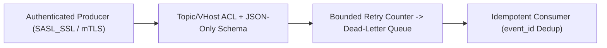

# ViperClaw Skill 53: Kafka, RabbitMQ & Background Queue Security Auditor (`viper-kafka-rabbitmq-queue`)

## 1. Standards & Open-Source Reference
- **Standards:** Apache Kafka Security Guide, RabbitMQ Production Checklist, Celery Security Advisory (Pickle RCE).
- **Focus:** Auditing asynchronous message brokers, event-driven schemas, and background worker consumers.

---

## 2. Threat Model & Trust-Boundary Architecture



### Automated ViperClaw Command
```bash
viperclaw taint . --db .viperclaw/graph.db
```

---

## 3. Rapid Discovery Patterns
- Search for `CELERY_ACCEPT_CONTENT`, `task_serializer`, `security.protocol=PLAINTEXT`, `auto.offset.reset`, `ack(`, `nack(requeue=True)`.

---

## 4. Senior Security Engineer Technical Audit Checklist
1. **Celery / Worker Safe Serialization (`json` Only):** In Celery, verify `task_serializer = "json"`, `result_serializer = "json"`, and `accept_content = ["json"]`—never allow `"pickle"`, `"yaml"`, or `"marshal"` on broker queues.
2. **Broker Transport Encryption & SASL/mTLS Auth:** Reject `security.protocol=PLAINTEXT` in Kafka and default `guest:guest` credentials in RabbitMQ; enforce `SASL_SSL` / `mTLS` and per-service topic/vhost ACLs (producers can only write to their topic; consumers can only read).
3. **Malformed Message & Infinite Requeue Loop Defense:** Consumers that call `channel.basic_nack(requeue=True)` on malformed messages without a retry counter cause instant infinite-loop DoS. Enforce schema validation + max retries (e.g., `x-delivery-count <= 3`) routing to a Dead-Letter Queue (DLQ).
4. **Consumer Idempotency & Replay Deduplication:** Because message queues guarantee at-least-once delivery, consumers executing financial/email/state actions must record `event_id` in an atomic idempotency table.
5. **Event Envelope Signing / Tenant Binding:** Never trust an unverified `tenant_id` or `user_id` field inside a shared queue message without validating its producer identity or HMAC/JWS envelope.

---

## 5. Production Remediation Patterns (Vulnerable vs. Hardened Code)
```python
# ❌ VULNERABLE: Celery accepts pickle serialization & retries malformed messages infinitely
app.conf.accept_content = ["pickle", "json"]

# ✅ HARDENED: Strict JSON-only serialization & bounded retry with DLQ
app.conf.update(
    task_serializer="json",
    result_serializer="json",
    accept_content=["json"],
    task_acks_late=True,
    task_reject_on_worker_lost=True,
)
```

---

## 6. False-Positive Elimination & CVSS v3.1 Triage Rubric

### False-Positive Elimination Gate
1. **Reachability & Boundary Check:** Confirm the flagged pattern or configuration is reachable across a trust boundary in production (not an isolated unit-test mock, build-time sample, or dead code path).
2. **Upstream Control Verification:** Check whether an upstream gateway, middleware, database policy, or compiler flag already neutralizes the weakness before marking a finding as verified.
3. **Standards Reference:** `Kafka/RabbitMQ/Celery Security Guides, CWE-502, CWE-400`

| Severity Tier | Baseline CVSS v3.1 Vector | Qualifying Security Impact |
| :--- | :--- | :--- |
| **CRITICAL (9.0–10.0)** | `CVSS:3.1/AV:N/AC:L/PR:N/UI:N/S:C/C:H/I:H/A:H` | Unauthenticated remote code execution, cross-tenant authentication or isolation gap, or direct theft of funds/keys. |
| **HIGH (7.0–8.9)** | `CVSS:3.1/AV:N/AC:L/PR:L/UI:N/S:U/C:H/I:H/A:N` | Authenticated privilege escalation, unauthorized sensitive data exposure, or single-request service outage. |
| **MEDIUM (4.0–6.9)** | `CVSS:3.1/AV:N/AC:L/PR:L/UI:R/S:C/C:L/I:L/A:N` | Scoped information disclosure, non-admin state mutation, or configuration weakness requiring user interaction. |
| **LOW (0.1–3.9)** | `CVSS:3.1/AV:N/AC:H/PR:H/UI:N/S:U/C:L/I:N/A:N` | Defense-in-depth hardening gap requiring high precondition complexity and minimal direct impact. |

---

## 7. Regression Testing & Continuous Verification
1. **Positive Functional Test:** Verify that legitimate callers and valid inputs continue to succeed after applying the hardened pattern.
2. **Negative Security Regression Test:** Write an automated unit/integration test confirming that the vulnerable input, unauthenticated call, or misconfiguration is deterministically rejected.
3. **Graph & SARIF Verification:** Run `viperclaw taint . --db .viperclaw/graph.db` and `viperclaw verify` to record the verified state in `.viperclaw/graph.db`.
