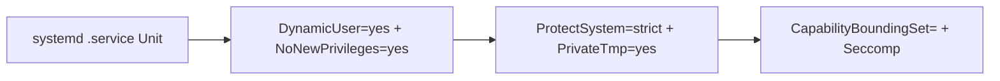

# ViperClaw Skill 50: Linux Host, Systemd & Kernel Hardening Auditor (`viper-linux-systemd-host`)

## 1. Standards & Open-Source Reference
- **Standards:** CIS Distribution Independent Linux Benchmark, `CISOfy/lynis`, `systemd-analyze security`.
- **Focus:** Auditing Linux server configurations, `systemd` service units, `/etc/sudoers`, `/etc/ssh/sshd_config`, and `sysctl` parameters.

---

## 2. Threat Model & Trust-Boundary Architecture



### Automated ViperClaw Command
```bash
viperclaw taint . --db .viperclaw/graph.db
```

---

## 3. Rapid Discovery Patterns
- Search `*.service` files for `User=root`, missing `ProtectSystem=`, `NoNewPrivileges=`, `PrivateTmp=`.
- Search `sudoers` / provisioning scripts for `NOPASSWD: ALL`, `chmod 4755`, `chmod 777`.

---

## 4. Senior Security Engineer Technical Audit Checklist
1. **Systemd Service Unit Sandboxing (`systemd-analyze security`):** Every production `.service` unit should run as an unprivileged `User=` / `DynamicUser=yes` and enforce `NoNewPrivileges=yes`, `ProtectSystem=strict`, `ProtectHome=yes`, `PrivateTmp=yes`, `PrivateDevices=yes`, `ProtectKernelTunables=yes`, and `CapabilityBoundingSet=`.
2. **Sudoers & SUID/SGID Hygiene:** Never grant `(ALL) NOPASSWD: ALL` or allow wildcards `*` in `sudoers` commands (`sudo /bin/chown *` allows `/etc/shadow` takeover via `--reference`). Audit SUID/SGID binaries (`find / -perm /6000`).
3. **SSH Daemon (`sshd_config`) Hardening:** Enforce `PermitRootLogin no`, `PasswordAuthentication no`, `PubkeyAuthentication yes`, `KbdInteractiveAuthentication no`, `X11Forwarding no`, and `MaxAuthTries 3`.
4. **Kernel & Network `sysctl` Hardening:** Verify `kernel.kptr_restrict = 2`, `kernel.dmesg_restrict = 1`, `kernel.yama.ptrace_scope = 2`, `fs.protected_hardlinks = 1`, `fs.protected_symlinks = 1`, and `net.ipv4.conf.all.rp_filter = 1`.
5. **Cron & Systemd Timer Path Ownership:** Confirm all scripts executed by root cron jobs or systemd timers are owned by `root:root` with mode `0755`/`0644` and located in non-world-writable directories.

---

## 5. Production Remediation Patterns (Vulnerable vs. Hardened Code)
```ini
# ❌ VULNERABLE: Runs as root with unrestricted filesystem & capability access
[Service]
ExecStart=/usr/local/bin/app-worker

# ✅ HARDENED: Isolated unprivileged systemd service sandbox
[Service]
ExecStart=/usr/local/bin/app-worker
DynamicUser=yes
NoNewPrivileges=yes
ProtectSystem=strict
ProtectHome=yes
PrivateTmp=yes
PrivateDevices=yes
CapabilityBoundingSet=
SystemCallFilter=@system-service
```

---

## 6. False-Positive Elimination & CVSS v3.1 Triage Rubric

### False-Positive Elimination Gate
1. **Reachability & Boundary Check:** Confirm the flagged pattern or configuration is reachable across a trust boundary in production (not an isolated unit-test mock, build-time sample, or dead code path).
2. **Upstream Control Verification:** Check whether an upstream gateway, middleware, database policy, or compiler flag already neutralizes the weakness before marking a finding as verified.
3. **Standards Reference:** `CIS Linux Benchmark, Lynis, systemd-analyze, CWE-250, CWE-732`

| Severity Tier | Baseline CVSS v3.1 Vector | Qualifying Security Impact |
| :--- | :--- | :--- |
| **CRITICAL (9.0–10.0)** | `CVSS:3.1/AV:N/AC:L/PR:N/UI:N/S:C/C:H/I:H/A:H` | Unauthenticated remote code execution, cross-tenant authentication or isolation gap, or direct theft of funds/keys. |
| **HIGH (7.0–8.9)** | `CVSS:3.1/AV:N/AC:L/PR:L/UI:N/S:U/C:H/I:H/A:N` | Authenticated privilege escalation, unauthorized sensitive data exposure, or single-request service outage. |
| **MEDIUM (4.0–6.9)** | `CVSS:3.1/AV:N/AC:L/PR:L/UI:R/S:C/C:L/I:L/A:N` | Scoped information disclosure, non-admin state mutation, or configuration weakness requiring user interaction. |
| **LOW (0.1–3.9)** | `CVSS:3.1/AV:N/AC:H/PR:H/UI:N/S:U/C:L/I:N/A:N` | Defense-in-depth hardening gap requiring high precondition complexity and minimal direct impact. |

---

## 7. Regression Testing & Continuous Verification
1. **Positive Functional Test:** Verify that legitimate callers and valid inputs continue to succeed after applying the hardened pattern.
2. **Negative Security Regression Test:** Write an automated unit/integration test confirming that the vulnerable input, unauthenticated call, or misconfiguration is deterministically rejected.
3. **Graph & SARIF Verification:** Run `viperclaw taint . --db .viperclaw/graph.db` and `viperclaw verify` to record the verified state in `.viperclaw/graph.db`.
