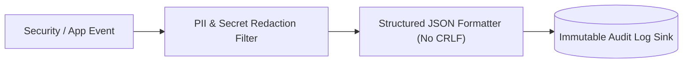

# Security Logging, PII Redaction & Audit Trail Compliance Auditor (`viper-logging-pii-compliance`)

## 1. Executive Scope, Standards & CWE/OWASP Mapping
- **Frameworks & Standards:** OWASP Logging Cheat Sheet, OWASP Top 10:2025 A09 (Security Logging and Alerting Failures), OWASP ASVS V7, CWE-532, CWE-117
- **Primary CWE Mapping:** CWE-532 (Insertion of Sensitive Information into Log File), CWE-117 (Improper Output Neutralization for Logs / Log Injection), CWE-778 (Insufficient Logging)
- **ViperClaw MCP Tools:** `viper_taint_scan`, `viper_verify_and_report`
- **ViperClaw CLI Command:** `viperclaw taint ./src --db .viperclaw/graph.db`

---

## 2. Threat Model & Root-Cause Architecture



### Root-Cause Analysis
Applications either log too much (dumping full `req.headers` or `req.body` containing plaintext passwords, Bearer JWTs, session cookies, and credit card numbers into Datadog/CloudWatch) or log too little (failing to record failed logins, privilege escalations, and cross-tenant `403` denials, or allowing `
` log injection).

---

## 3. Deterministic Discovery & Grep/AST Audit Commands

Run the following discovery commands across the target repository before manual code review:

```bash
# 1. Automated ViperClaw analysis
viperclaw taint ./src --db .viperclaw/graph.db

# 2. Rapid static pattern discovery (ripgrep)
rg -n "(logger\.(info|debug|error|warning)|console\.(log|error))\(.*(password|token|secret|authorization|cookie|ssn|card)" -i
rg -n "(print\(request\.|console\.log\(req\.(headers|body))"
```

---

## 4. Senior Security Engineer 8-Point Audit Checklist

| Control ID | Audit Verification Target | Pass Criteria | Fail / Vulnerability Indicator |
| :---: | :--- | :--- | :--- |
| `LOG-01` | **Automatic Credential & Token Redaction** | Structured log processors scrub `password`, `secret`, `token`, `authorization`, `cookie`, `api_key`, `cvv`, and `ssn` keys at the root logger level. | `logger.debug(f"Login body: {request.json}")` writes plaintext passwords to log storage. |
| `LOG-02` | **Log Injection & CRLF Neutralization (CWE-117)** | Logs are emitted as single-line structured JSON (`structlog` / `pino` / `zap`) or strip `\r`, `\n`, and ANSI escape sequences (`\x1b[`) from user strings. | Plaintext log `logger.info(f"User {username} logged in")` allows forging fake log lines via `username="guest\n2026-11-18 INFO Admin privilege granted"`. |
| `LOG-03` | **Mandatory Security Event Coverage (CWE-778)** | Auth failures, password/MFA resets, role changes, API key creations, and `403 Forbidden` authorization failures emit structured audit events. | Administrative role elevation or repeated BOLA probes leave zero audit trail. |
| `LOG-04` | **Correlation / Request ID Propagation** | Every incoming HTTP request generates or validates a UUID `X-Request-ID` propagated across all downstream logs and error responses. | Impossible to trace a security incident across microservices. |
| `LOG-05` | **Exception Handler Secret Scrubbing** | Crash reporters (Sentry, Rollbar, Bugsnag) enable `send_default_pii=False` and scrub local stack variables containing secrets. | Unhandled exception dumps local environment variables and DB connection strings to external crash tracker. |
| `LOG-06` | **HTTP Access Log Query-String Hygiene** | Sensitive values are never placed in URL query strings, and access logs redact `?token=` / `?code=` parameters. | OAuth `code` or password-reset `token` logged in plaintext Nginx/ALB access logs. |
| `LOG-07` | **Tamper-Evident Append-Only Audit Storage** | Compliance audit trails (`audit_logs` table / S3 Object Lock) disallow `UPDATE` and `DELETE` by the application DB role. | Compromised application role can `DELETE FROM audit_logs` to erase evidence. |
| `LOG-08` | **Log Level Hygiene in Production** | Production environments run at `INFO` or `WARN` level, never `DEBUG` or `TRACE`. | `LOG_LEVEL=DEBUG` in production dumps full SQL query parameters and HTTP bodies. |

---

## 5. False-Positive Elimination & CVSS v3.1 Triage Rubric

### False-Positive Gate
1. Verify whether an upstream API Gateway, global middleware, or ORM hook already enforces the control before flagging a controller.
2. Confirm the code path is reachable from an external entrypoint (not dead code, CLI-only admin script, or unit-test fixture).

| Severity Tier | Baseline CVSS v3.1 Vector | Qualifying Security Impact |
| :--- | :--- | :--- |
| **HIGH (7.5)** | `CVSS:3.1/AV:N/AC:L/PR:L/UI:N/S:U/C:H/I:N/A:N` | Plaintext passwords, active session JWTs, or payment card data written to shared log management systems. |
| **MEDIUM (5.3)** | `CVSS:3.1/AV:N/AC:L/PR:N/UI:N/S:U/C:N/I:L/A:N` | Unescaped CRLF / ANSI log injection allowing audit log forgery or terminal escape injection. |
| **LOW (3.3)** | `CVSS:3.1/AV:L/AC:L/PR:L/UI:N/S:U/C:L/I:N/A:N` | Missing security audit events on privilege changes or failed authentication attempts. |

---

## 6. Production Remediation Patterns (Vulnerable vs. Hardened Code)

```python
# ❌ VULNERABLE: Logs raw headers/body (leaking Authorization & password) with newline injection risk
logger.info(f"Auth attempt for {request.form.get('username')} with headers {dict(request.headers)}")

# ✅ HARDENED: Structured JSON logging with automatic sensitive-key redaction & CRLF stripping
REDACTED_KEYS = {"authorization", "cookie", "password", "token", "secret", "api_key"}

def redact_dict(d: dict) -> dict:
    return {k: ("[REDACTED]" if k.lower() in REDACTED_KEYS else v) for k, v in d.items()}

safe_user = str(request.form.get("username", "")).replace("\r", "").replace("\n", "")[:64]
logger.info("auth_attempt", extra={"username": safe_user, "headers": redact_dict(dict(request.headers))})
```

---

## 7. Regression Testing & Continuous Verification
1. Write a **Positive Unit Test** confirming authorized, schema-valid requests succeed.
2. Write a **Negative Security Regression Test** confirming unauthorized, cross-tenant, or malformed inputs are deterministically rejected.
3. Re-run `viperclaw taint` and `viperclaw verify` to confirm zero remaining unmitigated flows in `.viperclaw/graph.db`.
