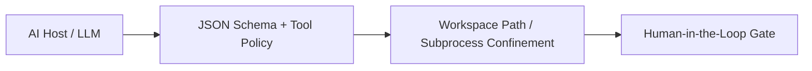

# ViperClaw Skill 35: Model Context Protocol (MCP) Server Security Auditor (`viper-mcp-server-audit`)

## 1. Standards & Open-Source Reference
- **Standards:** OWASP MCP Top 10, OWASP Top 10 for Agentic Applications (ASI01–ASI10), CWE-78, CWE-22, CWE-269.
- **Focus:** Auditing local (`stdio`) and remote (`SSE` / Streamable HTTP) MCP servers, tool schemas, and agent host integrations.

---

## 2. Threat Model & Trust-Boundary Architecture



### Automated ViperClaw Command
```bash
viperclaw taint . --db .viperclaw/graph.db
```

---

## 3. Rapid Discovery Patterns
- Search for MCP tool registrations: `@mcp.tool`, `server.setRequestHandler(CallToolRequestSchema`, `tools/list`, `inputSchema`.
- Search for shell/filesystem sinks inside tool handlers: `subprocess`, `child_process.exec`, `os.system`, `fs.readFile`, `open(`.

---

## 4. Senior Security Engineer Technical Audit Checklist
1. **Strict Input Schema Enforcement:** Every MCP tool must define a strict JSON Schema (`additionalProperties: false`, explicit `enum` or regex patterns, and bounded string lengths) and validate arguments before execution.
2. **Command & Path Sandboxing (`stdio` Servers):** Never pass tool arguments into `shell=True` or unvalidated filesystem paths; canonicalize paths with `Path.resolve()` and enforce an explicit workspace root prefix check.
3. **Tool Metadata Integrity & Prompt-Boundary Defense:** Audit tool `description` fields and returned tool output blocks to ensure untrusted external data cannot alter or override sibling MCP tool behavior.
4. **Remote MCP Transport Authentication:** Remote HTTP/SSE MCP endpoints must validate OAuth 2.1 Bearer tokens with audience (`aud`) binding, mTLS, and strict `Origin` header checks to prevent local DNS-rebinding or CSRF calls.
5. **Human-in-the-Loop (HITL) Confirmation:** State-changing, network-egress, or destructive tools must declare destructive annotations and require explicit user approval showing exact resolved arguments.

---

## 5. Production Remediation Patterns (Vulnerable vs. Hardened Code)
```python
# ❌ VULNERABLE: Unchecked path & shell interpolation in MCP tool
def read_log(filename: str) -> str:
    return subprocess.check_output(f"tail -n 50 /var/log/app/{filename}", shell=True).decode()

# ✅ HARDENED: Canonicalized workspace boundary & zero-shell reading
ALLOWED_DIR = Path("/var/log/app").resolve()
def read_log(filename: str) -> str:
    target = (ALLOWED_DIR / filename).resolve()
    if not target.is_relative_to(ALLOWED_DIR) or not target.is_file():
        raise ValueError("Access denied: path outside allowed log directory")
    lines = target.read_text(encoding="utf-8", errors="replace").splitlines()
    return "\n".join(lines[-50:])
```

---

## 6. False-Positive Elimination & CVSS v3.1 Triage Rubric

### False-Positive Elimination Gate
1. **Reachability & Boundary Check:** Confirm the flagged pattern or configuration is reachable across a trust boundary in production (not an isolated unit-test mock, build-time sample, or dead code path).
2. **Upstream Control Verification:** Check whether an upstream gateway, middleware, database policy, or compiler flag already neutralizes the weakness before marking a finding as verified.
3. **Standards Reference:** `OWASP MCP Top 10, ASI01–ASI10, CWE-78, CWE-22, CWE-269`

| Severity Tier | Baseline CVSS v3.1 Vector | Qualifying Security Impact |
| :--- | :--- | :--- |
| **CRITICAL (9.0–10.0)** | `CVSS:3.1/AV:N/AC:L/PR:N/UI:N/S:C/C:H/I:H/A:H` | Unauthenticated remote code execution, cross-tenant authentication or isolation gap, or direct theft of funds/keys. |
| **HIGH (7.0–8.9)** | `CVSS:3.1/AV:N/AC:L/PR:L/UI:N/S:U/C:H/I:H/A:N` | Authenticated privilege escalation, unauthorized sensitive data exposure, or single-request service outage. |
| **MEDIUM (4.0–6.9)** | `CVSS:3.1/AV:N/AC:L/PR:L/UI:R/S:C/C:L/I:L/A:N` | Scoped information disclosure, non-admin state mutation, or configuration weakness requiring user interaction. |
| **LOW (0.1–3.9)** | `CVSS:3.1/AV:N/AC:H/PR:H/UI:N/S:U/C:L/I:N/A:N` | Defense-in-depth hardening gap requiring high precondition complexity and minimal direct impact. |

---

## 7. Regression Testing & Continuous Verification
1. **Positive Functional Test:** Verify that legitimate callers and valid inputs continue to succeed after applying the hardened pattern.
2. **Negative Security Regression Test:** Write an automated unit/integration test confirming that the vulnerable input, unauthenticated call, or misconfiguration is deterministically rejected.
3. **Graph & SARIF Verification:** Run `viperclaw taint . --db .viperclaw/graph.db` and `viperclaw verify` to record the verified state in `.viperclaw/graph.db`.
