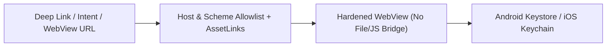

# Mobile App Static Configuration & API Security Auditor (OWASP MASVS) (`viper-mobile-api-config`)

## 1. Executive Scope, Standards & CWE/OWASP Mapping
- **Frameworks & Standards:** OWASP MASVS v2.1 (STORAGE, CRYPTO, AUTH, NETWORK, PLATFORM), OWASP MASTG, MobSF Static Rules
- **Primary CWE Mapping:** CWE-926 (Improper Export of Android Application Components), CWE-939 (Improper Authorization in Handler for Custom URL Scheme / Deeplink), CWE-319 (Cleartext Transmission)
- **ViperClaw MCP Tools:** `viper_taint_scan`, `viper_harvest_js`, `viper_verify_and_report`
- **ViperClaw CLI Command:** `viperclaw taint . --db .viperclaw/graph.db`

---

## 2. Threat Model & Root-Cause Architecture



### Root-Cause Analysis
Mobile applications expose internal activities/receivers via `android:exported="true"` without permission guards, load unvalidated deep-link URLs (`myapp://webview?url=https://untrusted.example` or `file:///data/data/.../shared_prefs/`) into a JavaScript-enabled WebView that attaches a native bridge (`addJavascriptInterface`) or authentication headers, or store tokens in plaintext `SharedPreferences`.

---

## 3. Deterministic Discovery & Grep/AST Audit Commands

Run the following discovery commands across the target repository before manual code review:

```bash
# 1. Automated ViperClaw analysis
viperclaw taint . --db .viperclaw/graph.db

# 2. Rapid static pattern discovery (ripgrep)
rg -n "(android:exported=\"true\"|android:debuggable=\"true\"|android:allowBackup=\"true\")" AndroidManifest.xml
rg -n "(setJavaScriptEnabled\(true\)|addJavascriptInterface|setAllowFileAccessFromFileURLs)"
rg -n "(NSAllowsArbitraryLoads|CFBundleURLSchemes|kSecAttrAccessibleAlways)"
```

---

## 4. Senior Security Engineer 8-Point Audit Checklist

| Control ID | Audit Verification Target | Pass Criteria | Fail / Vulnerability Indicator |
| :---: | :--- | :--- | :--- |
| `MOB-01` | **Exported Component Lockdown (`AndroidManifest.xml`)** | All `<activity>`, `<service>`, `<receiver>`, and `<provider>` components set `android:exported="false"` unless required and protected by `android:permission`. | Internal debug or WebView activity has `<intent-filter>` with `android:exported="true"` and no permission check. |
| `MOB-02` | **Deep Link & Universal Link URL Validation** | Deep-link handlers validate scheme (`https://` only) and exact host before loading URLs in a WebView or attaching `Authorization` headers. | `myapp://open?url=https://evil.tld` loads `evil.tld` in the app's WebView with the user's Bearer token header attached! |
| `MOB-03` | **WebView File Access & JS Bridge Hardening** | `setAllowFileAccess(false)`, `setAllowFileAccessFromFileURLs(false)`, and `setAllowUniversalAccessFromFileURLs(false)` enforced; `addJavascriptInterface` restricted to pinned HTTPS origins. | WebView with `addJavascriptInterface` loads untrusted URLs, allowing arbitrary Java/Kotlin method invocation. |
| `MOB-04` | **Cleartext Traffic & Certificate Pinning** | `network_security_config.xml` sets `cleartextTrafficPermitted="false"` with zero user-installed `<certificates src="user"/>` trust in release builds; iOS disables `NSAllowsArbitraryLoads`. | `cleartextTrafficPermitted="true"` or `<certificates src="user"/>` left enabled in production APK. |
| `MOB-05` | **Hardware-Backed Credential Storage** | Tokens and keys are stored in `EncryptedSharedPreferences` (Android Keystore) or iOS Keychain (`kSecAttrAccessibleWhenUnlockedThisDeviceOnly`). | Session JWTs stored in plaintext `SharedPreferences`, `NSUserDefaults`, or world-readable SQLite DBs. |
| `MOB-06` | **Backup & Debug Flag Disablement** | Production builds enforce `android:debuggable="false"` and `android:allowBackup="false"` (or encrypted backup rules excluding auth files). | `android:allowBackup="true"` allows `adb backup` extraction of session data. |
| `MOB-07` | **ContentProvider SQLi & Path Traversal Guard** | Exported `ContentProvider` implementations parameterize `query()`/`openFile()` and validate canonical file paths. | Custom `ContentProvider.openFile` allows `content://app.provider/../../shared_prefs/auth.xml` read. |
| `MOB-08` | **Zero Hardcoded Backend Secrets in APK / IPA** | `strings.xml`, `BuildConfig.java`, and React Native / Flutter bundles contain zero private cloud/API secrets. | AWS/Firebase service key or Stripe secret key embedded in `BuildConfig` or `index.android.bundle`. |

---

## 5. False-Positive Elimination & CVSS v3.1 Triage Rubric

### False-Positive Gate
1. Verify whether an upstream API Gateway, global middleware, or ORM hook already enforces the control before flagging a controller.
2. Confirm the code path is reachable from an external entrypoint (not dead code, CLI-only admin script, or unit-test fixture).

| Severity Tier | Baseline CVSS v3.1 Vector | Qualifying Security Impact |
| :--- | :--- | :--- |
| **CRITICAL (9.3)** | `CVSS:3.1/AV:N/AC:L/PR:N/UI:R/S:C/C:H/I:H/A:N` | One-click deep link loading untrusted external URL into WebView with `addJavascriptInterface` or leaking Bearer token. |
| **HIGH (7.5)** | `CVSS:3.1/AV:L/AC:L/PR:N/UI:N/S:U/C:H/I:H/A:N` | Exported `ContentProvider` or `Activity` allowing any local app to read private files/tokens. |
| **MEDIUM (5.3)** | `CVSS:3.1/AV:N/AC:H/PR:N/UI:N/S:U/C:H/I:N/A:N` | Cleartext HTTP traffic allowed (`cleartextTrafficPermitted="true"`) or user CA trust in release build. |

---

## 6. Production Remediation Patterns (Vulnerable vs. Hardened Code)

```kotlin
// ❌ VULNERABLE: Loads unvalidated deep-link URL into WebView with Authorization header & file access
val targetUrl = intent.data?.getQueryParameter("url") ?: return
webView.settings.javaScriptEnabled = true
webView.settings.allowFileAccess = true
webView.loadUrl(targetUrl, mapOf("Authorization" to "Bearer $userJwt"))

// ✅ HARDENED: Validates exact HTTPS origin before loading or attaching credentials; disables file access
val rawUrl = intent.data?.getQueryParameter("url") ?: return
val uri = Uri.parse(rawUrl)
require(uri.scheme == "https" && uri.host == "app.example.com") { "Untrusted deep-link destination" }
webView.settings.apply {
    javaScriptEnabled = true
    allowFileAccess = false
    allowContentAccess = false
}
webView.loadUrl(uri.toString(), mapOf("Authorization" to "Bearer $userJwt"))
```

---

## 7. Regression Testing & Continuous Verification
1. Write a **Positive Unit Test** confirming authorized, schema-valid requests succeed.
2. Write a **Negative Security Regression Test** confirming unauthorized, cross-tenant, or malformed inputs are deterministically rejected.
3. Re-run `viperclaw taint` and `viperclaw verify` to confirm zero remaining unmitigated flows in `.viperclaw/graph.db`.
