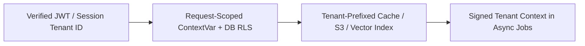

# Multi-Tenant SaaS Data Isolation & Row-Level Security (RLS) Auditor (`viper-multitenant-isolation`)

## 1. Executive Scope, Standards & CWE/OWASP Mapping
- **Frameworks & Standards:** AWS SaaS Tenant Isolation Architecture, OWASP Top 10:2025 A01, PostgreSQL RLS Best Practices, CWE-284, CWE-668
- **Primary CWE Mapping:** CWE-284 (Improper Access Control Across Tenants), CWE-668 (Exposure of Resource to Wrong Sphere), CWE-488 (Exposure of Data Element to Wrong Session)
- **ViperClaw MCP Tools:** `viper_taint_scan`, `viper_diff_oracle`, `viper_verify_and_report`
- **ViperClaw CLI Command:** `viperclaw taint ./src --db .viperclaw/graph.db`

---

## 2. Threat Model & Root-Cause Architecture



### Root-Cause Analysis
Cross-tenant data leaks in SaaS platforms happen when `tenant_id` is read from a request header/body instead of the verified session, when a global/singleton variable stores `current_tenant` across concurrent async requests, when Redis cache keys omit the `tenant_id` prefix, or when PostgreSQL RLS is enabled without `FORCE ROW LEVEL SECURITY` (allowing table owners to skip RLS enforcement).

---

## 3. Deterministic Discovery & Grep/AST Audit Commands

Run the following discovery commands across the target repository before manual code review:

```bash
# 1. Automated ViperClaw analysis
viperclaw taint ./src --db .viperclaw/graph.db

# 2. Rapid static pattern discovery (ripgrep)
rg -n "(tenant_id|org_id|organization_id|workspace_id|account_id)"
rg -n "(current_setting\(.app\.current_tenant|ENABLE ROW LEVEL SECURITY|FORCE ROW LEVEL SECURITY)"
rg -n "(redis\.(get|set)|cache\.(get|set))" ./src
```

---

## 4. Senior Security Engineer 8-Point Audit Checklist

| Control ID | Audit Verification Target | Pass Criteria | Fail / Vulnerability Indicator |
| :---: | :--- | :--- | :--- |
| `MT-01` | **Cryptographic Tenant Context Binding** | `tenant_id` is derived exclusively from the verified session/JWT or verified membership table—never from an unverified `X-Tenant-ID` header. | Middleware reads `req.headers['x-tenant-id']` without checking if `current_user` belongs to that tenant. |
| `MT-02` | **PostgreSQL RLS + `FORCE ROW LEVEL SECURITY`** | Every multi-tenant table enables *both* `ENABLE ROW LEVEL SECURITY` and `FORCE ROW LEVEL SECURITY` with `current_setting('app.tenant_id', true)`. | Application connects as the table owner without `FORCE ROW LEVEL SECURITY`, silently skipping all RLS policies! |
| `MT-03` | **Connection-Pool Tenant Context Reset** | Transaction-scoped `SET LOCAL app.tenant_id = ...` is used (or `DISCARD ALL` on pool checkout/checkin) so pooled connections never bleed tenant context. | Session-level `SET app.tenant_id` persists on a PgBouncer/SQLAlchemy pooled connection for the next request. |
| `MT-04` | **Async Coroutine Context Isolation (`ContextVar`)** | In Python/Node async servers, tenant state is stored in `contextvars.ContextVar` / `AsyncLocalStorage`, never on a module global or class singleton. | Singleton service attribute `self.tenant_id = ...` overwritten by concurrent coroutine from another tenant. |
| `MT-05` | **Tenant-Namespaced Cache Keys (Redis / Memcached)** | Every cache key includes `tenant:{tenant_id}:...` (`@cache` decorators include `tenant_id` in the key hash). | `@lru_cache` or `redis.get(f'report:{report_id}')` serves Tenant A's cached report to Tenant B. |
| `MT-06` | **S3 / Object Storage Prefix & KMS Isolation** | Object keys enforce `s3://bucket/{tenant_id}/{uuid}` and IAM/presigned policies restrict access to that prefix. | Flat S3 bucket path allowing cross-tenant key guessing or overwrite. |
| `MT-07` | **Search & Vector Index Tenant Filtering** | Elasticsearch, Algolia, and vector DB queries inject a mandatory server-side `tenant_id` filter. | Global search autocomplete leaks document titles or user names from other tenants. |
| `MT-08` | **Background Job Tenant Re-Validation** | Celery/BullMQ tasks receive `tenant_id` + `actor_id` and re-verify membership before executing exports or webhooks. | Background export job runs raw unscoped SQL without setting the tenant RLS context. |

---

## 5. False-Positive Elimination & CVSS v3.1 Triage Rubric

### False-Positive Gate
1. Verify whether an upstream API Gateway, global middleware, or ORM hook already enforces the control before flagging a controller.
2. Confirm the code path is reachable from an external entrypoint (not dead code, CLI-only admin script, or unit-test fixture).

| Severity Tier | Baseline CVSS v3.1 Vector | Qualifying Security Impact |
| :--- | :--- | :--- |
| **CRITICAL (9.3)** | `CVSS:3.1/AV:N/AC:L/PR:L/UI:N/S:C/C:H/I:H/A:N` | Unverified `X-Tenant-ID` header or pooled connection state bleed granting full access to any tenant's data. |
| **HIGH (8.1)** | `CVSS:3.1/AV:N/AC:L/PR:L/UI:N/S:U/C:H/I:N/A:N` | Unscoped Redis cache key or search index leaking cross-tenant reports or PII. |
| **MEDIUM (6.5)** | `CVSS:3.1/AV:N/AC:H/PR:L/UI:N/S:U/C:H/I:N/A:N` | Async coroutine race condition occasionally returning another user's response under high load. |

---

## 6. Production Remediation Patterns (Vulnerable vs. Hardened Code)

```sql
-- ❌ VULNERABLE: Missing FORCE ROW LEVEL SECURITY (table owner skips RLS!) & session-wide SET
ALTER TABLE invoices ENABLE ROW LEVEL SECURITY;
CREATE POLICY tenant_isolation ON invoices USING (tenant_id = current_setting('app.tenant_id')::uuid);

-- ✅ HARDENED: Enforces FORCE ROW LEVEL SECURITY + WITH CHECK on INSERT/UPDATE
ALTER TABLE invoices ENABLE ROW LEVEL SECURITY;
ALTER TABLE invoices FORCE ROW LEVEL SECURITY;
CREATE POLICY tenant_isolation ON invoices
  FOR ALL
  USING (tenant_id = NULLIF(current_setting('app.tenant_id', true), '')::uuid)
  WITH CHECK (tenant_id = NULLIF(current_setting('app.tenant_id', true), '')::uuid);
```

---

## 7. Regression Testing & Continuous Verification
1. Write a **Positive Unit Test** confirming authorized, schema-valid requests succeed.
2. Write a **Negative Security Regression Test** confirming unauthorized, cross-tenant, or malformed inputs are deterministically rejected.
3. Re-run `viperclaw taint` and `viperclaw verify` to confirm zero remaining unmitigated flows in `.viperclaw/graph.db`.
