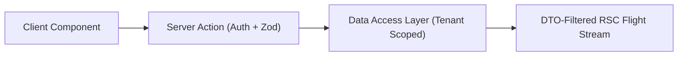

# ViperClaw Skill 37: Next.js, React Server Components & Server Actions Auditor (`viper-nextjs-react-rsc`)

## 1. Standards & Open-Source Reference
- **Standards:** Next.js Data Security Guide, OWASP Top 10 (A01 Broken Access Control, A04 Insecure Design), Semgrep `p/nextjs` & `p/react`.
- **Focus:** Auditing Next.js 13/14/15+ App Router, `"use server"` Server Actions, React Server Components (RSC), and `middleware.ts`.

---

## 2. Threat Model & Trust-Boundary Architecture



### Automated ViperClaw Command
```bash
viperclaw harvest-js ./.next --db .viperclaw/graph.db
```

---

## 3. Rapid Discovery Patterns
- Search for `"use server"`, `'use server'`, `NEXT_PUBLIC_`, `dangerouslySetInnerHTML`, `headers()`, `cookies()`, `NextResponse.next()`.

---

## 4. Senior Security Engineer Technical Audit Checklist
1. **Server Action Authentication & Authorization:** Every exported `"use server"` function is a public HTTP `POST` endpoint; verify that *each* Server Action independently authenticates the session and validates input with `zod` before mutating data.
2. **RSC Prop Serialization Tainting (`experimental_taintObjectReference`):** Never pass full ORM database objects (`user`) directly from a Server Component into a `"use client"` component, as all serialized props are sent in the RSC serialized stream to the browser. Use DTO mappers or `server-only` modules.
3. **`NEXT_PUBLIC_` Environment Variable Hygiene:** Audit `.env*` and `next.config.js` to confirm no private API keys, database URLs, or signing secrets use the `NEXT_PUBLIC_` prefix.
4. **Middleware Route Coverage (`matcher`):** Do not rely solely on `middleware.ts` path matchers for authentication; enforce authorization inside the Data Access Layer (DAL) on every query and mutation.
5. **Open Redirect & `next/image` SSRF Prevention:** Restrict `images.remotePatterns` in `next.config.js` to specific trusted hostnames/paths and validate `redirect()` targets against a relative-path check.

---

## 5. Production Remediation Patterns (Vulnerable vs. Hardened Code)
```typescript
// ❌ VULNERABLE: Server Action trusts client-supplied userId without session check
"use server";
export async function updateEmail(userId: string, newEmail: string) {
  await db.user.update({ where: { id: userId }, data: { email: newEmail } });
}

// ✅ HARDENED: Authenticates caller & validates input schema inside Server Action
"use server";
import { z } from "zod";
const EmailSchema = z.object({ newEmail: z.string().email() });
export async function updateEmail(formData: unknown) {
  const session = await requireVerifiedSession();
  const { newEmail } = EmailSchema.parse(formData);
  await db.user.update({ where: { id: session.user.id }, data: { email: newEmail } });
}
```

---

## 6. False-Positive Elimination & CVSS v3.1 Triage Rubric

### False-Positive Elimination Gate
1. **Reachability & Boundary Check:** Confirm the flagged pattern or configuration is reachable across a trust boundary in production (not an isolated unit-test mock, build-time sample, or dead code path).
2. **Upstream Control Verification:** Check whether an upstream gateway, middleware, database policy, or compiler flag already neutralizes the weakness before marking a finding as verified.
3. **Standards Reference:** `Next.js App Router Security, OWASP Top 10 A01/A04, CWE-285, CWE-200`

| Severity Tier | Baseline CVSS v3.1 Vector | Qualifying Security Impact |
| :--- | :--- | :--- |
| **CRITICAL (9.0–10.0)** | `CVSS:3.1/AV:N/AC:L/PR:N/UI:N/S:C/C:H/I:H/A:H` | Unauthenticated remote code execution, cross-tenant authentication or isolation gap, or direct theft of funds/keys. |
| **HIGH (7.0–8.9)** | `CVSS:3.1/AV:N/AC:L/PR:L/UI:N/S:U/C:H/I:H/A:N` | Authenticated privilege escalation, unauthorized sensitive data exposure, or single-request service outage. |
| **MEDIUM (4.0–6.9)** | `CVSS:3.1/AV:N/AC:L/PR:L/UI:R/S:C/C:L/I:L/A:N` | Scoped information disclosure, non-admin state mutation, or configuration weakness requiring user interaction. |
| **LOW (0.1–3.9)** | `CVSS:3.1/AV:N/AC:H/PR:H/UI:N/S:U/C:L/I:N/A:N` | Defense-in-depth hardening gap requiring high precondition complexity and minimal direct impact. |

---

## 7. Regression Testing & Continuous Verification
1. **Positive Functional Test:** Verify that legitimate callers and valid inputs continue to succeed after applying the hardened pattern.
2. **Negative Security Regression Test:** Write an automated unit/integration test confirming that the vulnerable input, unauthenticated call, or misconfiguration is deterministically rejected.
3. **Graph & SARIF Verification:** Run `viperclaw harvest-js ./.next --db .viperclaw/graph.db` and `viperclaw verify` to record the verified state in `.viperclaw/graph.db`.
