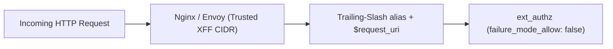

# ViperClaw Skill 51: Nginx, Envoy & API Gateway Security Auditor (`viper-nginx-envoy-gateway`)

## 1. Standards & Open-Source Reference
- **Standards:** `yandex/gixy` (Nginx Configuration Static Analyzer), Envoy Security Best Practices, OWASP Reverse Proxy Guidelines.
- **Focus:** Auditing `nginx.conf`, Envoy YAML filters, Traefik ingress rules, and Kong/APISIX gateway routes.

---

## 2. Threat Model & Trust-Boundary Architecture



### Automated ViperClaw Command
```bash
viperclaw taint . --db .viperclaw/graph.db
```

---

## 3. Rapid Discovery Patterns
- **Nginx:** `alias `, `return 302 $uri`, `add_header `, `proxy_pass http://$host`, `set_real_ip_from 0.0.0.0/0`.
- **Envoy:** `use_remote_address: false`, `xff_num_trusted_hops`, `ext_authz`, `failure_mode_allow: true`.

---

## 4. Senior Security Engineer Technical Audit Checklist
1. **Nginx `location` + `alias` Off-By-Slash Path Traversal (Gixy):** If a `location /static` block does **not** end with a trailing slash `/` while `alias /var/www/static/;` **does**, requesting `/static../app/settings.py` traverses into `/var/www/app/settings.py`! Always ensure both `location` and `alias` end with `/`.
2. **Nginx `add_header` Inheritance Drop:** In Nginx, adding *any* `add_header` inside a nested `location` block silently drops **all** `add_header` directives (like HSTS, CSP, `X-Frame-Options`) defined in the parent `server` or `http` block! Repeat security headers via an `include security_headers.conf;`.
3. **CRLF Header Injection via Unencoded `$uri` / `$request_uri`:** In Nginx redirects or `proxy_set_header`, `$uri` is URL-decoded and can contain `
` (CRLF response splitting). Use `$request_uri` instead of `$uri` in `return 301 https://$host$request_uri;`.
4. **Envoy / Nginx `X-Forwarded-For` Trust Boundary Defense:** Never set `set_real_ip_from 0.0.0.0/0` in Nginx or `use_remote_address: false` on edge Envoy listeners; configure exact trusted proxy CIDRs and `xff_num_trusted_hops`.
5. **External Auth (`ext_authz`) Fail-Closed Enforcement:** In Envoy `envoy.filters.http.ext_authz`, ensure `failure_mode_allow: false` so an auth-service timeout never fails open.

---

## 5. Production Remediation Patterns (Vulnerable vs. Hardened Code)
```nginx
# ❌ VULNERABLE: Off-by-slash alias traversal & decoded $uri CRLF injection
location /assets {
    alias /var/www/public/assets/;
}
location /old {
    return 301 https://$host$uri;
}

# ✅ HARDENED: Matching trailing slashes & raw $request_uri
location /assets/ {
    alias /var/www/public/assets/;
}
location /old {
    return 301 https://$host$request_uri;
}
```

---

## 6. False-Positive Elimination & CVSS v3.1 Triage Rubric

### False-Positive Elimination Gate
1. **Reachability & Boundary Check:** Confirm the flagged pattern or configuration is reachable across a trust boundary in production (not an isolated unit-test mock, build-time sample, or dead code path).
2. **Upstream Control Verification:** Check whether an upstream gateway, middleware, database policy, or compiler flag already neutralizes the weakness before marking a finding as verified.
3. **Standards Reference:** `Yandex Gixy, Envoy Security, OWASP Reverse Proxy, CWE-22, CWE-113`

| Severity Tier | Baseline CVSS v3.1 Vector | Qualifying Security Impact |
| :--- | :--- | :--- |
| **CRITICAL (9.0–10.0)** | `CVSS:3.1/AV:N/AC:L/PR:N/UI:N/S:C/C:H/I:H/A:H` | Unauthenticated remote code execution, cross-tenant authentication or isolation gap, or direct theft of funds/keys. |
| **HIGH (7.0–8.9)** | `CVSS:3.1/AV:N/AC:L/PR:L/UI:N/S:U/C:H/I:H/A:N` | Authenticated privilege escalation, unauthorized sensitive data exposure, or single-request service outage. |
| **MEDIUM (4.0–6.9)** | `CVSS:3.1/AV:N/AC:L/PR:L/UI:R/S:C/C:L/I:L/A:N` | Scoped information disclosure, non-admin state mutation, or configuration weakness requiring user interaction. |
| **LOW (0.1–3.9)** | `CVSS:3.1/AV:N/AC:H/PR:H/UI:N/S:U/C:L/I:N/A:N` | Defense-in-depth hardening gap requiring high precondition complexity and minimal direct impact. |

---

## 7. Regression Testing & Continuous Verification
1. **Positive Functional Test:** Verify that legitimate callers and valid inputs continue to succeed after applying the hardened pattern.
2. **Negative Security Regression Test:** Write an automated unit/integration test confirming that the vulnerable input, unauthenticated call, or misconfiguration is deterministically rejected.
3. **Graph & SARIF Verification:** Run `viperclaw taint . --db .viperclaw/graph.db` and `viperclaw verify` to record the verified state in `.viperclaw/graph.db`.
