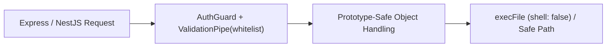

# ViperClaw Skill 39: Node.js, Express, NestJS & Fastify Security Auditor (`viper-nodejs-express-nestjs`)

## 1. Standards & Open-Source Reference
- **Standards:** NodeJS Security Cheat Sheet (OWASP), Semgrep `p/nodejs` & `p/typescript`, eslint-plugin-security.
- **Focus:** Auditing Express, NestJS, Fastify, and Koa backend applications.

---

## 2. Threat Model & Trust-Boundary Architecture



### Automated ViperClaw Command
```bash
viperclaw taint . --db .viperclaw/graph.db
```

---

## 3. Rapid Discovery Patterns
- Search for `@Public()`, `UseGuards`, `ValidationPipe`, `app.set('trust proxy'`, `Object.assign`, `lodash.merge`, `child_process`, `vm.runInNewContext`.

---

## 4. Senior Security Engineer Technical Audit Checklist
1. **NestJS Global ValidationPipe & Guard Coverage:** Ensure `new ValidationPipe({ whitelist: true, forbidNonWhitelisted: true, transform: true })` is registered globally, and audit every `@Public()` decorator to ensure sensitive controllers are not inadvertently exposed.
2. **Prototype Pollution & Object Merging:** Audit recursive merge functions, query parsers (`qs` depth/allowPrototypes), and dynamic property assignments (`obj[userKey][subKey] = val`); use `Object.create(null)` or `Map` for user-keyed dictionaries.
3. **`trust proxy` & Forwarded Header Boundaries:** Verify `app.set("trust proxy", ...)` is configured with the exact hop count or CIDR of the upstream load balancer so rate limiters and audit logs cannot be circumvented via untrusted `X-Forwarded-For` headers.
4. **Subprocess & VM Sandbox Sinks:** Replace `child_process.exec(cmd)` with `execFile(bin, args, { shell: false })`, and never use Node's built-in `vm` module to run untrusted code.
5. **Path Traversal in Static & Download Routes:** When serving files via `res.sendFile` or `fs.createReadStream`, use `path.resolve(ROOT_DIR, userPath)` and verify `resolved.startsWith(ROOT_DIR + path.sep)`.

---

## 5. Production Remediation Patterns (Vulnerable vs. Hardened Code)
```typescript
// ❌ VULNERABLE: NestJS DTO without whitelist allows mass-assigning role
app.useGlobalPipes(new ValidationPipe());

// ✅ HARDENED: Strips unknown properties and rejects unexpected fields
app.useGlobalPipes(new ValidationPipe({
  whitelist: true,
  forbidNonWhitelisted: true,
  transform: true,
}));
```

---

## 6. False-Positive Elimination & CVSS v3.1 Triage Rubric

### False-Positive Elimination Gate
1. **Reachability & Boundary Check:** Confirm the flagged pattern or configuration is reachable across a trust boundary in production (not an isolated unit-test mock, build-time sample, or dead code path).
2. **Upstream Control Verification:** Check whether an upstream gateway, middleware, database policy, or compiler flag already neutralizes the weakness before marking a finding as verified.
3. **Standards Reference:** `OWASP NodeJS Cheat Sheet, Semgrep Node/TS, CWE-1321, CWE-78`

| Severity Tier | Baseline CVSS v3.1 Vector | Qualifying Security Impact |
| :--- | :--- | :--- |
| **CRITICAL (9.0–10.0)** | `CVSS:3.1/AV:N/AC:L/PR:N/UI:N/S:C/C:H/I:H/A:H` | Unauthenticated remote code execution, cross-tenant authentication or isolation gap, or direct theft of funds/keys. |
| **HIGH (7.0–8.9)** | `CVSS:3.1/AV:N/AC:L/PR:L/UI:N/S:U/C:H/I:H/A:N` | Authenticated privilege escalation, unauthorized sensitive data exposure, or single-request service outage. |
| **MEDIUM (4.0–6.9)** | `CVSS:3.1/AV:N/AC:L/PR:L/UI:R/S:C/C:L/I:L/A:N` | Scoped information disclosure, non-admin state mutation, or configuration weakness requiring user interaction. |
| **LOW (0.1–3.9)** | `CVSS:3.1/AV:N/AC:H/PR:H/UI:N/S:U/C:L/I:N/A:N` | Defense-in-depth hardening gap requiring high precondition complexity and minimal direct impact. |

---

## 7. Regression Testing & Continuous Verification
1. **Positive Functional Test:** Verify that legitimate callers and valid inputs continue to succeed after applying the hardened pattern.
2. **Negative Security Regression Test:** Write an automated unit/integration test confirming that the vulnerable input, unauthenticated call, or misconfiguration is deterministically rejected.
3. **Graph & SARIF Verification:** Run `viperclaw taint . --db .viperclaw/graph.db` and `viperclaw verify` to record the verified state in `.viperclaw/graph.db`.
