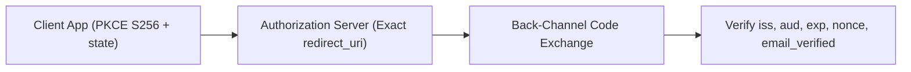

# OAuth 2.1, OpenID Connect (OIDC) & RFC 9700 Compliance Auditor (`viper-oauth-oidc-compliance`)

## 1. Executive Scope, Standards & CWE/OWASP Mapping
- **Frameworks & Standards:** RFC 9700 (OAuth 2.0 Security Best Current Practice), OAuth 2.1 Draft, OpenID Connect Core 1.0, CWE-346, CWE-601
- **Primary CWE Mapping:** CWE-601 (URL Redirection to Untrusted Site / Open Redirect), CWE-352 (Missing OAuth state / CSRF), CWE-345 (Unverified OIDC ID Token Claims)
- **ViperClaw MCP Tools:** `viper_jwt_audit`, `viper_taint_scan`, `viper_verify_and_report`
- **ViperClaw CLI Command:** `viperclaw taint ./src --db .viperclaw/graph.db`

---

## 2. Threat Model & Root-Cause Architecture



### Root-Cause Analysis
OAuth and OIDC implementations fail when Authorization Servers use prefix/wildcard matching on `redirect_uri` (allowing code leakage via open redirects or path traversal), omit mandatory PKCE (`S256`) and session-bound `state` parameters, or trust OIDC `email` claims without checking `email_verified === true` and `aud`.

---

## 3. Deterministic Discovery & Grep/AST Audit Commands

Run the following discovery commands across the target repository before manual code review:

```bash
# 1. Automated ViperClaw analysis
viperclaw taint ./src --db .viperclaw/graph.db

# 2. Rapid static pattern discovery (ripgrep)
rg -n "(authorize_redirect|fetch_token|code_challenge|code_verifier|redirect_uri)"
rg -n "(response_type=token|verify_id_token|oauth2|oidc)"
```

---

## 4. Senior Security Engineer 8-Point Audit Checklist

| Control ID | Audit Verification Target | Pass Criteria | Fail / Vulnerability Indicator |
| :---: | :--- | :--- | :--- |
| `OIDC-01` | **Exact Byte-for-Byte `redirect_uri` Matching** | Authorization Server compares `redirect_uri` using exact string equality against pre-registered URIs (no wildcards, regexes, or open-redirect chains). | `redirect_uri.startswith('https://app.example.com')` allows `https://app.example.com.evil.tld` or `/../open-redirect`. |
| `OIDC-02` | **Mandatory PKCE (`S256`) Enforcement** | Authorization code flow enforces `code_challenge_method=S256` and rejects `plain` or missing `code_verifier`. | Authorization code exchangeable without `code_verifier` or downgradable to `code_challenge_method=plain`. |
| `OIDC-03` | **Cryptographic Session-Bound `state` & `nonce`** | `state` parameter is a CSPRNG token bound to the caller's browser cookie and consumed once on `/callback`; OIDC `id_token` verifies `nonce`. | Static/missing `state` parameter allowing OAuth Login CSRF or authorization code injection. |
| `OIDC-04` | **Disable Legacy Implicit Flow (`response_type=token`)** | Only Authorization Code + PKCE (`response_type=code`) is permitted; tokens are never returned in URL fragments. | `response_type=token` enabled, leaking access tokens in browser history and referrer contexts. |
| `OIDC-05` | **Single-Use Short-Lived Authorization Codes** | Authorization codes expire in `<= 60 seconds`, are single-use, and replaying a used code revokes all tokens issued from it. | Authorization code can be exchanged multiple times. |
| `OIDC-06` | **OIDC ID Token `iss`, `aud` & `email_verified` Checks** | Relying Party verifies JWKS signature, `iss`, `aud == CLIENT_ID`, `exp`, and `email_verified is True` before linking accounts. | Relying Party links account by `email` claim without checking `email_verified` or `aud`. |
| `OIDC-07` | **IdP Mix-Up Prevention (Multi-IdP Clients)** | Clients supporting multiple OAuth/OIDC IdPs use distinct callback URLs per IdP or verify the `iss` parameter in the authorization response (RFC 9207). | Shared `/oauth/callback` trusts session state to determine which IdP issued the code. |
| `OIDC-08` | **Referrer Suppression on `/callback` Page** | The OAuth callback endpoint sets `Referrer-Policy: no-referrer` so `?code=...` is never leaked via third-party subresources. | Callback page loads external analytics scripts with `unsafe-url` referrer policy. |

---

## 5. False-Positive Elimination & CVSS v3.1 Triage Rubric

### False-Positive Gate
1. Verify whether an upstream API Gateway, global middleware, or ORM hook already enforces the control before flagging a controller.
2. Confirm the code path is reachable from an external entrypoint (not dead code, CLI-only admin script, or unit-test fixture).

| Severity Tier | Baseline CVSS v3.1 Vector | Qualifying Security Impact |
| :--- | :--- | :--- |
| **CRITICAL (9.1)** | `CVSS:3.1/AV:N/AC:L/PR:N/UI:R/S:C/C:H/I:H/A:N` | Wildcard/prefix `redirect_uri` validation gap or unverified `email_verified` claim enabling 1-click Account Takeover. |
| **HIGH (7.5)** | `CVSS:3.1/AV:N/AC:L/PR:N/UI:R/S:U/C:H/I:H/A:N` | Missing `state` parameter on OAuth account-linking flow allowing an external party to link their IdP to another user's account. |
| **MEDIUM (5.3)** | `CVSS:3.1/AV:N/AC:H/PR:N/UI:R/S:U/C:H/I:N/A:N` | Missing PKCE (`S256`) enforcement or reusable authorization codes. |

---

## 6. Production Remediation Patterns (Vulnerable vs. Hardened Code)

```python
# ❌ VULNERABLE: Prefix match on redirect_uri, no state verification, and no email_verified check
def oauth_callback(request):
    if not request.args["redirect_uri"].startswith("https://app.example.com"):
        abort(400)
    claims = exchange_code_for_id_token(request.args["code"])
    return login_user_by_email(claims["email"])

# ✅ HARDENED: Exact redirect_uri allowlist, single-use state check, PKCE verifier & email_verified check
ALLOWED_REDIRECT_URIS = {"https://app.example.com/oauth/callback"}

def oauth_callback(request):
    expected_state = session.pop("oauth_state", None)
    pkce_verifier = session.pop("oauth_pkce_verifier", None)
    if not expected_state or not hmac.compare_digest(expected_state, request.args.get("state", "")):
        abort(403, "Invalid OAuth state")
    redirect_uri = request.args.get("redirect_uri", "")
    if redirect_uri not in ALLOWED_REDIRECT_URIS:
        abort(400, "Untrusted redirect_uri")
    claims = exchange_code_for_id_token(request.args["code"], redirect_uri=redirect_uri, code_verifier=pkce_verifier)
    if not claims.get("email_verified"):
        abort(403, "Email address is not verified by identity provider")
    return login_user_by_email(claims["email"])
```

---

## 7. Regression Testing & Continuous Verification
1. Write a **Positive Unit Test** confirming authorized, schema-valid requests succeed.
2. Write a **Negative Security Regression Test** confirming unauthorized, cross-tenant, or malformed inputs are deterministically rejected.
3. Re-run `viperclaw taint` and `viperclaw verify` to confirm zero remaining unmitigated flows in `.viperclaw/graph.db`.
