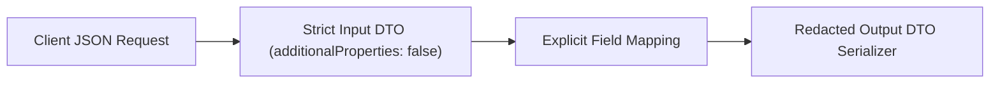

# OpenAPI Schema, Mass Assignment (BOPLA) & REST API Contract Auditor (`viper-openapi-rest-schema`)

## 1. Executive Scope, Standards & CWE/OWASP Mapping
- **Frameworks & Standards:** OWASP API3:2023 (Broken Object Property Level Authorization), OWASP API4:2023, OpenAPI v3.1 Specification, CWE-915
- **Primary CWE Mapping:** CWE-915 (Improperly Controlled Modification of Dynamically-Determined Object Attributes / Mass Assignment), CWE-213 (Exposure of Sensitive Information Due to Incompatible Policies / Excessive Data Exposure)
- **ViperClaw MCP Tools:** `viper_taint_scan`, `viper_diff_oracle`, `viper_verify_and_report`
- **ViperClaw CLI Command:** `viperclaw taint ./src --db .viperclaw/graph.db`

---

## 2. Threat Model & Root-Cause Architecture



### Root-Cause Analysis
REST controllers bind raw request JSON directly into database ORM objects (`User(**req.json)`, `Object.assign(entity, req.body)`), allowing callers to overwrite protected columns (`role`, `is_admin`, `tenant_id`, `email_verified`, `balance`), or return raw ORM entities that serialize `password_hash`, `mfa_secret`, and PII.

---

## 3. Deterministic Discovery & Grep/AST Audit Commands

Run the following discovery commands across the target repository before manual code review:

```bash
# 1. Automated ViperClaw analysis
viperclaw taint ./src --db .viperclaw/graph.db

# 2. Rapid static pattern discovery (ripgrep)
rg -n "(\*\*request\.(json|get_json)|Object\.assign\(user,\s*req\.body|Model\.create\(req\.body)"
rg -n "(swagger-ui|openapi\.json|/docs|/redoc|api-docs)"
rg -n "(extra\s*=\s*.allow.|additionalProperties\s*:\s*true)"
```

---

## 4. Senior Security Engineer 8-Point Audit Checklist

| Control ID | Audit Verification Target | Pass Criteria | Fail / Vulnerability Indicator |
| :---: | :--- | :--- | :--- |
| `API-01` | **Input DTO Property Allowlisting (No Mass Assignment)** | Every `POST`/`PUT`/`PATCH` route binds to a dedicated Input DTO that explicitly lists editable user fields and sets `extra='forbid'` / `additionalProperties: false`. | ORM model updated directly from `req.body` or `request.json`. |
| `API-02` | **Output Serializer DTO (No Excessive Data Exposure)** | Every read/list endpoint serializes through an explicit Output DTO that excludes `password_hash`, `mfa_secret`, `reset_token`, and internal metadata. | Controller returns raw database row (`SELECT *` / `return db_user`) to the JSON serializer. |
| `API-03` | **Pagination & Batch Size Caps (OWASP API4)** | List endpoints enforce `1 <= limit <= 100` and cap maximum `offset` or use cursor pagination. | `GET /api/users?limit=10000000` allowed, exhausting database memory and worker threads. |
| `API-04` | **Production Swagger / OpenAPI UI Access Control** | Interactive `/docs`, `/redoc`, `/swagger-ui.html`, and `/openapi.json` are disabled in production or gated behind internal authentication. | Unauthenticated `/swagger-ui` in production exposing internal admin and debug endpoints. |
| `API-05` | **Strict JSON Type & Bound Validation** | Strings enforce `minLength`/`maxLength` and regex patterns; numbers enforce `minimum`/`maximum` and reject `NaN`/`Infinity`. | Unbounded 50MB string field or negative numeric value accepted by API schema. |
| `API-06` | **API Version Lifecycle & Shadow API Retirement** | Legacy API versions (`/api/v1/*`, `/api/beta/*`) are decommissioned or share the exact same auth/rate-limit middleware as `/api/v2/*`. | Deprecated `/api/v1/login` remains online without MFA or rate limiting. |
| `API-07` | **JSON Patch (`application/json-patch+json`) Path Guard** | If RFC 6902 JSON Patch is used, `path` pointers (`/role`, `/tenantId`) are validated against an editable field allowlist. | Unfiltered `[{ "op": "replace", "path": "/isAdmin", "value": true }]` applied to entity. |
| `API-08` | **Uniform 401/403/422 Error Schema** | Validation errors (`422`) do not echo back internal server configuration or full raw database constraints. | Pydantic/Hibernate error response leaks internal class paths or SQL constraint names. |

---

## 5. False-Positive Elimination & CVSS v3.1 Triage Rubric

### False-Positive Gate
1. Verify whether an upstream API Gateway, global middleware, or ORM hook already enforces the control before flagging a controller.
2. Confirm the code path is reachable from an external entrypoint (not dead code, CLI-only admin script, or unit-test fixture).

| Severity Tier | Baseline CVSS v3.1 Vector | Qualifying Security Impact |
| :--- | :--- | :--- |
| **CRITICAL (9.1)** | `CVSS:3.1/AV:N/AC:L/PR:L/UI:N/S:U/C:H/I:H/A:N` | Mass assignment on user profile/registration overwriting `role: "admin"`, `is_superuser: true`, or `tenant_id`. |
| **HIGH (7.5)** | `CVSS:3.1/AV:N/AC:L/PR:N/UI:N/S:U/C:H/I:N/A:N` | Excessive data exposure returning `password_hash`, `api_key`, or `mfa_secret` in `/api/users` response. |
| **MEDIUM (5.3)** | `CVSS:3.1/AV:N/AC:L/PR:N/UI:N/S:U/C:N/I:N/A:L` | Uncapped pagination (`limit=999999`) or exposed internal Swagger documentation. |

---

## 6. Production Remediation Patterns (Vulnerable vs. Hardened Code)

```python
# ❌ VULNERABLE: Updates ORM user directly from raw dict & returns full ORM model (with password_hash!)
@router.patch("/users/me")
def update_me(req_body: dict, user: User = Depends(get_current_user), db: Session = Depends(get_db)):
    for k, v in req_body.items():
        setattr(user, k, v)  # Untrusted caller sends {"is_admin": True, "balance": 999999}
    db.commit()
    return user

# ✅ HARDENED: Strict Input DTO (extra='forbid') + Explicit Output DTO
class UserUpdateInput(BaseModel):
    model_config = ConfigDict(extra="forbid")
    display_name: str = Field(min_length=1, max_length=80)
    bio: str = Field(default="", max_length=500)

class UserPublicOutput(BaseModel):
    id: UUID
    display_name: str
    bio: str

@router.patch("/users/me", response_model=UserPublicOutput)
def update_me(req_body: UserUpdateInput, user: User = Depends(get_current_user), db: Session = Depends(get_db)):
    user.display_name = req_body.display_name
    user.bio = req_body.bio
    db.commit()
    return user
```

---

## 7. Regression Testing & Continuous Verification
1. Write a **Positive Unit Test** confirming authorized, schema-valid requests succeed.
2. Write a **Negative Security Regression Test** confirming unauthorized, cross-tenant, or malformed inputs are deterministically rejected.
3. Re-run `viperclaw taint` and `viperclaw verify` to confirm zero remaining unmitigated flows in `.viperclaw/graph.db`.
