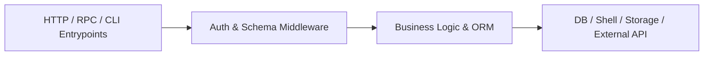

# Master 5-Phase Security Audit & Architecture Review Orchestrator (`viper-orchestrator`)

## 1. Executive Scope, Standards & CWE/OWASP Mapping
- **Frameworks & Standards:** OWASP ASVS v4.0.3 (L1–L3), OWASP Top 10:2025, OWASP API Security Top 10:2023, NIST SP 800-115, PTES
- **Primary CWE Mapping:** CWE-284 (Improper Access Control), CWE-20 (Improper Input Validation), CWE-707 (Improper Neutralization), CWE-693 (Protection Mechanism Failure)
- **ViperClaw MCP Tools:** `viper_graph_upsert`, `viper_graph_leads`, `viper_taint_scan`, `viper_harvest_js`, `viper_fingerprint_traffic`, `viper_diff_oracle`, `viper_verify_and_report`
- **ViperClaw CLI Command:** `viperclaw taint . --db .viperclaw/graph.db && viperclaw graph --db .viperclaw/graph.db --top-leads 15 --mermaid`

---

## 2. Threat Model & Root-Cause Architecture



### Root-Cause Analysis
Unstructured security reviews fail because auditors inspect isolated files without mapping trust boundaries, authentication state, and transitive data flows across the full application graph.

---

## 3. Deterministic Discovery & Grep/AST Audit Commands

Run the following discovery commands across the target repository before manual code review:

```bash
# 1. Automated ViperClaw analysis
viperclaw taint . --db .viperclaw/graph.db && viperclaw graph --db .viperclaw/graph.db --top-leads 15 --mermaid

# 2. Rapid static pattern discovery (ripgrep)
rg -n "(app|router)\.(get|post|put|delete|patch|use)\("
rg -n "@(RequestMapping|GetMapping|PostMapping|PutMapping|DeleteMapping|PatchMapping)"
rg -n "(Route::|path\(|re_path\(|http\.HandleFunc)"
```

---

## 4. Senior Security Engineer 8-Point Audit Checklist

| Control ID | Audit Verification Target | Pass Criteria | Fail / Vulnerability Indicator |
| :---: | :--- | :--- | :--- |
| `ORCH-01` | **Trust Boundary Inventory** | All external entrypoints (REST, GraphQL, gRPC, WebSockets, Webhooks, CLI) mapped in `.viperclaw/graph.db`. | Undocumented internal or legacy routes omitted from review scope. |
| `ORCH-02` | **Authentication Coverage** | Every state-changing and sensitive read route enforces centralized authentication middleware. | Per-route ad-hoc token checks or missing auth decorators. |
| `ORCH-03` | **Tenant & Object Scoping** | All resource queries bind `tenant_id` and `owner_id` from verified session state. | Direct primary-key lookups (`find_by_id`) using unverified request parameters. |
| `ORCH-04` | **Source-to-Sink Taint Audit** | `viperclaw taint` executed across all backend and frontend source directories. | Unparameterized SQL, command, template, or path sinks reachable from user input. |
| `ORCH-05` | **Client Bundle & Secret Hygiene** | `viperclaw harvest-js` executed on build artifacts and static directories. | Hardcoded API keys, internal staging URLs, or unescaped DOM sinks in bundles. |
| `ORCH-06` | **Dependency & IaC Posture** | Lockfiles, Dockerfiles, Kubernetes manifests, and CI workflows audited. | Unpinned dependencies, privileged containers, or unsafe CI triggers. |
| `ORCH-07` | **7-Gate Evidence Triage** | Every candidate finding validated via `viper_verify_and_report` (`ProofOracle`). | Unverified theoretical alerts or CDN/WAF challenge responses reported as bugs. |
| `ORCH-08` | **Remediation & Regression Suite** | Root-cause patches paired with automated positive and negative unit tests. | Symptom-level regex filtering without underlying parameterization or access control. |

---

## 5. False-Positive Elimination & CVSS v3.1 Triage Rubric

### False-Positive Gate
1. Verify whether an upstream API Gateway, global middleware, or ORM hook already enforces the control before flagging a controller.
2. Confirm the code path is reachable from an external entrypoint (not dead code, CLI-only admin script, or unit-test fixture).

| Severity Tier | Baseline CVSS v3.1 Vector | Qualifying Security Impact |
| :--- | :--- | :--- |
| **CRITICAL (9.0–10.0)** | `CVSS:3.1/AV:N/AC:L/PR:N/UI:N/S:C/C:H/I:H/A:H` | Unauthenticated RCE, authentication failure, or cross-tenant database compromise. |
| **HIGH (7.0–8.9)** | `CVSS:3.1/AV:N/AC:L/PR:L/UI:N/S:U/C:H/I:H/A:N` | Authenticated cross-tenant BOLA/IDOR, SQL injection, or SSRF to internal services. |
| **MEDIUM (4.0–6.9)** | `CVSS:3.1/AV:N/AC:L/PR:L/UI:R/S:C/C:L/I:L/A:N` | Stored/Reflected XSS, CSRF on non-admin actions, or schema/PII disclosure. |
| **LOW (0.1–3.9)** | `CVSS:3.1/AV:N/AC:H/PR:H/UI:N/S:U/C:L/I:N/A:N` | Verbose stack traces, minor configuration drift, or defense-in-depth gaps. |

---

## 6. Production Remediation Patterns (Vulnerable vs. Hardened Code)

```python
# ❌ VULNERABLE: Ad-hoc route handler with no centralized auth, schema validation, or tenant scoping
@app.route("/api/v1/exports/<export_id>", methods=["GET"])
def download_export(export_id: str):
    row = db.execute(f"SELECT file_path FROM exports WHERE id = '{export_id}'").fetchone()
    return send_file(row["file_path"])

# ✅ HARDENED: Centralized auth dependency, parameterized query, tenant scoping & path confinement
@app.route("/api/v1/exports/<uuid:export_id>", methods=["GET"])
@require_authenticated_session
def download_export(export_id: UUID, session: VerifiedSession):
    row = db.execute(
        "SELECT file_path FROM exports WHERE id = %s AND tenant_id = %s",
        (str(export_id), session.tenant_id),
    ).fetchone()
    if not row:
        abort(404)
    target = (EXPORT_ROOT / row["file_path"]).resolve()
    if not target.is_relative_to(EXPORT_ROOT):
        abort(403)
    return send_file(target, as_attachment=True)
```

---

## 7. Regression Testing & Continuous Verification
1. Write a **Positive Unit Test** confirming authorized, schema-valid requests succeed.
2. Write a **Negative Security Regression Test** confirming unauthorized, cross-tenant, or malformed inputs are deterministically rejected.
3. Re-run `viperclaw taint` and `viperclaw verify` to confirm zero remaining unmitigated flows in `.viperclaw/graph.db`.
