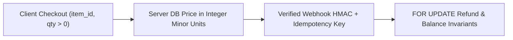

# ViperClaw Skill 54: Payment Processing, Ledger & Financial Logic Auditor (`viper-payment-stripe-pci`)

## 1. Standards & Open-Source Reference
- **Standards:** PCI-DSS v4.0, Stripe Security Integration Guide, OWASP Business Logic Security Cheat Sheet.
- **Focus:** Auditing checkout flows, subscription webhooks, wallet/credit balances, currency conversion, and refund logic.

---

## 2. Threat Model & Trust-Boundary Architecture



### Automated ViperClaw Command
```bash
viperclaw taint . --db .viperclaw/graph.db
```

---

## 3. Rapid Discovery Patterns
- Search for `stripe.checkout.Session.create`, `PaymentIntent.create`, `float(`, `amount`, `price`, `quantity`, `discount`, `refund`.

---

## 4. Senior Security Engineer Technical Audit Checklist
1. **Server-Side Price & Currency Lookup:** Never accept `unit_amount`, `price`, `currency`, or `discount_percent` from client request parameters; accept only `item_id` and `quantity`, validate `quantity > 0` (blocking negative-quantity credit bugs!), and look up the price from the server database.
2. **Exact Integer Minor-Unit / `Decimal` Arithmetic:** Never use IEEE-754 floating-point (`float` in Python, `number` float math in JS) for money (`0.1 + 0.2 == 0.30000000000000004`). Store and compute all monetary values as integer minor units (cents/satoshis/wei) or fixed-precision `Decimal` with explicit `ROUND_HALF_EVEN` / `ROUND_FLOOR`.
3. **Webhook Event Ordering & State-Machine Finality:** Payment webhooks (`checkout.session.completed`, `payment_intent.succeeded`, `charge.dispute.created`) can arrive out of order or multiple times. Verify `stripe.Webhook.construct_event` signature, check `payment_status == "paid"`, and enforce an atomic `WHERE status = 'PENDING'` state transition.
4. **Refund & Partial-Refund Cap Enforcement:** Ensure total cumulative refunds for an order (`SUM(refunds.amount) + new_refund <= order.captured_amount`) are checked inside a `SELECT ... FOR UPDATE` transaction so concurrent refund requests cannot exceed the original payment.
5. **PCI-DSS Scope Isolation:** Ensure raw PAN (card numbers) and CVV never touch application logs, databases, or backend servers—use client-side tokenization (`Stripe Elements`, `Braintree Hosted Fields`).

---

## 5. Production Remediation Patterns (Vulnerable vs. Hardened Code)
```python
# ❌ VULNERABLE: Uses float math, trusts client price, and lacks negative quantity check
total = float(req.json["price"]) * int(req.json["quantity"])
stripe.PaymentIntent.create(amount=int(total * 100), currency="usd")

# ✅ HARDENED: Positive integer quantity, DB price in integer cents, and idempotency key
qty = int(req.json["quantity"])
if qty <= 0 or qty > 100:
    raise ValueError("Invalid quantity")
product = db.get_product(req.json["product_id"])
amount_cents = product.price_cents * qty
stripe.PaymentIntent.create(
    amount=amount_cents,
    currency=product.currency,
    idempotency_key=f"order:{order.id}",
)
```

---

## 6. False-Positive Elimination & CVSS v3.1 Triage Rubric

### False-Positive Elimination Gate
1. **Reachability & Boundary Check:** Confirm the flagged pattern or configuration is reachable across a trust boundary in production (not an isolated unit-test mock, build-time sample, or dead code path).
2. **Upstream Control Verification:** Check whether an upstream gateway, middleware, database policy, or compiler flag already neutralizes the weakness before marking a finding as verified.
3. **Standards Reference:** `PCI-DSS v4.0, Stripe Security Guide, CWE-682, CWE-840`

| Severity Tier | Baseline CVSS v3.1 Vector | Qualifying Security Impact |
| :--- | :--- | :--- |
| **CRITICAL (9.0–10.0)** | `CVSS:3.1/AV:N/AC:L/PR:N/UI:N/S:C/C:H/I:H/A:H` | Unauthenticated remote code execution, cross-tenant authentication or isolation gap, or direct theft of funds/keys. |
| **HIGH (7.0–8.9)** | `CVSS:3.1/AV:N/AC:L/PR:L/UI:N/S:U/C:H/I:H/A:N` | Authenticated privilege escalation, unauthorized sensitive data exposure, or single-request service outage. |
| **MEDIUM (4.0–6.9)** | `CVSS:3.1/AV:N/AC:L/PR:L/UI:R/S:C/C:L/I:L/A:N` | Scoped information disclosure, non-admin state mutation, or configuration weakness requiring user interaction. |
| **LOW (0.1–3.9)** | `CVSS:3.1/AV:N/AC:H/PR:H/UI:N/S:U/C:L/I:N/A:N` | Defense-in-depth hardening gap requiring high precondition complexity and minimal direct impact. |

---

## 7. Regression Testing & Continuous Verification
1. **Positive Functional Test:** Verify that legitimate callers and valid inputs continue to succeed after applying the hardened pattern.
2. **Negative Security Regression Test:** Write an automated unit/integration test confirming that the vulnerable input, unauthenticated call, or misconfiguration is deterministically rejected.
3. **Graph & SARIF Verification:** Run `viperclaw taint . --db .viperclaw/graph.db` and `viperclaw verify` to record the verified state in `.viperclaw/graph.db`.
