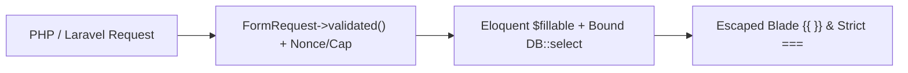

# ViperClaw Skill 43: PHP, Laravel & WordPress Security Auditor (`viper-php-laravel-wordpress`)

## 1. Standards & Open-Source Reference
- **Standards:** OWASP PHP Configuration Cheat Sheet, Enlightn (Laravel Security Analyzer), WordPress VIP Coding Standards.
- **Focus:** Auditing modern PHP 8+, Laravel, Symfony, and WordPress plugins/themes.

---

## 2. Threat Model & Trust-Boundary Architecture



### Automated ViperClaw Command
```bash
viperclaw taint . --db .viperclaw/graph.db
```

---

## 3. Rapid Discovery Patterns
- **Laravel:** `$guarded = []`, `Model::create($request->all())`, `DB::raw(`, `whereRaw(`, `{!! `, `unserialize(`.
- **WordPress:** `$_POST`, `$_GET`, `$wpdb->query(`, `wp_ajax_nopriv_`, `update_option(`.

---

## 4. Senior Security Engineer Technical Audit Checklist
1. **Laravel Mass Assignment & FormRequest Validation:** Never pass `$request->all()` into `Model::create()` or `$model->update()` nor set `protected $guarded = []` on Eloquent models containing privilege/tenant columns; use `$request->validated()` with explicit `FormRequest` rules.
2. **Laravel Raw SQL & Query Builder Column Names:** Audit `DB::raw()`, `whereRaw()`, `orderByRaw()`, and note that column/sort names in `$query->orderBy($request->input('sort'))` must be validated against `in_array($sort, ['created_at', 'name'], true)`.
3. **Blade & Twig Output Escaping:** Replace unescaped `{!! $userContent !!}` with escaped `{{ $userContent }}` unless sanitized via `HTMLPurifier`.
4. **WordPress Capability + Nonce Dual Check:** Every `wp_ajax_*`, REST route, or admin action must check *both* `current_user_can('manage_options')` (authorization) *and* `check_ajax_referer()` / `wp_verify_nonce()` (CSRF), and parameterize SQL via `$wpdb->prepare()`.
5. **PHP Strict Comparison & File Inclusion:** Use strict equality `===` / `!==` and `in_array(..., true)` to prevent type-juggling coercion gaps, and disable `allow_url_include = Off` in `php.ini`.

---

## 5. Production Remediation Patterns (Vulnerable vs. Hardened Code)
```php
// ❌ VULNERABLE: Mass assignment of all request inputs & raw SQL interpolation
User::create($request->all());
$users = DB::select("SELECT * FROM users WHERE role = '" . $request->input('role') . "'");

// ✅ HARDENED: Validated DTO attributes & bound query parameters
User::create($request->safe()->only(['name', 'email']));
$users = DB::select("SELECT * FROM users WHERE role = ?", [$request->validated('role')]);
```

---

## 6. False-Positive Elimination & CVSS v3.1 Triage Rubric

### False-Positive Elimination Gate
1. **Reachability & Boundary Check:** Confirm the flagged pattern or configuration is reachable across a trust boundary in production (not an isolated unit-test mock, build-time sample, or dead code path).
2. **Upstream Control Verification:** Check whether an upstream gateway, middleware, database policy, or compiler flag already neutralizes the weakness before marking a finding as verified.
3. **Standards Reference:** `Enlightn, OWASP PHP, WP VIP Standards, CWE-89, CWE-915`

| Severity Tier | Baseline CVSS v3.1 Vector | Qualifying Security Impact |
| :--- | :--- | :--- |
| **CRITICAL (9.0–10.0)** | `CVSS:3.1/AV:N/AC:L/PR:N/UI:N/S:C/C:H/I:H/A:H` | Unauthenticated remote code execution, cross-tenant authentication or isolation gap, or direct theft of funds/keys. |
| **HIGH (7.0–8.9)** | `CVSS:3.1/AV:N/AC:L/PR:L/UI:N/S:U/C:H/I:H/A:N` | Authenticated privilege escalation, unauthorized sensitive data exposure, or single-request service outage. |
| **MEDIUM (4.0–6.9)** | `CVSS:3.1/AV:N/AC:L/PR:L/UI:R/S:C/C:L/I:L/A:N` | Scoped information disclosure, non-admin state mutation, or configuration weakness requiring user interaction. |
| **LOW (0.1–3.9)** | `CVSS:3.1/AV:N/AC:H/PR:H/UI:N/S:U/C:L/I:N/A:N` | Defense-in-depth hardening gap requiring high precondition complexity and minimal direct impact. |

---

## 7. Regression Testing & Continuous Verification
1. **Positive Functional Test:** Verify that legitimate callers and valid inputs continue to succeed after applying the hardened pattern.
2. **Negative Security Regression Test:** Write an automated unit/integration test confirming that the vulnerable input, unauthenticated call, or misconfiguration is deterministically rejected.
3. **Graph & SARIF Verification:** Run `viperclaw taint . --db .viperclaw/graph.db` and `viperclaw verify` to record the verified state in `.viperclaw/graph.db`.
