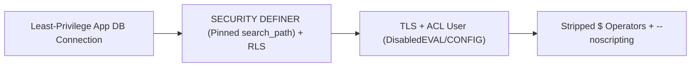

# ViperClaw Skill 52: PostgreSQL, Redis & MongoDB Security Auditor (`viper-postgres-redis-mongo`)

## 1. Standards & Open-Source Reference
- **Standards:** CIS PostgreSQL / MongoDB / Redis Benchmarks, OWASP Database Security Cheat Sheet.
- **Focus:** Auditing SQL migrations, stored procedures, PostgreSQL RLS policies, Redis configurations, and MongoDB queries.

---

## 2. Threat Model & Trust-Boundary Architecture



### Automated ViperClaw Command
```bash
viperclaw taint . --db .viperclaw/graph.db
```

---

## 3. Rapid Discovery Patterns
- **PostgreSQL:** `SECURITY DEFINER`, `ENABLE ROW LEVEL SECURITY`, `EXECUTE format(`, `GRANT ALL`.
- **Redis:** `bind 0.0.0.0`, `protected-mode no`, `KEYS *`, `EVAL `.
- **MongoDB:** `$where`, `$regex`, `express-mongo-sanitize`.

---

## 4. Senior Security Engineer Technical Audit Checklist
1. **PostgreSQL `SECURITY DEFINER` `search_path` Hardening:** Every `SECURITY DEFINER` function in PostgreSQL must explicitly set `SET search_path = pg_catalog, public` in its definition to prevent schema-shadowing privilege escalation (CWE-426).
2. **PostgreSQL Dynamic SQL (`EXECUTE`) & RLS Completeness:** Inside PL/pgSQL functions, use `EXECUTE format('SELECT ... FROM %I WHERE id = $1', tbl) USING val` (`%I` for identifiers, `$1` for values, never `%s` for values); verify tables with `ENABLE ROW LEVEL SECURITY` also define policies for `INSERT`/`UPDATE`/`DELETE` (`WITH CHECK`).
3. **Redis Authentication, ACLs & Dangerous Commands:** Ensure Redis binds only to private interfaces (`bind 127.0.0.1`), enforces TLS + `requirepass` / Redis 6+ ACL users, and disables/renames `FLUSHALL`, `FLUSHDB`, `CONFIG`, `MODULE`, and `EVAL` for standard application roles.
4. **MongoDB Operator & `$where` Sanitization:** Disable server-side JavaScript execution (`--noscripting`), forbid `$where` and `mapReduce`, and strip keys starting with `$` or containing `.` from user inputs (`mongo-sanitize`) before passing to `.find()` / `.updateOne()`.
5. **Least-Privilege Application DB Roles:** The runtime web application should connect using a role that has `SELECT, INSERT, UPDATE, DELETE` on application tables only—never `SUPERUSER`, `rds_superuser`, or DDL (`DROP`/`ALTER`) privileges.

---

## 5. Production Remediation Patterns (Vulnerable vs. Hardened Code)
```sql
-- ❌ VULNERABLE: SECURITY DEFINER without search_path & unsafe %s value interpolation
CREATE FUNCTION get_user_email(uid int) RETURNS text AS $$
DECLARE res text;
BEGIN
  EXECUTE format('SELECT email FROM users WHERE id = %s', uid) INTO res;
  RETURN res;
END;
$$ LANGUAGE plpgsql SECURITY DEFINER;

-- ✅ HARDENED: Pinned search_path & parameterized USING clause
CREATE FUNCTION get_user_email(uid int) RETURNS text AS $$
DECLARE res text;
BEGIN
  EXECUTE 'SELECT email FROM public.users WHERE id = $1' INTO res USING uid;
  RETURN res;
END;
$$ LANGUAGE plpgsql SECURITY DEFINER SET search_path = pg_catalog, public;
```

---

## 6. False-Positive Elimination & CVSS v3.1 Triage Rubric

### False-Positive Elimination Gate
1. **Reachability & Boundary Check:** Confirm the flagged pattern or configuration is reachable across a trust boundary in production (not an isolated unit-test mock, build-time sample, or dead code path).
2. **Upstream Control Verification:** Check whether an upstream gateway, middleware, database policy, or compiler flag already neutralizes the weakness before marking a finding as verified.
3. **Standards Reference:** `CIS PostgreSQL/Redis/Mongo Benchmarks, CWE-89, CWE-426`

| Severity Tier | Baseline CVSS v3.1 Vector | Qualifying Security Impact |
| :--- | :--- | :--- |
| **CRITICAL (9.0–10.0)** | `CVSS:3.1/AV:N/AC:L/PR:N/UI:N/S:C/C:H/I:H/A:H` | Unauthenticated remote code execution, cross-tenant authentication or isolation gap, or direct theft of funds/keys. |
| **HIGH (7.0–8.9)** | `CVSS:3.1/AV:N/AC:L/PR:L/UI:N/S:U/C:H/I:H/A:N` | Authenticated privilege escalation, unauthorized sensitive data exposure, or single-request service outage. |
| **MEDIUM (4.0–6.9)** | `CVSS:3.1/AV:N/AC:L/PR:L/UI:R/S:C/C:L/I:L/A:N` | Scoped information disclosure, non-admin state mutation, or configuration weakness requiring user interaction. |
| **LOW (0.1–3.9)** | `CVSS:3.1/AV:N/AC:H/PR:H/UI:N/S:U/C:L/I:N/A:N` | Defense-in-depth hardening gap requiring high precondition complexity and minimal direct impact. |

---

## 7. Regression Testing & Continuous Verification
1. **Positive Functional Test:** Verify that legitimate callers and valid inputs continue to succeed after applying the hardened pattern.
2. **Negative Security Regression Test:** Write an automated unit/integration test confirming that the vulnerable input, unauthenticated call, or misconfiguration is deterministically rejected.
3. **Graph & SARIF Verification:** Run `viperclaw taint . --db .viperclaw/graph.db` and `viperclaw verify` to record the verified state in `.viperclaw/graph.db`.
