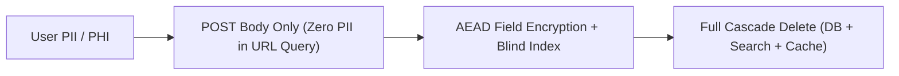

# ViperClaw Skill 60: Privacy Engineering, GDPR / HIPAA & PII Data Flow Auditor (`viper-privacy-gdpr-hipaa`)

## 1. Standards & Open-Source Reference
- **Standards:** GDPR Articles 17/25/32, HIPAA Security Rule, OWASP Top 10 Privacy Risks, LINDDUN Privacy Threat Modeling.
- **Focus:** Auditing PII/PHI collection, storage encryption, deletion cascades, URL query parameters, and third-party SDK data sharing.

---

## 2. Threat Model & Trust-Boundary Architecture



### Automated ViperClaw Command
```bash
viperclaw taint . --db .viperclaw/graph.db
```

---

## 3. Rapid Discovery Patterns
- Search models and schemas for `email`, `phone`, `ssn`, `dob`, `date_of_birth`, `ip_address`, `tax_id`, `medical`, `location`.
- Check URL parameters, analytics calls (`gtag(`, `segment.track`, `mixpanel.track`), and account deletion handlers.

---

## 4. Senior Security Engineer Technical Audit Checklist
1. **No PII/PHI in URL Query Strings:** Never pass email addresses, phone numbers, names, session tokens, or reset codes in `GET` query parameters (`?email=user@example.com`), as URLs are leaked via `Referer` headers, browser history, and proxy/CDN access logs.
2. **Application-Layer Field Encryption & Blind Indexing:** Encrypt high-sensitivity PII/PHI (SSN, tax IDs, health records, biometric templates) at the application layer using envelope encryption (AEAD `AES-256-GCM` with KMS data keys) and use keyed HMAC-SHA256 blind indexes if exact-match lookup is required.
3. **Complete Right-to-Erasure (GDPR Art. 17) Cascade:** Audit user deletion workflows (`delete_account`) to ensure PII is purged or irreversibly anonymized across primary tables, search indexes (Elasticsearch/Algolia), vector stores, Redis caches, and S3 exports.
4. **Third-Party Analytics & LLM Egress Scrubbing:** Verify that frontend analytics SDKs (Google Analytics, PostHog, Segment, Sentry) and external LLM API calls scrub PII/PHI and respect user consent flags before transmitting events.
5. **Data Retention & Automated TTL Purging:** Enforce explicit retention TTL policies on raw audit logs, IP addresses, session tables, and temporary file exports.

---

## 5. Production Remediation Patterns (Vulnerable vs. Hardened Code)
```python
# ❌ VULNERABLE: Soft-deletes user flag but leaves plaintext PII, sessions & search index intact
def delete_account(user_id: int):
    db.execute("UPDATE users SET deleted_at = NOW() WHERE id = %s", [user_id])

# ✅ HARDENED: Scrubs PII, revokes active sessions, and purges secondary search/cache stores
def delete_account(user_id: int):
    with db.transaction():
        db.execute(
            "UPDATE users SET email = %s, name = 'Deleted User', phone = NULL, pii_blob = NULL, deleted_at = NOW() WHERE id = %s",
            [f"deleted-{user_id}@anonymized.invalid", user_id],
        )
        db.execute("DELETE FROM user_sessions WHERE user_id = %s", [user_id])
    search_index.delete_document(f"user:{user_id}")
    redis_cache.delete(f"user_profile:{user_id}")
```

---

## 6. False-Positive Elimination & CVSS v3.1 Triage Rubric

### False-Positive Elimination Gate
1. **Reachability & Boundary Check:** Confirm the flagged pattern or configuration is reachable across a trust boundary in production (not an isolated unit-test mock, build-time sample, or dead code path).
2. **Upstream Control Verification:** Check whether an upstream gateway, middleware, database policy, or compiler flag already neutralizes the weakness before marking a finding as verified.
3. **Standards Reference:** `GDPR Art. 17/25/32, HIPAA Security Rule, LINDDUN, CWE-359`

| Severity Tier | Baseline CVSS v3.1 Vector | Qualifying Security Impact |
| :--- | :--- | :--- |
| **CRITICAL (9.0–10.0)** | `CVSS:3.1/AV:N/AC:L/PR:N/UI:N/S:C/C:H/I:H/A:H` | Unauthenticated remote code execution, cross-tenant authentication or isolation gap, or direct theft of funds/keys. |
| **HIGH (7.0–8.9)** | `CVSS:3.1/AV:N/AC:L/PR:L/UI:N/S:U/C:H/I:H/A:N` | Authenticated privilege escalation, unauthorized sensitive data exposure, or single-request service outage. |
| **MEDIUM (4.0–6.9)** | `CVSS:3.1/AV:N/AC:L/PR:L/UI:R/S:C/C:L/I:L/A:N` | Scoped information disclosure, non-admin state mutation, or configuration weakness requiring user interaction. |
| **LOW (0.1–3.9)** | `CVSS:3.1/AV:N/AC:H/PR:H/UI:N/S:U/C:L/I:N/A:N` | Defense-in-depth hardening gap requiring high precondition complexity and minimal direct impact. |

---

## 7. Regression Testing & Continuous Verification
1. **Positive Functional Test:** Verify that legitimate callers and valid inputs continue to succeed after applying the hardened pattern.
2. **Negative Security Regression Test:** Write an automated unit/integration test confirming that the vulnerable input, unauthenticated call, or misconfiguration is deterministically rejected.
3. **Graph & SARIF Verification:** Run `viperclaw taint . --db .viperclaw/graph.db` and `viperclaw verify` to record the verified state in `.viperclaw/graph.db`.
