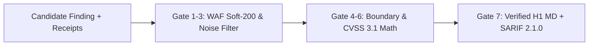

# 7-Gate Evidence Quality Judge, CVSS v3.1 Calculator & SARIF Reporter (`viper-proof-judge`)

## 1. Executive Scope, Standards & CWE/OWASP Mapping
- **Frameworks & Standards:** FIRST CVSS v3.1 Specification, OASIS SARIF v2.1.0 Standard, Enterprise Vulnerability Triage & Compliance Quality Guidelines
- **Primary CWE Mapping:** CWE-1000 (Research Concepts), CVSS v3.1 Base Metric Group
- **ViperClaw MCP Tools:** `viper_verify_and_report`, `viper_diff_oracle`
- **ViperClaw CLI Command:** `viperclaw verify findings.json --report-md audit_report.md --report-sarif findings.sarif`

---

## 2. Threat Model & Root-Cause Architecture



### Root-Cause Analysis
Automated scanners and generic LLM agents flood engineering teams with false positives: reporting Cloudflare/Akamai `200 OK` HTML challenge pages as vulnerabilities, flagging informational response headers as High severity, or emitting speculative reports without reproducible evidence.

---

## 3. Deterministic Discovery & Grep/AST Audit Commands

Run the following discovery commands across the target repository before manual code review:

```bash
# 1. Automated ViperClaw analysis
viperclaw verify findings.json --report-md audit_report.md --report-sarif findings.sarif

# 2. Rapid static pattern discovery (ripgrep)
viperclaw verify --title "<title>" --asset "<endpoint>" --request "<req>" --response "<resp>"
```

---

## 4. Senior Security Engineer 8-Point Audit Checklist

| Control ID | Audit Verification Target | Pass Criteria | Fail / Vulnerability Indicator |
| :---: | :--- | :--- | :--- |
| `JUDGE-01` | **Gate 1 — Target & Asset Specificity** | Exact file path + line number (SAST) or full HTTP endpoint + parameter (DAST) recorded. | Vague component reference without a concrete file or URL. |
| `JUDGE-02` | **Gate 2 — Non-Noise Classification** | Finding is not on the auto-rejected scanner-noise list (missing `X-Frame-Options` on API, version banners, self-XSS, rate-limit on public read). | Informational best-practice suggestion reported as an actionable vulnerability. |
| `JUDGE-03` | **Gate 3 — WAF Soft-200 Elimination** | Response receipt verified by `ProofOracle.detect_waf_soft_block` to be genuine application output. | Cloudflare (`Attention Required!`), Akamai (`Reference #`), or Imperva block page mistaken for a `200 OK` hit. |
| `JUDGE-04` | **Gate 4 — Complete Diagnostic Receipt** | Both `request_receipt` (or source trace) and `response_receipt` (or sink proof) are non-empty and reproducible. | Speculative claim (`'This endpoint might be vulnerable to SQLi'`) with no verification receipt. |
| `JUDGE-05` | **Gate 5 — Trust Boundary Crossing** | Evidence demonstrates crossing an authentication, tenant, or privilege boundary. | User accessing their own data or admin executing an intended admin feature. |
| `JUDGE-06` | **Gate 6 — Exact CVSS v3.1 Vector Math** | CVSS v3.1 base score computed deterministically from `AV/AC/PR/UI/S/C/I/A` metrics. | Inflated severity score that contradicts the required privileges (`PR:H`) or impact. |
| `JUDGE-07` | **Gate 7 — Root-Cause Remediation Included** | Report includes an idiomatic, copy-pasteable code or configuration patch. | Generic remediation advice (`'Sanitize all user inputs'`) without specific code guidance. |
| `JUDGE-08` | **SARIF 2.1.0 Schema Compliance** | Output validates against OASIS SARIF v2.1.0 for direct upload to GitHub Code Scanning. | Malformed JSON report incompatible with CI/CD security dashboards. |

---

## 5. False-Positive Elimination & CVSS v3.1 Triage Rubric

### False-Positive Gate
1. Verify whether an upstream API Gateway, global middleware, or ORM hook already enforces the control before flagging a controller.
2. Confirm the code path is reachable from an external entrypoint (not dead code, CLI-only admin script, or unit-test fixture).

| Severity Tier | Baseline CVSS v3.1 Vector | Qualifying Security Impact |
| :--- | :--- | :--- |
| **CRITICAL (9.0–10.0)** | `CVSS:3.1/AV:N/AC:L/PR:N/UI:N/S:C/C:H/I:H/A:H` | Verified unauthenticated remote code execution, authentication failure, or full database compromise. |
| **HIGH (7.0–8.9)** | `CVSS:3.1/AV:N/AC:L/PR:L/UI:N/S:U/C:H/I:H/A:N` | Verified cross-tenant BOLA/IDOR, SSRF to internal infrastructure, or privilege escalation. |
| **MEDIUM (4.0–6.9)** | `CVSS:3.1/AV:N/AC:L/PR:L/UI:R/S:C/C:L/I:L/A:N` | Verified XSS, CSRF on state-changing routes, or scoped information disclosure. |
| **LOW (0.1–3.9)** | `CVSS:3.1/AV:N/AC:H/PR:H/UI:N/S:U/C:L/I:N/A:N` | Verified minor defense-in-depth weakness requiring high precondition complexity. |

---

## 6. Production Remediation Patterns (Vulnerable vs. Hardened Code)

```bash
# ❌ INVALID REPORT: Speculative claim with no request/response receipt or WAF check
# Title: "Potential SQL Injection on /api/search" (Rejected by ProofOracle Gate 4)

# ✅ VERIFIED REPORT: Validated through all 7 ProofOracle gates with SARIF + Markdown export
viperclaw verify findings.json \
  --report-md verified_audit_report.md \
  --report-sarif github_code_scanning.sarif
```

---

## 7. Regression Testing & Continuous Verification
1. Write a **Positive Unit Test** confirming authorized, schema-valid requests succeed.
2. Write a **Negative Security Regression Test** confirming unauthorized, cross-tenant, or malformed inputs are deterministically rejected.
3. Re-run `viperclaw taint` and `viperclaw verify` to confirm zero remaining unmitigated flows in `.viperclaw/graph.db`.
