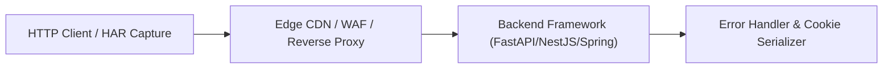

# HTTP Stack, Reverse-Proxy & Error-Envelope Security Auditor (`viper-proxy-fingerprint`)

## 1. Executive Scope, Standards & CWE/OWASP Mapping
- **Frameworks & Standards:** OWASP WSTG-INFO-02/08, OWASP Secure Headers Project, OWASP ASVS V14 (Configuration), CWE-209, CWE-614
- **Primary CWE Mapping:** CWE-209 (Generation of Error Message Containing Sensitive Information), CWE-614 (Sensitive Cookie in HTTPS Session Without 'Secure' Attribute), CWE-1004 (Sensitive Cookie Without 'HttpOnly' Flag)
- **ViperClaw MCP Tools:** `viper_fingerprint_traffic`, `viper_diff_oracle`, `viper_graph_upsert`
- **ViperClaw CLI Command:** `viperclaw fingerprint ./traffic.har --domain example.com --output stack_audit.json`

---

## 2. Threat Model & Root-Cause Architecture



### Root-Cause Analysis
Inconsistent configuration between edge proxies and backend frameworks leaks internal version banners (`Server`, `X-Powered-By`, `X-AspNet-Version`), framework debug stack traces on malformed JSON/query inputs, and insecure session cookies.

---

## 3. Deterministic Discovery & Grep/AST Audit Commands

Run the following discovery commands across the target repository before manual code review:

```bash
# 1. Automated ViperClaw analysis
viperclaw fingerprint ./traffic.har --domain example.com --output stack_audit.json

# 2. Rapid static pattern discovery (ripgrep)
rg -n "(ServerTokens|server_tokens|x-powered-by|expose_php)"
rg -n "(set_cookie|Set-Cookie|SESSION_COOKIE_SECURE|SESSION_COOKIE_HTTPONLY)"
rg -n "(traceback\.format_exc|stackTrace|APP_DEBUG)"
```

---

## 4. Senior Security Engineer 8-Point Audit Checklist

| Control ID | Audit Verification Target | Pass Criteria | Fail / Vulnerability Indicator |
| :---: | :--- | :--- | :--- |
| `FP-01` | **Version Banner Suppression** | `Server`, `X-Powered-By`, and `X-AspNet-Version` headers stripped or genericized. | Exact patch versions (`nginx/1.18.0`, `PHP/8.1.2`, `Express`) disclosed in responses. |
| `FP-02` | **Production Error Envelope Hygiene** | 500/400 errors return uniform JSON (`{"error": "Bad Request", "request_id": "..."}`). | Werkzeug/Django/Laravel/Spring debug pages or SQL stack traces returned to clients. |
| `FP-03` | **Session Cookie Security Flags** | All authentication cookies set `Secure; HttpOnly; SameSite=Lax` (or `Strict`). | Session cookies missing `HttpOnly` or `Secure` flags. |
| `FP-04` | **Cache-Control on Authenticated APIs** | Sensitive endpoints set `Cache-Control: no-store, private`. | Authenticated PII responses cached by shared CDNs due to missing `Cache-Control`. |
| `FP-05` | **Sibling & Staging Host Isolation** | Staging/internal API hosts discovered in HAR traffic require VPN/mTLS or Zero-Trust auth. | Development subdomains (`api-dev`, `staging`) accessible publicly with debug flags enabled. |
| `FP-06` | **HTTP Method Restriction** | `TRACE`, `TRACK`, and unused WebDAV methods disabled at the reverse proxy. | `TRACE` enabled or `OPTIONS` exposing administrative verbs without auth. |
| `FP-07` | **Content-Type & `nosniff` Enforcement** | Every API response sets explicit `Content-Type: application/json; charset=utf-8` + `X-Content-Type-Options: nosniff`. | Missing `Content-Type` allowing MIME-sniffing XSS on uploaded/reflected content. |
| `FP-08` | **HSTS Transport Pinning** | `Strict-Transport-Security: max-age=63072000; includeSubDomains; preload` enforced. | Missing HSTS or `http://` endpoints accepting credentials in cleartext. |

---

## 5. False-Positive Elimination & CVSS v3.1 Triage Rubric

### False-Positive Gate
1. Verify whether an upstream API Gateway, global middleware, or ORM hook already enforces the control before flagging a controller.
2. Confirm the code path is reachable from an external entrypoint (not dead code, CLI-only admin script, or unit-test fixture).

| Severity Tier | Baseline CVSS v3.1 Vector | Qualifying Security Impact |
| :--- | :--- | :--- |
| **HIGH (7.5)** | `CVSS:3.1/AV:N/AC:L/PR:N/UI:N/S:U/C:H/I:N/A:N` | Verbose exception handler leaks environment variables, DB credentials, or AWS keys in 500 tracebacks. |
| **MEDIUM (5.3)** | `CVSS:3.1/AV:N/AC:L/PR:N/UI:N/S:U/C:L/I:N/A:N` | Authenticated PII endpoints missing `Cache-Control: no-store`, enabling Web Cache Deception. |
| **LOW (3.1)** | `CVSS:3.1/AV:N/AC:H/PR:N/UI:R/S:U/C:L/I:N/A:N` | Session cookie missing `Secure` or `HttpOnly` attribute or verbose server version banner. |

---

## 6. Production Remediation Patterns (Vulnerable vs. Hardened Code)

```python
# ❌ VULNERABLE: Returns raw exception traceback to client & sets insecure cookie
@app.errorhandler(Exception)
def handle_error(exc: Exception):
    return jsonify({"error": str(exc), "trace": traceback.format_exc()}), 500

# ✅ HARDENED: Logs full traceback internally with correlation ID & returns sanitized envelope
@app.errorhandler(Exception)
def handle_error(exc: Exception):
    req_id = str(uuid.uuid4())
    logger.exception("Unhandled error [request_id=%s]", req_id, exc_info=exc)
    resp = jsonify({"error": "Internal Server Error", "request_id": req_id})
    resp.headers["Cache-Control"] = "no-store"
    resp.headers["X-Content-Type-Options"] = "nosniff"
    return resp, 500
```

---

## 7. Regression Testing & Continuous Verification
1. Write a **Positive Unit Test** confirming authorized, schema-valid requests succeed.
2. Write a **Negative Security Regression Test** confirming unauthorized, cross-tenant, or malformed inputs are deterministically rejected.
3. Re-run `viperclaw taint` and `viperclaw verify` to confirm zero remaining unmitigated flows in `.viperclaw/graph.db`.
