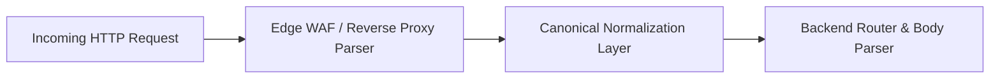

# Reverse-Proxy, Edge Filter & Backend Parser Alignment Auditor (`viper-proxy-parser-alignment`)

## 1. Executive Scope, Standards & CWE/OWASP Mapping
- **Frameworks & Standards:** OWASP WSTG-CONF, RFC 9110/9112 (HTTP Semantics), CWE-436 (Interpretation Conflict), CWE-178
- **Primary CWE Mapping:** CWE-436 (Interpretation Conflict Between Edge Proxy and Backend), CWE-235 (Improper Handling of Extra Parameters / HPP), CWE-444 (Inconsistent Interpretation of HTTP Requests)
- **ViperClaw MCP Tools:** `viper_fingerprint_traffic`, `viper_diff_oracle`, `viper_verify_and_report`
- **ViperClaw CLI Command:** `viperclaw fingerprint ./traffic.har --output proxy_audit.json`

---

## 2. Threat Model & Root-Cause Architecture



### Root-Cause Analysis
Defense-in-depth controls fail when an upstream edge proxy or WAF parses paths, headers, query parameters, or body encodings differently from the downstream web framework (e.g., Nginx vs. Spring path matrix parameters `/admin;v=1`, duplicate JSON keys, or mismatched `Content-Type` handling).

---

## 3. Deterministic Discovery & Grep/AST Audit Commands

Run the following discovery commands across the target repository before manual code review:

```bash
# 1. Automated ViperClaw analysis
viperclaw fingerprint ./traffic.har --output proxy_audit.json

# 2. Rapid static pattern discovery (ripgrep)
rg -n "(Content-Type|application/x-www-form-urlencoded|multipart/form-data|application/json)"
rg -n "(req\.query|request\.args|request\.GET|parse_qs)"
rg -n "(Transfer-Encoding|Content-Length|X-Original-URL|X-Rewrite-URL)"
```

---

## 4. Senior Security Engineer 8-Point Audit Checklist

| Control ID | Audit Verification Target | Pass Criteria | Fail / Vulnerability Indicator |
| :---: | :--- | :--- | :--- |
| `EDGE-01` | **Strict Content-Type Allowlisting** | Backend controllers explicitly reject requests whose `Content-Type` does not match the endpoint contract (e.g., `415 Unsupported Media Type`). | JSON endpoint also accepts `application/x-www-form-urlencoded` or `text/plain`, causing parser mismatch with edge rules or CSRF preflights. |
| `EDGE-02` | **Path Normalization Consistency** | Reverse proxy and backend normalize `;` matrix parameters, `%2f` encoded slashes, and dot-segments identically. | Proxy ACL restricts `/admin/*` while normalized variants reach downstream routing handlers. |
| `EDGE-03` | **HTTP Parameter Precedence (HPP)** | Duplicate query parameters (`?role=user&role=admin`) are rejected or handled with identical precedence across proxy and app. | Edge validator checks the first value while Express/PHP/Python reads the last value or a list. |
| `EDGE-04` | **Duplicate JSON Key Rejection** | JSON parsers reject bodies containing duplicate object keys (`{"admin":false,"admin":true}`). | Upstream validator checks the first key while downstream parser keeps the last key. |
| `EDGE-05` | **Routing Override Header Stripping** | Edge proxy strips untrusted `X-Original-URL`, `X-Rewrite-URL`, `X-Forwarded-Host`, and `X-Forwarded-Prefix` headers. | Untrusted `X-Original-URL` header accepted by downstream middleware to alter resolved route path. |
| `EDGE-06` | **Body Size & Inspection Limit Alignment** | Maximum request body size at the reverse proxy is `<=` the edge filter's inspection limit (e.g., 8KB/64KB). | Backend accepts multi-megabyte bodies while upstream inspection stops at the first 8KB. |
| `EDGE-07` | **HTTP/1.1 Framing Consistency** | Front-end and back-end servers use HTTP/2 or normalize `Transfer-Encoding` and reject ambiguous `Content-Length` + `Transfer-Encoding` requests. | Ambiguous chunked framing accepted by edge proxy (CWE-444). |
| `EDGE-08` | **Code-Level Root-Cause Remediation** | Validation and access control are enforced directly in application handlers rather than relying solely on edge rules. | Authorization or parameterization omitted in application code behind regex edge filters. |

---

## 5. False-Positive Elimination & CVSS v3.1 Triage Rubric

### False-Positive Gate
1. Verify whether an upstream API Gateway, global middleware, or ORM hook already enforces the control before flagging a controller.
2. Confirm the code path is reachable from an external entrypoint (not dead code, CLI-only admin script, or unit-test fixture).

| Severity Tier | Baseline CVSS v3.1 Vector | Qualifying Security Impact |
| :--- | :--- | :--- |
| **CRITICAL (9.1)** | `CVSS:3.1/AV:N/AC:L/PR:N/UI:N/S:U/C:H/I:H/A:N` | Path normalization or `X-Original-URL` mismatch circumventing access checks on restricted endpoints. |
| **HIGH (7.5)** | `CVSS:3.1/AV:N/AC:L/PR:N/UI:N/S:U/C:H/I:N/A:N` | Duplicate JSON key or parameter precedence mismatch circumventing input validation filters. |
| **MEDIUM (5.3)** | `CVSS:3.1/AV:N/AC:L/PR:N/UI:N/S:U/C:N/I:L/A:N` | Unrestricted Content-Type acceptance or missing header stripping at the reverse proxy. |

---

## 6. Production Remediation Patterns (Vulnerable vs. Hardened Code)

```nginx
# ❌ VULNERABLE: Passes untrusted X-Original-URL & unnormalized path directly to backend
location / {
    proxy_pass http://backend_upstream;
}

# ✅ HARDENED: Strips routing override headers, caps body size to inspection limit & normalizes URI
location / {
    client_max_body_size 64k;
    proxy_set_header X-Original-URL "";
    proxy_set_header X-Rewrite-URL "";
    proxy_set_header X-Forwarded-Host $host;
    proxy_pass http://backend_upstream;
}
```

---

## 7. Regression Testing & Continuous Verification
1. Write a **Positive Unit Test** confirming authorized, schema-valid requests succeed.
2. Write a **Negative Security Regression Test** confirming unauthorized, cross-tenant, or malformed inputs are deterministically rejected.
3. Re-run `viperclaw taint` and `viperclaw verify` to confirm zero remaining unmitigated flows in `.viperclaw/graph.db`.
