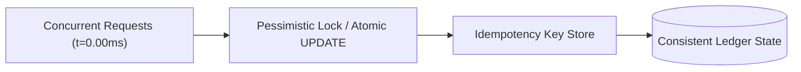

# Concurrency, TOCTOU Race Condition & Business Logic Auditor (`viper-race-logic`)

## 1. Executive Scope, Standards & CWE/OWASP Mapping
- **Frameworks & Standards:** OWASP Top 10:2025 A04 (Insecure Design), OWASP API6:2023, CWE-362, CWE-841
- **Primary CWE Mapping:** CWE-362 (Concurrent Execution using Shared Resource with Improper Synchronization / Race Condition), CWE-367 (TOCTOU), CWE-841 (Improper Enforcement of Behavioral Workflow)
- **ViperClaw MCP Tools:** `viper_race_burst`, `viper_diff_oracle`, `viper_verify_and_report`
- **ViperClaw CLI Command:** `viperclaw race https://api.example.com/v1/redeem -X POST -d "code=PROMO" -c 15`

---

## 2. Threat Model & Root-Cause Architecture



### Root-Cause Analysis
Applications read a state value (`SELECT balance, redeemed FROM ...`), validate it in application memory (`if balance >= amount`), and issue a separate `UPDATE` statement without a row lock (`FOR UPDATE`) or atomic `WHERE` predicate, allowing parallel requests arriving within the same 5–50ms DB round-trip window to pass the check simultaneously.

---

## 3. Deterministic Discovery & Grep/AST Audit Commands

Run the following discovery commands across the target repository before manual code review:

```bash
# 1. Automated ViperClaw analysis
viperclaw race https://api.example.com/v1/redeem -X POST -d "code=PROMO" -c 15

# 2. Rapid static pattern discovery (ripgrep)
rg -n "(SELECT\s+.*balance|with_for_update|FOR UPDATE|select_for_update|SERIALIZABLE)"
rg -n "(idempotency_key|Idempotency-Key|redis\.setnx|SET .* NX)"
rg -n "(coupon|redeem|withdraw|transfer|vote|credit|quota)"
```

---

## 4. Senior Security Engineer 8-Point Audit Checklist

| Control ID | Audit Verification Target | Pass Criteria | Fail / Vulnerability Indicator |
| :---: | :--- | :--- | :--- |
| `RACE-01` | **Atomic Conditional SQL Updates** | Balance/inventory deductions execute `UPDATE accounts SET balance = balance - :amt WHERE id = :id AND balance >= :amt` and check `rowcount == 1`. | Separate `SELECT balance` followed by unconditional `UPDATE accounts SET balance = :new_bal`. |
| `RACE-02` | **Pessimistic Row Locking (`FOR UPDATE`)** | Multi-query read-modify-write transactions lock rows with `SELECT ... FOR UPDATE` (`with_for_update()`). | Read-Committed transaction reads mutable state without row locking before writing. |
| `RACE-03` | **Database Unique Constraints on One-Time Actions** | Coupon redemptions, likes, referrals, and invite claims enforce a composite `UNIQUE(user_id, coupon_id)` DB index. | Uniqueness checked only in application code (`if not Redeemed.exists(...)`) before `INSERT`. |
| `RACE-04` | **Idempotency Key Enforcement** | Financial/mutation endpoints require an `Idempotency-Key` header locked atomically via `INSERT ... ON CONFLICT DO NOTHING` or Redis `SET NX`. | Retried or parallel POST requests execute duplicate charges or state transitions. |
| `RACE-05` | **Multi-Step Workflow State Verification** | Step 3 of a checkout/KYC/reset flow verifies in the server session that Steps 1 and 2 were completed for the same transaction. | Client can call `POST /checkout/confirm` directly without completing `POST /checkout/pay`. |
| `RACE-06` | **Negative & Zero Boundary Validation** | Quantities, transfer amounts, and pagination offsets enforce `val > 0` and upper bounds. | Transferring `-100` credits increases the sender's balance. |
| `RACE-07` | **Distributed Lock Lease Safety** | Redis/distributed locks use unique lock tokens and Lua compare-and-delete scripts with sufficient TTL. | Worker A's lock expires mid-operation and Worker A deletes Worker B's newly acquired lock. |
| `RACE-08` | **Rate-Limit Counter Atomicity** | Rate-limit counters increment atomically (`INCR` + `EXPIRE` in Lua) rather than `GET` then `SET`. | Parallel burst requests read the same counter value (`9/10`) and exceed the rate limit. |

---

## 5. False-Positive Elimination & CVSS v3.1 Triage Rubric

### False-Positive Gate
1. Verify whether an upstream API Gateway, global middleware, or ORM hook already enforces the control before flagging a controller.
2. Confirm the code path is reachable from an external entrypoint (not dead code, CLI-only admin script, or unit-test fixture).

| Severity Tier | Baseline CVSS v3.1 Vector | Qualifying Security Impact |
| :--- | :--- | :--- |
| **CRITICAL (9.1)** | `CVSS:3.1/AV:N/AC:L/PR:L/UI:N/S:U/C:N/I:H/A:H` | TOCTOU race condition allowing unlimited balance withdrawal, gift-card duplication, or privilege escalation. |
| **HIGH (7.5)** | `CVSS:3.1/AV:N/AC:L/PR:L/UI:N/S:U/C:N/I:H/A:N` | Single-use coupon, referral bonus, or seat quota overrun via concurrent requests. |
| **MEDIUM (5.3)** | `CVSS:3.1/AV:N/AC:H/PR:L/UI:N/S:U/C:N/I:L/A:N` | Non-financial counter or vote/rating manipulation via parallel requests. |

---

## 6. Production Remediation Patterns (Vulnerable vs. Hardened Code)

```python
# ❌ VULNERABLE: Classic read-then-write TOCTOU window (no row lock, no atomic predicate)
def withdraw_funds(db: Session, account_id: int, amount: int):
    acct = db.query(Account).filter(Account.id == account_id).first()
    if acct.balance < amount:
        raise ValueError("Insufficient funds")
    acct.balance -= amount
    db.commit()

# ✅ HARDENED: Atomic conditional UPDATE + positive amount check inside transaction
def withdraw_funds(db: Session, account_id: int, amount: int):
    if amount <= 0:
        raise ValueError("Amount must be positive")
    updated = (
        db.query(Account)
        .filter(Account.id == account_id, Account.balance >= amount)
        .update({Account.balance: Account.balance - amount}, synchronize_session=False)
    )
    if updated != 1:
        db.rollback()
        raise ValueError("Insufficient funds or concurrent modification")
    db.commit()
```

---

## 7. Regression Testing & Continuous Verification
1. Write a **Positive Unit Test** confirming authorized, schema-valid requests succeed.
2. Write a **Negative Security Regression Test** confirming unauthorized, cross-tenant, or malformed inputs are deterministically rejected.
3. Re-run `viperclaw taint` and `viperclaw verify` to confirm zero remaining unmitigated flows in `.viperclaw/graph.db`.
