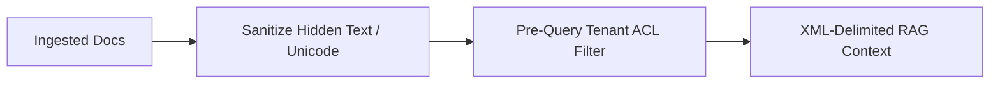

# ViperClaw Skill 36: RAG Pipeline & Vector Database Security Auditor (`viper-rag-vector-audit`)

## 1. Standards & Open-Source Reference
- **Standards:** OWASP LLM01 (Indirect Prompt Injection), OWASP LLM06 (Sensitive Information Disclosure), OWASP LLM08 (Vector and Embedding Weaknesses).
- **Focus:** Auditing Retrieval-Augmented Generation (RAG) ingestion pipelines, vector store queries (`pgvector`, Pinecone, Qdrant, Weaviate, Milvus, Chroma), and context assembly.

---

## 2. Threat Model & Trust-Boundary Architecture



### Automated ViperClaw Command
```bash
viperclaw taint . --db .viperclaw/graph.db
```

---

## 3. Rapid Discovery Patterns
- Search for vector queries: `.similarity_search(`, `.query(vector=`, ` <=> `, ` <-> `, ` VectorStoreIndex`, `RetrievalQA`.
- Check whether `filter=` / `where=` metadata predicates include the authenticated caller's `tenant_id` and `user_id`.

---

## 4. Senior Security Engineer Technical Audit Checklist
1. **Mandatory Pre-Query Tenant & ACL Filtering:** Vector similarity searches must enforce mandatory metadata filters (`filter={"tenant_id": current_user.tenant_id, "acl_groups": {"$in": user.groups}}`) *inside* the vector index query—never rely on LLM prompt instructions to ignore unauthorized chunks.
2. **Document Ingestion Sanitization:** Strip hidden HTML/CSS (`display:none`, `font-size:0`, white-on-white text), invisible Unicode tag characters (`U+E0000`–`U+E007F`), and PDF annotation layers during document chunking.
3. **Untrusted Context Delimiting:** Wrap retrieved RAG chunks in explicit XML/JSON data tags (`<retrieved_document source_id="...">...</retrieved_document>`) and instruct the system prompt to treat contents strictly as passive reference data.
4. **Citation & Grounding Verification:** Validate that any URLs or markdown images emitted in the LLM's response match domains present in the authorized retrieved documents (preventing unapproved external image beacons).
5. **Permission Sync on Document Revocation:** Ensure deleting or revoking access to a source document immediately deletes or updates its corresponding vector embeddings.

---

## 5. Production Remediation Patterns (Vulnerable vs. Hardened Code)
```python
# ❌ VULNERABLE: Global similarity search across all tenants
docs = vector_store.similarity_search(user_query, k=5)

# ✅ HARDENED: Pre-filtered vector search scoped to verified tenant & role
docs = vector_store.similarity_search(
    user_query,
    k=5,
    filter={"tenant_id": session.verified_tenant_id, "visibility": {"$in": session.allowed_scopes}},
)
```

---

## 6. False-Positive Elimination & CVSS v3.1 Triage Rubric

### False-Positive Elimination Gate
1. **Reachability & Boundary Check:** Confirm the flagged pattern or configuration is reachable across a trust boundary in production (not an isolated unit-test mock, build-time sample, or dead code path).
2. **Upstream Control Verification:** Check whether an upstream gateway, middleware, database policy, or compiler flag already neutralizes the weakness before marking a finding as verified.
3. **Standards Reference:** `OWASP LLM01, LLM06, LLM08, CWE-284, CWE-200`

| Severity Tier | Baseline CVSS v3.1 Vector | Qualifying Security Impact |
| :--- | :--- | :--- |
| **CRITICAL (9.0–10.0)** | `CVSS:3.1/AV:N/AC:L/PR:N/UI:N/S:C/C:H/I:H/A:H` | Unauthenticated remote code execution, cross-tenant authentication or isolation gap, or direct theft of funds/keys. |
| **HIGH (7.0–8.9)** | `CVSS:3.1/AV:N/AC:L/PR:L/UI:N/S:U/C:H/I:H/A:N` | Authenticated privilege escalation, unauthorized sensitive data exposure, or single-request service outage. |
| **MEDIUM (4.0–6.9)** | `CVSS:3.1/AV:N/AC:L/PR:L/UI:R/S:C/C:L/I:L/A:N` | Scoped information disclosure, non-admin state mutation, or configuration weakness requiring user interaction. |
| **LOW (0.1–3.9)** | `CVSS:3.1/AV:N/AC:H/PR:H/UI:N/S:U/C:L/I:N/A:N` | Defense-in-depth hardening gap requiring high precondition complexity and minimal direct impact. |

---

## 7. Regression Testing & Continuous Verification
1. **Positive Functional Test:** Verify that legitimate callers and valid inputs continue to succeed after applying the hardened pattern.
2. **Negative Security Regression Test:** Write an automated unit/integration test confirming that the vulnerable input, unauthenticated call, or misconfiguration is deterministically rejected.
3. **Graph & SARIF Verification:** Run `viperclaw taint . --db .viperclaw/graph.db` and `viperclaw verify` to record the verified state in `.viperclaw/graph.db`.
