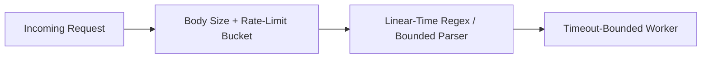

# Rate Limiting, ReDoS & Resource Exhaustion Resilience Auditor (`viper-rate-limit-dos-resilience`)

## 1. Executive Scope, Standards & CWE/OWASP Mapping
- **Frameworks & Standards:** OWASP API4:2023 (Unrestricted Resource Consumption), OWASP Denial of Service Cheat Sheet, CWE-1333, CWE-400, CWE-307
- **Primary CWE Mapping:** CWE-1333 (Inefficient Regular Expression Complexity / ReDoS), CWE-400 (Uncontrolled Resource Consumption), CWE-307 (Improper Restriction of Excessive Authentication Attempts)
- **ViperClaw MCP Tools:** `viper_taint_scan`, `viper_race_burst`, `viper_verify_and_report`
- **ViperClaw CLI Command:** `viperclaw taint ./src --db .viperclaw/graph.db`

---

## 2. Threat Model & Root-Cause Architecture



### Root-Cause Analysis
Single-request Denial of Service (DoS) occurs when a route evaluates a catastrophic backtracking regex (`^([a-zA-Z0-9]+)+$`) on a 50-character string (freezing the Python GIL or Node.js event loop for minutes), accepts multi-gigabyte request bodies or JSON/XML bodies without `Content-Length` caps, or allows unlimited credential-guessing attempts on 6-digit OTPs.

---

## 3. Deterministic Discovery & Grep/AST Audit Commands

Run the following discovery commands across the target repository before manual code review:

```bash
# 1. Automated ViperClaw analysis
viperclaw taint ./src --db .viperclaw/graph.db

# 2. Rapid static pattern discovery (ripgrep)
rg -n "re\.(compile|match|search|sub)\(.*(\+\)|\*\))[\+\*\{]"
rg -n "(MAX_CONTENT_LENGTH|client_max_body_size|bodyParser\.json\(\{.*limit)"
rg -n "(ratelimit|RateLimiter|SlowAPI|throttler)"
```

---

## 4. Senior Security Engineer 8-Point Audit Checklist

| Control ID | Audit Verification Target | Pass Criteria | Fail / Vulnerability Indicator |
| :---: | :--- | :--- | :--- |
| `DOS-01` | **Auth & OTP Credential-Throttling Limits** | Login, 2FA/OTP verification, and password reset enforce strict per-account AND per-IP rate limits (e.g., max 5 attempts per 15m before invalidating the OTP). | 6-digit OTP endpoint allows 1,000,000 requests without invalidating the code or locking out. |
| `DOS-02` | **Zero Catastrophic Backtracking Regexes (ReDoS)** | All regular expressions evaluated on user input avoid nested quantifiers (`(a+)+`, `(a|aa)+`, `([a-z]+)*`), or use linear-time `google-re2`. | Email/URL validation regex uses `^([a-zA-Z0-9_\.-]+)+@...` (freezes CPU on 32-char non-matching input). |
| `DOS-03` | **Request Body & Multipart Size Caps** | Web server and framework enforce explicit body size limits (e.g., `1MB` for JSON APIs, `10MB` for uploads). | Missing `MAX_CONTENT_LENGTH` allows a single `POST` of 2GB JSON to OOM-kill the worker pod. |
| `DOS-04` | **Expensive Operation & AI/Export Quotas** | PDF generation, CSV exports, password hashing, and LLM API routes enforce strict per-user concurrency and daily quota caps. | Unthrottled `/api/export-all` or `/api/chat` route allows exhausting DB CPU or LLM billing. |
| `DOS-05` | **Password Input Length Cap Before Hashing (`<= 128` bytes)** | Password strings are capped at `<= 128` characters before passing to `bcrypt` / `Argon2` / `PBKDF2`. | Passing a 10MB password string into `PBKDF2` / `Argon2` blocks the worker thread for several seconds per request. |
| `DOS-06` | **Trusted Proxy IP Resolution for Rate Limiters** | Rate limiters extract client IP from the rightmost trusted proxy hop, never an unvalidated client `X-Forwarded-For` header. | Clients send arbitrary `X-Forwarded-For: 1.2.3.4` headers to circumvent IP rate limiting. |
| `DOS-07` | **Database & Upstream Outbound Timeouts** | Every DB query (`statement_timeout`) and outbound HTTP/RPC call defines an explicit timeout (e.g., `3s`–`10s`). | requests.get(url) called without `timeout=`, hanging worker threads indefinitely when upstream stalls. |
| `DOS-08` | **JSON Nesting Depth & Array Length Bounds** | JSON parsers and schema validators cap maximum object nesting depth and array element counts. | 10,000-element array passed to a batch endpoint triggers $O(N^2)$ processing or 10,000 sequential DB queries. |

---

## 5. False-Positive Elimination & CVSS v3.1 Triage Rubric

### False-Positive Gate
1. Verify whether an upstream API Gateway, global middleware, or ORM hook already enforces the control before flagging a controller.
2. Confirm the code path is reachable from an external entrypoint (not dead code, CLI-only admin script, or unit-test fixture).

| Severity Tier | Baseline CVSS v3.1 Vector | Qualifying Security Impact |
| :--- | :--- | :--- |
| **HIGH (8.1)** | `CVSS:3.1/AV:N/AC:L/PR:N/UI:N/S:U/C:H/I:H/A:N` | Missing rate limit and attempt cap on 4/6-digit OTP/reset code allowing trivial account takeover. |
| **HIGH (7.5)** | `CVSS:3.1/AV:N/AC:L/PR:N/UI:N/S:U/C:N/I:N/A:H` | Unauthenticated ReDoS regex or unbounded memory allocation crashing the application server in a single request. |
| **MEDIUM (5.3)** | `CVSS:3.1/AV:N/AC:L/PR:L/UI:N/S:U/C:N/I:N/A:L` | Rate limit avoidable via untrusted `X-Forwarded-For` header or missing password max-length cap. |

---

## 6. Production Remediation Patterns (Vulnerable vs. Hardened Code)

```python
# ❌ VULNERABLE: Catastrophic backtracking regex (ReDoS) & uncapped password length into bcrypt
SLUG_RE = re.compile(r"^([a-z0-9]+(-[a-z0-9]+)*)+$")

def verify_login(slug: str, password: str, stored_hash: bytes) -> bool:
    if not SLUG_RE.match(slug):
        return False
    return bcrypt.checkpw(password.encode("utf-8"), stored_hash)

# ✅ HARDENED: Linear-time non-nested regex + strict input length caps before hashing
SLUG_RE = re.compile(r"^[a-z0-9]+(?:-[a-z0-9]+)*$")

def verify_login(slug: str, password: str, stored_hash: bytes) -> bool:
    if len(slug) > 64 or len(password) > 128 or not SLUG_RE.match(slug):
        return False
    return bcrypt.checkpw(password.encode("utf-8"), stored_hash)
```

---

## 7. Regression Testing & Continuous Verification
1. Write a **Positive Unit Test** confirming authorized, schema-valid requests succeed.
2. Write a **Negative Security Regression Test** confirming unauthorized, cross-tenant, or malformed inputs are deterministically rejected.
3. Re-run `viperclaw taint` and `viperclaw verify` to confirm zero remaining unmitigated flows in `.viperclaw/graph.db`.
