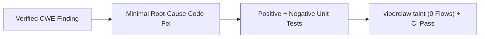

# Root-Cause Security Patch Synthesizer & Regression Test Verifier (`viper-remediation-patch-verifier`)

## 1. Executive Scope, Standards & CWE/OWASP Mapping
- **Frameworks & Standards:** OWASP ASVS, NIST SSDF (Secure Software Development Framework), SARIF v2.1.0 Verification
- **Primary CWE Mapping:** CWE-693 (Protection Mechanism Failure / Incomplete Fix), CWE-184 (Incomplete List of Disallowed Inputs)
- **ViperClaw MCP Tools:** `viper_taint_scan`, `viper_verify_and_report`
- **ViperClaw CLI Command:** `viperclaw taint ./src && pytest -v`

---

## 2. Threat Model & Root-Cause Architecture



### Root-Cause Analysis
Many security patches fail verification testing because developers patch the *symptom* (adding a naive blacklist like `.replace("'", "")` or `.replace("../", "")`) instead of fixing the structural *root cause* (using parameterized SQL statements, canonical path resolution with `.is_relative_to()`, or query-level tenant scoping).

---

## 3. Deterministic Discovery & Grep/AST Audit Commands

Run the following discovery commands across the target repository before manual code review:

```bash
# 1. Automated ViperClaw analysis
viperclaw taint ./src && pytest -v

# 2. Rapid static pattern discovery (ripgrep)
viperclaw taint ./src
pytest -v
```

---

## 4. Senior Security Engineer 8-Point Audit Checklist

| Control ID | Audit Verification Target | Pass Criteria | Fail / Vulnerability Indicator |
| :---: | :--- | :--- | :--- |
| `FIX-01` | **Eliminate Blacklists in Favor of Structural Controls** | Fixes use parameterization, strict type/enum allowlists, or canonicalization—never substring blacklists. | Patch adds `input.replace('../', '')` (trivially circumvented by `....//`). |
| `FIX-02` | **Minimal Diff & Backward Compatibility** | Patch modifies only the necessary security boundary without breaking existing API contracts or valid inputs. | Overly broad patch breaks legitimate unicode names, special characters in passwords, or API response schemas. |
| `FIX-03` | **Variant Analysis Across Entire Codebase** | When fixing a bug in one controller, all sibling controllers/services are scanned for the same pattern. | BOLA or SQLi fixed on `GET /invoices/{id}` while `DELETE /invoices/{id}` and `GET /quotes/{id}` remain vulnerable. |
| `FIX-04` | **Positive Functional Regression Test** | Automated test confirms authorized users with valid inputs still receive the expected `200 OK` result. | Security patch accidentally blocks all users (`403` for everyone) and goes unnoticed without a positive test. |
| `FIX-05` | **Negative Security Regression Test** | Automated test sends the previously problematic input (cross-tenant ID, unparameterized metacharacters, expired token) and asserts rejection (`400`/`403`/`404`). | No regression test added; a future refactor re-introduces the exact same vulnerability. |
| `FIX-06` | **Zero Remaining Taint Flows (`viperclaw taint`)** | Re-running `viperclaw taint` on the patched file confirms `total_flows == 0` for the remediated sink. | Taint flow still reaches a secondary sink in the same function. |
| `FIX-07` | **Fail-Closed Exception Handling** | Any validation or authorization error raises an explicit exception / `403` rather than logging a warning and continuing. | `except Exception: pass` swallows the security check failure and proceeds to execute the sink. |
| `FIX-08` | **Update Graph Node Status to `verified` / `remediated`** | The corresponding finding node in `.viperclaw/graph.db` is updated and documented. | Audit ledger left out of sync with remediated codebase. |

---

## 5. False-Positive Elimination & CVSS v3.1 Triage Rubric

### False-Positive Gate
1. Verify whether an upstream API Gateway, global middleware, or ORM hook already enforces the control before flagging a controller.
2. Confirm the code path is reachable from an external entrypoint (not dead code, CLI-only admin script, or unit-test fixture).

| Severity Tier | Baseline CVSS v3.1 Vector | Qualifying Security Impact |
| :--- | :--- | :--- |
| **CRITICAL -> 0.0** | `Remediated (CVSS 0.0)` | Root-cause parameterization / isolation applied + verified by automated negative regression test. |
| **INCOMPLETE FIX** | `CVSS Unchanged` | Blacklist or client-side-only fix that remains avoidable via encoding or direct API calls. |

---

## 6. Production Remediation Patterns (Vulnerable vs. Hardened Code)

```python
# ❌ INCOMPLETE SYMPTOM PATCH: Non-recursive string replace('..', '') is circumvented by '....//'
def get_template_file(name: str) -> str:
    clean_name = name.replace("../", "")
    return Path(f"/app/templates/{clean_name}").read_text()

# ✅ ROOT-CAUSE PATCH + REGRESSION TEST: Canonical path confinement + negative unit test
TEMPLATE_ROOT = Path("/app/templates").resolve()

def get_template_file(name: str) -> str:
    target = (TEMPLATE_ROOT / name).resolve()
    if not target.is_relative_to(TEMPLATE_ROOT) or not target.is_file():
        raise PermissionError("Unauthorized template path")
    return target.read_text(encoding="utf-8")

def test_get_template_file_blocks_traversal():
    with pytest.raises(PermissionError):
        get_template_file("....//....//etc/passwd")
```

---

## 7. Regression Testing & Continuous Verification
1. Write a **Positive Unit Test** confirming authorized, schema-valid requests succeed.
2. Write a **Negative Security Regression Test** confirming unauthorized, cross-tenant, or malformed inputs are deterministically rejected.
3. Re-run `viperclaw taint` and `viperclaw verify` to confirm zero remaining unmitigated flows in `.viperclaw/graph.db`.
