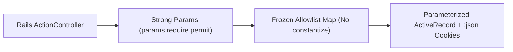

# ViperClaw Skill 44: Ruby on Rails & Rack Security Auditor (`viper-ruby-rails-audit`)

## 1. Standards & Open-Source Reference
- **Standards:** Brakeman SAST ruleset, Official Ruby on Rails Security Guide, OWASP Ruby on Rails Cheat Sheet.
- **Focus:** Auditing Rails controllers, ActiveRecord queries, ERB views, and background workers (Sidekiq).

---

## 2. Threat Model & Trust-Boundary Architecture



### Automated ViperClaw Command
```bash
viperclaw taint . --db .viperclaw/graph.db
```

---

## 3. Rapid Discovery Patterns
- Search for `params.permit!`, `.constantize`, `.public_send(`, `.send(`, `render inline:`, `.html_safe`, `raw(`, `Kernel.open(`, `YAML.load(`.

---

## 4. Senior Security Engineer Technical Audit Checklist
1. **Strong Parameters Enforcement:** Never call `params.permit!` or include `role`, `admin`, or `organization_id` in standard `params.require(:user).permit(...)` lists.
2. **ActiveRecord SQL Interpolation:** Never use Ruby string interpolation `"name = '#{params[:name]}'"` inside `.where()`, `.order()`, `.pluck()`, or `.find_by_sql()`; use hash conditions `.where(name: params[:name])` or placeholder arrays `.where("name = ?", params[:name])`.
3. **Dynamic Class / Method Dispatch (`constantize` & `send`):** Never call `params[:type].constantize` or `obj.send(params[:action])` directly on user input; map allowed string keys through a frozen Hash allowlist.
4. **Command Injection in `Kernel.open` / `IO.read`:** In Ruby, passing a string starting with `|` to `Kernel.open("|whoami")` executes a shell command! Always use `File.open` or `URI.open` with explicit scheme validation.
5. **ERB XSS & Session Serializer Hardening:** Avoid `.html_safe`, `raw()`, and `render inline:`; ensure `config.action_dispatch.cookies_serializer = :json` (never `:marshal` or `:hybrid`).

---

## 5. Production Remediation Patterns (Vulnerable vs. Hardened Code)
```ruby
# ❌ VULNERABLE: String interpolation in ActiveRecord & dynamic constantize
users = User.where("email = '#{params[:email]}'")
klass = params[:report_type].classify.constantize

# ✅ HARDENED: Bound parameters & explicit constant allowlist
users = User.where(email: params[:email].to_s)
REPORT_TYPES = { "daily" => DailyReport, "monthly" => MonthlyReport }.freeze
klass = REPORT_TYPES.fetch(params[:report_type])
```

---

## 6. False-Positive Elimination & CVSS v3.1 Triage Rubric

### False-Positive Elimination Gate
1. **Reachability & Boundary Check:** Confirm the flagged pattern or configuration is reachable across a trust boundary in production (not an isolated unit-test mock, build-time sample, or dead code path).
2. **Upstream Control Verification:** Check whether an upstream gateway, middleware, database policy, or compiler flag already neutralizes the weakness before marking a finding as verified.
3. **Standards Reference:** `Brakeman, Rails Security Guide, CWE-89, CWE-470, CWE-502`

| Severity Tier | Baseline CVSS v3.1 Vector | Qualifying Security Impact |
| :--- | :--- | :--- |
| **CRITICAL (9.0–10.0)** | `CVSS:3.1/AV:N/AC:L/PR:N/UI:N/S:C/C:H/I:H/A:H` | Unauthenticated remote code execution, cross-tenant authentication or isolation gap, or direct theft of funds/keys. |
| **HIGH (7.0–8.9)** | `CVSS:3.1/AV:N/AC:L/PR:L/UI:N/S:U/C:H/I:H/A:N` | Authenticated privilege escalation, unauthorized sensitive data exposure, or single-request service outage. |
| **MEDIUM (4.0–6.9)** | `CVSS:3.1/AV:N/AC:L/PR:L/UI:R/S:C/C:L/I:L/A:N` | Scoped information disclosure, non-admin state mutation, or configuration weakness requiring user interaction. |
| **LOW (0.1–3.9)** | `CVSS:3.1/AV:N/AC:H/PR:H/UI:N/S:U/C:L/I:N/A:N` | Defense-in-depth hardening gap requiring high precondition complexity and minimal direct impact. |

---

## 7. Regression Testing & Continuous Verification
1. **Positive Functional Test:** Verify that legitimate callers and valid inputs continue to succeed after applying the hardened pattern.
2. **Negative Security Regression Test:** Write an automated unit/integration test confirming that the vulnerable input, unauthenticated call, or misconfiguration is deterministically rejected.
3. **Graph & SARIF Verification:** Run `viperclaw taint . --db .viperclaw/graph.db` and `viperclaw verify` to record the verified state in `.viperclaw/graph.db`.
