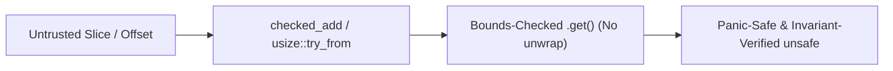

# ViperClaw Skill 41: Rust Memory, `unsafe` & Integer Safety Auditor (`viper-rust-memory-unsafe`)

## 1. Standards & Open-Source Reference
- **Standards:** RustSec Advisory DB, Rudra (memory-safety analyzer), ANSSI Rust Secure Coding Guide, Clippy `undocumented_unsafe_blocks`.
- **Focus:** Auditing Rust systems code, Web/Axum/Actix services, FFI boundaries, and cryptographic crates.

---

## 2. Threat Model & Trust-Boundary Architecture



### Automated ViperClaw Command
```bash
viperclaw taint . --db .viperclaw/graph.db
```

---

## 3. Rapid Discovery Patterns
- Search for `unsafe `, `std::mem::transmute`, `from_raw_parts`, `set_len`, `as usize`, `unwrap()`, `unsafe impl Send`, `unsafe impl Sync`.

---

## 4. Senior Security Engineer Technical Audit Checklist
1. **`unsafe` Invariant & `set_len` Auditing:** Audit every `unsafe` block to ensure pointer alignment, non-nullability, lifetime validity, and initialization invariants hold even if a caller-supplied closure panics (Rudra panic-safety pattern; never call `Vec::set_len` *before* initializing elements).
2. **Release-Mode Integer Overflow & Cast Truncation:** In Cargo `--release` builds, standard `+`, `*`, and `-` wrap silently by default! Use `.checked_add()`, `.saturating_mul()`, or `overflow-checks = true` in `Cargo.toml`, and use `usize::try_from(val)` instead of truncating `as` casts.
3. **Manual `Send` / `Sync` Soundness:** Audit every `unsafe impl Send` and `unsafe impl Sync` to confirm interior mutability (`UnsafeCell`, raw pointers) is protected by atomic operations or locks.
4. **DoS via `.unwrap()` / `.expect()` on Untrusted Input:** Never call `.unwrap()`, `.expect()`, or slice indexing `buf[idx]` on network-supplied inputs inside request handlers; use `.get(idx)` and propagate errors with `?`.
5. **FFI Boundary Null & Aliasing Safety:** Validate C pointers for `is_null()` before dereferencing, catch Rust panics with `std::panic::catch_unwind` before crossing `extern "C"` boundaries, and bound buffer lengths.

---

## 5. Production Remediation Patterns (Vulnerable vs. Hardened Code)
```rust
// ❌ VULNERABLE: wraps in release builds & panics on out-of-bounds slice
pub fn read_frame(buf: &[u8], offset: u32, len: u32) -> &[u8] {
    let end = (offset + len) as usize;
    &buf[offset as usize..end]
}

// ✅ HARDENED: Checked arithmetic and non-panicking slice lookup
pub fn read_frame(buf: &[u8], offset: u32, len: u32) -> Option<&[u8]> {
    let start = usize::try_from(offset).ok()?;
    let end = start.checked_add(usize::try_from(len).ok()?)?;
    buf.get(start..end)
}
```

---

## 6. False-Positive Elimination & CVSS v3.1 Triage Rubric

### False-Positive Elimination Gate
1. **Reachability & Boundary Check:** Confirm the flagged pattern or configuration is reachable across a trust boundary in production (not an isolated unit-test mock, build-time sample, or dead code path).
2. **Upstream Control Verification:** Check whether an upstream gateway, middleware, database policy, or compiler flag already neutralizes the weakness before marking a finding as verified.
3. **Standards Reference:** `RustSec, Rudra, ANSSI Rust Guide, CWE-119, CWE-190`

| Severity Tier | Baseline CVSS v3.1 Vector | Qualifying Security Impact |
| :--- | :--- | :--- |
| **CRITICAL (9.0–10.0)** | `CVSS:3.1/AV:N/AC:L/PR:N/UI:N/S:C/C:H/I:H/A:H` | Unauthenticated remote code execution, cross-tenant authentication or isolation gap, or direct theft of funds/keys. |
| **HIGH (7.0–8.9)** | `CVSS:3.1/AV:N/AC:L/PR:L/UI:N/S:U/C:H/I:H/A:N` | Authenticated privilege escalation, unauthorized sensitive data exposure, or single-request service outage. |
| **MEDIUM (4.0–6.9)** | `CVSS:3.1/AV:N/AC:L/PR:L/UI:R/S:C/C:L/I:L/A:N` | Scoped information disclosure, non-admin state mutation, or configuration weakness requiring user interaction. |
| **LOW (0.1–3.9)** | `CVSS:3.1/AV:N/AC:H/PR:H/UI:N/S:U/C:L/I:N/A:N` | Defense-in-depth hardening gap requiring high precondition complexity and minimal direct impact. |

---

## 7. Regression Testing & Continuous Verification
1. **Positive Functional Test:** Verify that legitimate callers and valid inputs continue to succeed after applying the hardened pattern.
2. **Negative Security Regression Test:** Write an automated unit/integration test confirming that the vulnerable input, unauthenticated call, or misconfiguration is deterministically rejected.
3. **Graph & SARIF Verification:** Run `viperclaw taint . --db .viperclaw/graph.db` and `viperclaw verify` to record the verified state in `.viperclaw/graph.db`.
