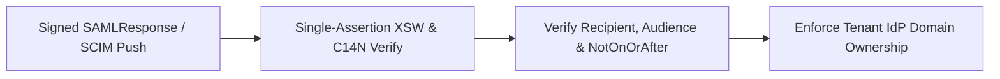

# ViperClaw Skill 47: Enterprise SAML 2.0, SCIM & SSO Security Auditor (`viper-saml-sso-enterprise`)

## 1. Standards & Open-Source Reference
- **Standards:** OASIS SAML 2.0 Security Considerations, OWASP SAML Security Cheat Sheet, RFC 7644 (SCIM).
- **Focus:** Auditing SAML 2.0 Service Providers (SP), XML signature verification, and SCIM directory sync endpoints.

---

## 2. Threat Model & Trust-Boundary Architecture



### Automated ViperClaw Command
```bash
viperclaw taint . --db .viperclaw/graph.db
```

---

## 3. Rapid Discovery Patterns
- Search for `SAMLResponse`, `Assertion`, `validateSignature`, `wantAssertionsSigned`, `wantMessagesSigned`, `InResponseTo`, `/scim/v2/Users`.

---

## 4. Senior Security Engineer Technical Audit Checklist
1. **XML Signature Wrapping (XSW) Prevention:** Verify that the SAML library validates the XML Digital Signature against the pinned IdP X.509 certificate *and* extracts the authenticated `NameID` / attributes **exclusively** from the exact DOM node referenced by the verified `<ds:Reference URI="#...">`, rejecting documents with multiple `<Assertion>` elements.
2. **XML Comments in `NameID` Canonicalization:** Ensure the SAML parser uses Exclusive XML Canonicalization *without comments* (`http://www.w3.org/2001/10/xml-exc-c14n#`) or reads `.textContent` after signature verification so `admin<!--comment-->@corp.com` cannot impersonate `admin@corp.com`.
3. **Mandatory `Recipient`, `Audience`, `NotOnOrAfter` & `InResponseTo` Validation:** Reject assertions missing `AudienceRestriction` matching your SP EntityID, expired timestamps, or replayed `Assertion` IDs; disable IdP-initiated SSO or bind `InResponseTo` to a server-issued `AuthnRequest` ID.
4. **Multi-Tenant IdP Mapping Isolation:** In multi-tenant SaaS, verify that an assertion signed by **Tenant A's IdP certificate** can only authenticate users whose email domain belongs to **Tenant A** (preventing a rogue tenant admin from asserting `ceo@other-tenant.com`).
5. **SCIM v2 Provisioning Endpoint Hardening:** Ensure `/scim/v2/Users` and `/scim/v2/Groups` validate tenant-scoped Bearer tokens, prevent cross-tenant `externalId` collisions, and immediately revoke active sessions when `active: false` is pushed via SCIM PATCH/PUT.

---

## 5. Production Remediation Patterns (Vulnerable vs. Hardened Code)
```python
# ❌ VULNERABLE: Accepts any tenant's IdP assertion for any email domain
idp_cert = get_idp_cert(request.form["tenant_slug"])
assertion = verify_saml_response(request.form["SAMLResponse"], idp_cert)
login_user_by_email(assertion.name_id)

# ✅ HARDENED: Enforces verified domain ownership binding between Tenant IdP and NameID
tenant = get_tenant_by_slug(request.form["tenant_slug"])
assertion = verify_saml_response(
    request.form["SAMLResponse"],
    cert=tenant.idp_x509_cert,
    expected_audience=SP_ENTITY_ID,
    expected_recipient=SP_ACS_URL,
)
email_domain = assertion.name_id.split("@")[-1].lower()
if email_domain not in tenant.verified_domains:
    raise PermissionError("IdP is not authorized to assert identities for this domain")
```

---

## 6. False-Positive Elimination & CVSS v3.1 Triage Rubric

### False-Positive Elimination Gate
1. **Reachability & Boundary Check:** Confirm the flagged pattern or configuration is reachable across a trust boundary in production (not an isolated unit-test mock, build-time sample, or dead code path).
2. **Upstream Control Verification:** Check whether an upstream gateway, middleware, database policy, or compiler flag already neutralizes the weakness before marking a finding as verified.
3. **Standards Reference:** `OASIS SAML 2.0, OWASP SAML Cheat Sheet, RFC 7644 (SCIM), CWE-347`

| Severity Tier | Baseline CVSS v3.1 Vector | Qualifying Security Impact |
| :--- | :--- | :--- |
| **CRITICAL (9.0–10.0)** | `CVSS:3.1/AV:N/AC:L/PR:N/UI:N/S:C/C:H/I:H/A:H` | Unauthenticated remote code execution, cross-tenant authentication or isolation gap, or direct theft of funds/keys. |
| **HIGH (7.0–8.9)** | `CVSS:3.1/AV:N/AC:L/PR:L/UI:N/S:U/C:H/I:H/A:N` | Authenticated privilege escalation, unauthorized sensitive data exposure, or single-request service outage. |
| **MEDIUM (4.0–6.9)** | `CVSS:3.1/AV:N/AC:L/PR:L/UI:R/S:C/C:L/I:L/A:N` | Scoped information disclosure, non-admin state mutation, or configuration weakness requiring user interaction. |
| **LOW (0.1–3.9)** | `CVSS:3.1/AV:N/AC:H/PR:H/UI:N/S:U/C:L/I:N/A:N` | Defense-in-depth hardening gap requiring high precondition complexity and minimal direct impact. |

---

## 7. Regression Testing & Continuous Verification
1. **Positive Functional Test:** Verify that legitimate callers and valid inputs continue to succeed after applying the hardened pattern.
2. **Negative Security Regression Test:** Write an automated unit/integration test confirming that the vulnerable input, unauthenticated call, or misconfiguration is deterministically rejected.
3. **Graph & SARIF Verification:** Run `viperclaw taint . --db .viperclaw/graph.db` and `viperclaw verify` to record the verified state in `.viperclaw/graph.db`.
