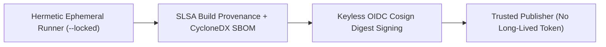

# ViperClaw Skill 59: SLSA Build Provenance, Sigstore Cosign & SBOM Auditor (`viper-sbom-slsa-provenance`)

## 1. Standards & Open-Source Reference
- **Standards:** SLSA v1.0 (Supply-chain Levels for Software Artifacts), Sigstore `cosign`, PyPI Trusted Publishers (OIDC), CycloneDX / SPDX SBOM.
- **Focus:** Auditing release pipelines, container image signing, package publishing, and build provenance verification.

---

## 2. Threat Model & Trust-Boundary Architecture



### Automated ViperClaw Command
```bash
viperclaw taint .github/workflows --db .viperclaw/graph.db
```

---

## 3. Rapid Discovery Patterns
- Search release workflows for `slsa-framework/slsa-github-generator`, `actions/attest-build-provenance`, `sigstore/cosign-installer`, `id-token: write`.

---

## 4. Senior Security Engineer Technical Audit Checklist
1. **Keyless OIDC Trusted Publishing (PyPI / npm / Crates):** Replace long-lived `PYPI_API_TOKEN` or `NPM_TOKEN` secrets in release workflows with OIDC Trusted Publishing (`id-token: write` + `npm publish --provenance` or `pypa/gh-action-pypi-publish`).
2. **SLSA Build Provenance Attestation:** Generate cryptographic build provenance attestations (`actions/attest-build-provenance` or `slsa-github-generator`) in isolated, ephemeral build runners so consumers can verify the artifact was built from the exact commit SHA.
3. **Container Image Signing & Digest Pinning (`cosign`):** Sign published container images by `@sha256:...` digest (never mutable tags like `:latest`) using Sigstore `cosign sign --yes image@sha256:...`, and enforce signature verification via Kyverno / Sigstore Policy Controller in Kubernetes.
4. **Automated SBOM Generation & Attestation:** Emit a CycloneDX or SPDX Software Bill of Materials (`syft` / `cyclonedx-bom`) alongside every release artifact and attach it via `cosign attach sbom`.
5. **Hermetic & Reproducible Build Hygiene:** Ensure release builds run with `--locked` / `--frozen-lockfile`, set `SOURCE_DATE_EPOCH`, and do not fetch unverified remote scripts (`curl ... | sh`) during compilation.

---

## 5. Production Remediation Patterns (Vulnerable vs. Hardened Code)
```yaml
# ❌ VULNERABLE: Publishes package using static long-lived secret token without provenance
- run: twine upload dist/* -u __token__ -p ${{ secrets.PYPI_TOKEN }}

# ✅ HARDENED: Keyless OIDC Trusted Publisher with GitHub Artifact Provenance Attestation
permissions:
  contents: read
  id-token: write
  attestations: write
steps:
  - uses: actions/attest-build-provenance@v2
    with:
      subject-path: "dist/*"
  - uses: pypa/gh-action-pypi-publish@release/v1
```

---

## 6. False-Positive Elimination & CVSS v3.1 Triage Rubric

### False-Positive Elimination Gate
1. **Reachability & Boundary Check:** Confirm the flagged pattern or configuration is reachable across a trust boundary in production (not an isolated unit-test mock, build-time sample, or dead code path).
2. **Upstream Control Verification:** Check whether an upstream gateway, middleware, database policy, or compiler flag already neutralizes the weakness before marking a finding as verified.
3. **Standards Reference:** `SLSA v1.0 Build L3, Sigstore Cosign, CycloneDX, CWE-494`

| Severity Tier | Baseline CVSS v3.1 Vector | Qualifying Security Impact |
| :--- | :--- | :--- |
| **CRITICAL (9.0–10.0)** | `CVSS:3.1/AV:N/AC:L/PR:N/UI:N/S:C/C:H/I:H/A:H` | Unauthenticated remote code execution, cross-tenant authentication or isolation gap, or direct theft of funds/keys. |
| **HIGH (7.0–8.9)** | `CVSS:3.1/AV:N/AC:L/PR:L/UI:N/S:U/C:H/I:H/A:N` | Authenticated privilege escalation, unauthorized sensitive data exposure, or single-request service outage. |
| **MEDIUM (4.0–6.9)** | `CVSS:3.1/AV:N/AC:L/PR:L/UI:R/S:C/C:L/I:L/A:N` | Scoped information disclosure, non-admin state mutation, or configuration weakness requiring user interaction. |
| **LOW (0.1–3.9)** | `CVSS:3.1/AV:N/AC:H/PR:H/UI:N/S:U/C:L/I:N/A:N` | Defense-in-depth hardening gap requiring high precondition complexity and minimal direct impact. |

---

## 7. Regression Testing & Continuous Verification
1. **Positive Functional Test:** Verify that legitimate callers and valid inputs continue to succeed after applying the hardened pattern.
2. **Negative Security Regression Test:** Write an automated unit/integration test confirming that the vulnerable input, unauthenticated call, or misconfiguration is deterministically rejected.
3. **Graph & SARIF Verification:** Run `viperclaw taint .github/workflows --db .viperclaw/graph.db` and `viperclaw verify` to record the verified state in `.viperclaw/graph.db`.
