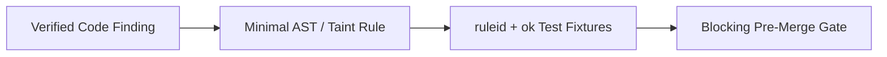

# Custom SAST & Semgrep Rule Authoring Guide (`viper-semgrep-rule-author`)

## 1. Executive Scope, Standards & CWE/OWASP Mapping
- **Frameworks & Standards:** Semgrep Rule Syntax v2, OWASP SAMM Security Testing, CWE Top 25
- **Primary CWE Mapping:** CWE-89 (SQL Injection), CWE-78 (OS Command Injection), CWE-79 (XSS), CWE-918 (SSRF)
- **ViperClaw MCP Tools:** `viper_taint_scan`, `viper_verify_and_report`
- **ViperClaw CLI Command:** `viperclaw taint ./src --db .viperclaw/graph.db`

---

## 2. Threat Model & Root-Cause Architecture



### Root-Cause Analysis
Fixing a vulnerability in one controller does not prevent the same insecure API pattern from reappearing in another service. Encoding every verified root cause into a deterministic AST or taint rule stops whole vulnerability classes permanently in CI.

---

## 3. Deterministic Discovery & Grep/AST Audit Commands

```bash
# 1. Identify recurring sink patterns across the repository
viperclaw taint ./src --db .viperclaw/graph.db

# 2. Locate existing Semgrep / custom lint rule directories
rg --files -g "*semgrep*" -g "*.rules.yml"
```

---

## 4. Senior Security Engineer 8-Point Audit Checklist

| Control ID | Audit Verification Target | Pass Criteria | Fail / Vulnerability Indicator |
| :---: | :--- | :--- | :--- |
| `RULE-01` | **Prefer `mode: taint` for Dataflow Bugs** | Injection rules model `pattern-sources`, `pattern-sanitizers`, and `pattern-sinks` instead of fragile regexes. | Regex-only rule flags hardcoded constant strings as SQLi. |
| `RULE-02` | **Explicit Sanitizer Modeling** | Safe casts (`int()`, `UUID()`, parameterized bindings) are declared in `pattern-sanitizers`. | High false-positive rate causes engineers to disable the CI rule. |
| `RULE-03` | **Paired `ruleid:` and `ok:` Tests** | Every custom rule ships with test fixtures containing both vulnerable (`ruleid:`) and hardened (`ok:`) cases. | Untested rule shipped directly to CI. |
| `RULE-04` | **Actionable Fix Guidance** | Rule `message` explains the exact safe internal wrapper or API to use instead. | Generic message ("Unsafe call detected") with no migration guidance. |
| `RULE-05` | **Complete Metadata (CWE/OWASP/Confidence)** | Every rule specifies `cwe`, `owasp`, `category: security`, `confidence`, and `impact`. | Unclassified findings break SARIF triage dashboards. |
| `RULE-06` | **Scoped Language & Path Filters** | Rules exclude generated vendored files and test mocks where appropriate (`paths.exclude`). | Alerts fire on unit-test fixtures instead of production routes. |
| `RULE-07` | **Low-Noise Blocking Threshold** | Only `HIGH` confidence rules block PR merges; experimental rules run in `audit` mode first. | Noisy rules block unrelated pull requests. |
| `RULE-08` | **Periodic Precision Measurement** | Track true-positive vs. false-positive rate on PR comments quarterly. | Stale rules silently ignored via inline `nosemgrep` comments. |

---

## 5. False-Positive Elimination & CVSS v3.1 Triage Rubric

### False-Positive Gate
1. Run `semgrep --test` on positive and negative fixtures before enabling any rule in CI.
2. Audit `nosemgrep` suppressions during PR review to ensure real issues are not silenced.

| Severity Tier | Baseline CVSS v3.1 Vector | Qualifying Security Impact |
| :--- | :--- | :--- |
| **HIGH (7.5)** | `CVSS:3.1/AV:N/AC:L/PR:L/UI:N/S:U/C:H/I:H/A:N` | Unenforced guardrail allowing recurring injection or auth-boundary regressions across services. |
| **MEDIUM (5.3)** | `CVSS:3.1/AV:N/AC:L/PR:L/UI:N/S:U/C:L/I:L/A:N` | Missing sanitizer definitions or untested CI rules permitting drift. |
| **LOW (3.1)** | `CVSS:3.1/AV:N/AC:H/PR:H/UI:N/S:U/C:L/I:N/A:N` | Incomplete CWE/OWASP metadata in SARIF rule exports. |

---

## 6. Production Remediation Patterns (Vulnerable vs. Hardened Code)

```yaml
# ✅ HARDENED: Precision taint rule with explicit sanitizer and CWE metadata
rules:
  - id: python-raw-sql-taint
    mode: taint
    languages: [python]
    severity: ERROR
    message: "User-controlled data reaches cursor.execute() without parameterization. Use bound parameters."
    metadata:
      cwe: "CWE-89"
      owasp: "A03:2021"
      confidence: HIGH
    pattern-sources:
      - pattern: request.args.get(...)
      - pattern: request.form.get(...)
    pattern-sanitizers:
      - pattern: int(...)
    pattern-sinks:
      - pattern: $CURSOR.execute($QUERY)
```

---

## 7. Regression Testing & Continuous Verification
1. Validate every rule against paired `ruleid:` and `ok:` unit test cases.
2. Run `viperclaw taint .` alongside custom Semgrep rules in CI.
3. Verify zero regressions before promoting a rule to blocking status.
