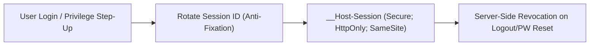

# Session Lifecycle, Cookie Hardening & Token Revocation Auditor (`viper-session-cookie-audit`)

## 1. Executive Scope, Standards & CWE/OWASP Mapping
- **Frameworks & Standards:** OWASP ASVS V3 (Session Management), OWASP Session Management Cheat Sheet, RFC 6265bis
- **Primary CWE Mapping:** CWE-384 (Session Fixation), CWE-613 (Insufficient Session Expiration), CWE-614 (Missing Secure Flag), CWE-1004 (Missing HttpOnly Flag)
- **ViperClaw MCP Tools:** `viper_fingerprint_traffic`, `viper_browser_ingest`, `viper_verify_and_report`
- **ViperClaw CLI Command:** `viperclaw fingerprint ./traffic.har --output session_audit.json`

---

## 2. Threat Model & Root-Cause Architecture



### Root-Cause Analysis
Applications issue stateless tokens or client-side cookies without server-side revocation lists, fail to rotate session IDs on login (Session Fixation), or leave existing sessions active after a user changes their password or resets MFA.

---

## 3. Deterministic Discovery & Grep/AST Audit Commands

Run the following discovery commands across the target repository before manual code review:

```bash
# 1. Automated ViperClaw analysis
viperclaw fingerprint ./traffic.har --output session_audit.json

# 2. Rapid static pattern discovery (ripgrep)
rg -n "(session\.regenerate|request\.session\.cycle_key|migrate_session)"
rg -n "(SESSION_COOKIE_SECURE|SESSION_COOKIE_HTTPONLY|SESSION_COOKIE_SAMESITE|__Host-)"
rg -n "(logout|revoke_token|blacklist|delete_cookie)"
```

---

## 4. Senior Security Engineer 8-Point Audit Checklist

| Control ID | Audit Verification Target | Pass Criteria | Fail / Vulnerability Indicator |
| :---: | :--- | :--- | :--- |
| `SESS-01` | **Session ID Rotation on Authentication** | Session identifier is regenerated (`req.session.regenerate()`, `cycle_key()`) upon login and privilege elevation. | Pre-login anonymous session ID is retained after authentication (Session Fixation, CWE-384). |
| `SESS-02` | **Server-Side Logout & Revocation** | `POST /logout` deletes the session record from Redis/DB on the server, not just clearing the browser cookie. | `/logout` only sends `Set-Cookie: session=; Max-Age=0` while the token remains valid on the server. |
| `SESS-03` | **Invalidate All Sessions on Password/MFA Change** | Changing password, resetting password, or disabling MFA revokes all other active sessions and refresh tokens for that user. | Previously issued sessions remain valid after the user resets their compromised password. |
| `SESS-04` | **`__Host-` Cookie Prefix & Hardened Flags** | Primary session cookie uses `__Host-` prefix with `Secure; HttpOnly; Path=/; SameSite=Lax` (no `Domain` attribute). | Cookie sets `Domain=.example.com`, allowing any compromised sibling subdomain to read or overwrite the session cookie (Cookie Tossing). |
| `SESS-05` | **Idle & Absolute Session Timeouts** | Sessions enforce both an idle timeout (e.g., 30m–2h for sensitive apps) and an absolute lifetime cap (e.g., 12h–7d). | Infinite session lifetime or refresh tokens that rotate indefinitely without an absolute cap. |
| `SESS-06` | **Refresh Token Rotation & Reuse Detection** | OAuth/JWT refresh tokens are single-use; replaying an already-rotated refresh token immediately revokes the entire token family. | Static refresh token reusable multiple times without rotation. |
| `SESS-07` | **Concurrent Session Visibility & Revocation UI** | Users can view active devices/sessions and revoke individual or all sessions from account settings. | No mechanism for users to terminate active sessions on lost/stolen devices. |
| `SESS-08` | **Zero Session Tokens in URLs** | Session IDs are never transmitted in URL query parameters (`?sid=...`) or logged in plaintext access logs. | Session token exposed in `Referer` headers or server access logs. |

---

## 5. False-Positive Elimination & CVSS v3.1 Triage Rubric

### False-Positive Gate
1. Verify whether an upstream API Gateway, global middleware, or ORM hook already enforces the control before flagging a controller.
2. Confirm the code path is reachable from an external entrypoint (not dead code, CLI-only admin script, or unit-test fixture).

| Severity Tier | Baseline CVSS v3.1 Vector | Qualifying Security Impact |
| :--- | :--- | :--- |
| **HIGH (7.5)** | `CVSS:3.1/AV:N/AC:L/PR:N/UI:N/S:U/C:H/I:N/A:N` | Sessions/tokens remain valid after password reset or logout, or predictable session ID generation. |
| **MEDIUM (6.1)** | `CVSS:3.1/AV:N/AC:L/PR:N/UI:R/S:U/C:H/I:L/A:N` | Session fixation (session ID not rotated on login) or subdomain cookie tossing via broad `Domain` attribute. |
| **LOW (3.7)** | `CVSS:3.1/AV:N/AC:H/PR:N/UI:R/S:U/C:L/I:N/A:N` | Missing `HttpOnly`/`Secure` flag or overly long idle timeout. |

---

## 6. Production Remediation Patterns (Vulnerable vs. Hardened Code)

```python
# ❌ VULNERABLE: Only clears client cookie on logout; server session & sibling-subdomain Domain remain active
@app.post("/logout")
def logout():
    resp = make_response({"status": "logged_out"})
    resp.delete_cookie("session_id", domain=".example.com")
    return resp

# ✅ HARDENED: Revokes session in server Redis store & uses __Host- prefix (no Domain attribute)
@app.post("/logout")
def logout(session: VerifiedSession):
    redis_store.delete(f"sess:{session.session_id}")
    resp = make_response({"status": "logged_out"})
    resp.delete_cookie("__Host-session_id", path="/", secure=True, httponly=True, samesite="Lax")
    return resp
```

---

## 7. Regression Testing & Continuous Verification
1. Write a **Positive Unit Test** confirming authorized, schema-valid requests succeed.
2. Write a **Negative Security Regression Test** confirming unauthorized, cross-tenant, or malformed inputs are deterministically rejected.
3. Re-run `viperclaw taint` and `viperclaw verify` to confirm zero remaining unmitigated flows in `.viperclaw/graph.db`.
