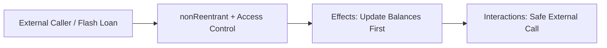

# Smart Contract Static Security Auditor (Solidity / EVM & Rust / Solana) (`viper-smart-contract-review`)

## 1. Executive Scope, Standards & CWE/OWASP Mapping
- **Frameworks & Standards:** Smart Contract Weakness Classification (SWC), Slither / Mythril Rulesets, OpenZeppelin Security Guidelines
- **Primary CWE Mapping:** CWE-841 (Reentrancy), CWE-284 (Missing Access Control / Unprotected Initializer), CWE-682 (Incorrect Rounding / Precision Loss)
- **ViperClaw MCP Tools:** `viper_taint_scan`, `viper_verify_and_report`
- **ViperClaw CLI Command:** `viperclaw taint ./contracts --db .viperclaw/graph.db`

---

## 2. Threat Model & Root-Cause Architecture



### Root-Cause Analysis
Smart contract vulnerabilities stem from violating the Checks-Effects-Interactions (CEI) pattern (updating user balances *after* an external `.call{value: ...}` or ERC-721/ERC-777 hook), leaving upgradeable proxy `initialize()` functions unprotected, dividing before multiplying in integer math, or skipping signer/owner checks in Solana Anchor accounts.

---

## 3. Deterministic Discovery & Grep/AST Audit Commands

Run the following discovery commands across the target repository before manual code review:

```bash
# 1. Automated ViperClaw analysis
viperclaw taint ./contracts --db .viperclaw/graph.db

# 2. Rapid static pattern discovery (ripgrep)
rg -n "(\.call\{value:|\.delegatecall\(|selfdestruct\(|tx\.origin)" *.sol
rg -n "(function initialize\(|_disableInitializers|onlyOwner|nonReentrant)" *.sol
rg -n "(latestRoundData|transferFrom\(|safeTransferFrom)" *.sol
```

---

## 4. Senior Security Engineer 8-Point Audit Checklist

| Control ID | Audit Verification Target | Pass Criteria | Fail / Vulnerability Indicator |
| :---: | :--- | :--- | :--- |
| `SC-01` | **Checks-Effects-Interactions (CEI) & `nonReentrant`** | All state mutations occur *before* external calls, and state-sharing functions enforce OpenZeppelin `ReentrancyGuard` (`nonReentrant`). | `msg.sender.call{value: amt}("")` executed before `balances[msg.sender] -= amt`. |
| `SC-02` | **Upgradeable Proxy Initializer Lockdown** | Implementation contracts call `_disableInitializers()` in their `constructor`, and `initialize()` has the `initializer` modifier. | Unprotected `initialize()` allows an unauthorized caller to take ownership of the implementation or proxy contract. |
| `SC-03` | **Zero `tx.origin` Authentication** | Authorization checks use `msg.sender`, never `tx.origin`. | `require(tx.origin == owner)` used (vulnerable to phishing contract relay). |
| `SC-04` | **Checked Return Values & `SafeERC20`** | All low-level `.call()` return booleans are checked, and ERC-20 transfers use `SafeERC20.safeTransfer` / `safeTransferFrom`. | Unchecked `token.transfer(...)` silently fails on non-reverting tokens or reverts on USDT (missing bool return). |
| `SC-05` | **Precision Loss & Rounding Direction** | Multiplication always precedes division (`(a * b) / c`), and vault share math rounds in favor of the vault (`Math.Rounding.Floor` on mint/withdraw, `Ceil` on deposit/redeem). | Division before multiplication truncates to `0` or rounds against the protocol. |
| `SC-06` | **ERC-4626 First-Depositor Inflation Defense** | ERC-4626 vaults use OpenZeppelin v5 virtual shares/assets offset (`_decimalsOffset()`) or dead-share seeding. | An untrusted caller donates tokens to an empty vault to inflate share price and steal the next depositor's funds via rounding. |
| `SC-07` | **Chainlink Oracle Staleness & Sequencer Checks** | `latestRoundData()` verifies `price > 0`, `updatedAt >= block.timestamp - MAX_DELAY`, and `answeredInRound >= roundId`. | Stale or zero price accepted during market crash or L2 sequencer downtime. |
| `SC-08` | **Solana / Anchor Signer & Owner Account Checks** | In Rust/Anchor programs, every privileged account uses `Signer<'info>` and `Account<'info, T>` (verifying program ownership + PDA seeds). | Raw `AccountInfo` used without checking `is_signer` or `owner == program_id`. |

---

## 5. False-Positive Elimination & CVSS v3.1 Triage Rubric

### False-Positive Gate
1. Verify whether an upstream API Gateway, global middleware, or ORM hook already enforces the control before flagging a controller.
2. Confirm the code path is reachable from an external entrypoint (not dead code, CLI-only admin script, or unit-test fixture).

| Severity Tier | Baseline CVSS v3.1 Vector | Qualifying Security Impact |
| :--- | :--- | :--- |
| **CRITICAL (9.8)** | `CVSS:3.1/AV:N/AC:L/PR:N/UI:N/S:C/C:H/I:H/A:H` | Direct theft of user funds or permanent freezing of protocol TVL via reentrancy, unprotected initializer, or access control flaw. |
| **HIGH (8.1)** | `CVSS:3.1/AV:N/AC:L/PR:N/UI:N/S:U/C:N/I:H/A:H` | Theft of unclaimed yield, ERC-4626 share-inflation vector, or oracle manipulation. |
| **MEDIUM (5.3)** | `CVSS:3.1/AV:N/AC:H/PR:N/UI:N/S:U/C:N/I:L/A:L` | Temporary griefing or non-Standard ERC-20 compatibility bug. |

---

## 6. Production Remediation Patterns (Vulnerable vs. Hardened Code)

```solidity
// ❌ VULNERABLE: External call before state update (Classic Reentrancy)
function withdraw(uint256 amount) external {
    require(balances[msg.sender] >= amount, "Insufficient balance");
    (bool ok, ) = msg.sender.call{value: amount}("");
    require(ok, "Transfer failed");
    balances[msg.sender] -= amount;
}

// ✅ HARDENED: nonReentrant modifier + Checks-Effects-Interactions (state updated first)
function withdraw(uint256 amount) external nonReentrant {
    require(balances[msg.sender] >= amount, "Insufficient balance");
    balances[msg.sender] -= amount;
    (bool ok, ) = msg.sender.call{value: amount}("");
    require(ok, "Transfer failed");
}
```

---

## 7. Regression Testing & Continuous Verification
1. Write a **Positive Unit Test** confirming authorized, schema-valid requests succeed.
2. Write a **Negative Security Regression Test** confirming unauthorized, cross-tenant, or malformed inputs are deterministically rejected.
3. Re-run `viperclaw taint` and `viperclaw verify` to confirm zero remaining unmitigated flows in `.viperclaw/graph.db`.
