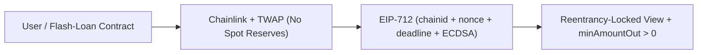

# ViperClaw Skill 63: Advanced DeFi, EIP-712 & Cross-Chain Bridge Auditor (`viper-solidity-defi-advanced`)

## 1. Standards & Open-Source Reference
- **Standards:** Trail of Bits `building-secure-contracts`, OpenZeppelin Contracts v5, Immunefi Top DeFi Vulnerability Taxonomy.
- **Focus:** Auditing AMMs, lending markets, staking/yield vaults, EIP-712/EIP-2612 permit signatures, and cross-chain bridges.

---

## 2. Threat Model & Trust-Boundary Architecture



### Automated ViperClaw Command
```bash
viperclaw taint . --db .viperclaw/graph.db
```

---

## 3. Rapid Discovery Patterns
- Search `*.sol` for `ecrecover`, `DOMAIN_SEPARATOR`, `getReserves()`, `balanceOf(address(this))`, `latestRoundData()`, `delegatecall`.

---

## 4. Senior Security Engineer Technical Audit Checklist
1. **Flash-Loan Spot Price & `balanceOf(address(this))` Manipulation:** Never compute collateral value or share price from instantaneous AMM spot reserves (`pair.getReserves()`) or raw `token.balanceOf(address(this))` (vulnerable to flash-loan and direct-donation manipulation). Use manipulation-resistant Chainlink feeds + TWAP or internal accounting balances.
2. **Read-Only Reentrancy Across Composable Protocols:** During Balancer/Curve/ETH liquidity removal, external `receive()` callbacks fire *before* the pool's internal invariant/virtual price is updated. Any lending protocol reading `pool.get_virtual_price()` during that callback reads an inflated price; check the target pool's reentrancy lock even on `view` functions.
3. **EIP-712 Signature Replay, Cross-Chain `chainid` & `ecrecover` Malleability:** Ensure EIP-712 domain separators recompute dynamically if `block.chainid` changes (hard forks), include a per-user `nonces[signer]++` and `deadline >= block.timestamp`, reject `ecrecover` returning `address(0)`, and use OpenZeppelin's `ECDSA.recover` (enforcing low-`s` malleability).
4. **Fee-on-Transfer, Rebasing & Non-Standard ERC-20 Tokens:** Do not assume `token.transferFrom(user, address(this), amount)` increases the contract's balance by `amount`; measure actual received amount (`balAfter - balBefore`) and use `SafeERC20.safeTransferFrom` (handling USDT's missing boolean return).
5. **Slippage (`minAmountOut` > 0) & Deadline Protection:** Flag any swap or liquidity call that hardcodes `amountOutMin = 0` or `deadline = block.timestamp` (which provides zero MEV/sandwich or mempool delay protection).

---

## 5. Production Remediation Patterns (Vulnerable vs. Hardened Code)
```solidity
// ❌ VULNERABLE: Hardcodes amountOutMin = 0 & deadline = block.timestamp (100% sandwichable)
router.swapExactTokensForTokens(amountIn, 0, path, msg.sender, block.timestamp);

// ✅ HARDENED: Caller-specified slippage floor & expiration deadline
function swapWithSlippage(uint256 amountIn, uint256 minAmountOut, uint256 deadline) external {
    require(minAmountOut > 0, "Zero slippage protection");
    require(block.timestamp <= deadline, "Expired deadline");
    router.swapExactTokensForTokens(amountIn, minAmountOut, path, msg.sender, deadline);
}
```

---

## 6. False-Positive Elimination & CVSS v3.1 Triage Rubric

### False-Positive Elimination Gate
1. **Reachability & Boundary Check:** Confirm the flagged pattern or configuration is reachable across a trust boundary in production (not an isolated unit-test mock, build-time sample, or dead code path).
2. **Upstream Control Verification:** Check whether an upstream gateway, middleware, database policy, or compiler flag already neutralizes the weakness before marking a finding as verified.
3. **Standards Reference:** `Trail of Bits DeFi, OpenZeppelin v5, Immunefi, CWE-682, CWE-347`

| Severity Tier | Baseline CVSS v3.1 Vector | Qualifying Security Impact |
| :--- | :--- | :--- |
| **CRITICAL (9.0–10.0)** | `CVSS:3.1/AV:N/AC:L/PR:N/UI:N/S:C/C:H/I:H/A:H` | Unauthenticated remote code execution, cross-tenant authentication or isolation gap, or direct theft of funds/keys. |
| **HIGH (7.0–8.9)** | `CVSS:3.1/AV:N/AC:L/PR:L/UI:N/S:U/C:H/I:H/A:N` | Authenticated privilege escalation, unauthorized sensitive data exposure, or single-request service outage. |
| **MEDIUM (4.0–6.9)** | `CVSS:3.1/AV:N/AC:L/PR:L/UI:R/S:C/C:L/I:L/A:N` | Scoped information disclosure, non-admin state mutation, or configuration weakness requiring user interaction. |
| **LOW (0.1–3.9)** | `CVSS:3.1/AV:N/AC:H/PR:H/UI:N/S:U/C:L/I:N/A:N` | Defense-in-depth hardening gap requiring high precondition complexity and minimal direct impact. |

---

## 7. Regression Testing & Continuous Verification
1. **Positive Functional Test:** Verify that legitimate callers and valid inputs continue to succeed after applying the hardened pattern.
2. **Negative Security Regression Test:** Write an automated unit/integration test confirming that the vulnerable input, unauthenticated call, or misconfiguration is deterministically rejected.
3. **Graph & SARIF Verification:** Run `viperclaw taint . --db .viperclaw/graph.db` and `viperclaw verify` to record the verified state in `.viperclaw/graph.db`.
