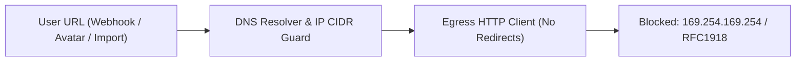

# Server-Side Request Forgery (SSRF) & Cloud Egress Isolation Auditor (`viper-ssrf-cloud`)

## 1. Executive Scope, Standards & CWE/OWASP Mapping
- **Frameworks & Standards:** OWASP Top 10:2025 A10 / API7:2023 (SSRF), CWE-918, AWS/GCP/Azure Cloud Security Best Practices
- **Primary CWE Mapping:** CWE-918 (Server-Side Request Forgery), CWE-441 (Unintended Proxy or Intermediary / Confused Deputy)
- **ViperClaw MCP Tools:** `viper_taint_scan`, `viper_oob_probe`, `viper_verify_and_report`
- **ViperClaw CLI Command:** `viperclaw taint ./src --db .viperclaw/graph.db`

---

## 2. Threat Model & Root-Cause Architecture



### Root-Cause Analysis
Applications validate a user-supplied URL using naive string checks (`url.startswith('https://')`) without resolving DNS, pinning the resolved IP against DNS rebinding, blocking RFC 1918 / link-local (`169.254.169.254`) ranges, or re-validating HTTP `301`/`302` redirect hops.

---

## 3. Deterministic Discovery & Grep/AST Audit Commands

Run the following discovery commands across the target repository before manual code review:

```bash
# 1. Automated ViperClaw analysis
viperclaw taint ./src --db .viperclaw/graph.db

# 2. Rapid static pattern discovery (ripgrep)
rg -n "(requests\.(get|post|request)|httpx\.(get|post|AsyncClient)|urllib\.request\.urlopen|fetch\(|axios\.)"
rg -n "(puppeteer|playwright|wkhtmltopdf|weasyprint|headless)"
rg -n "follow_redirects\s*=\s*True|allow_redirects\s*=\s*True"
```

---

## 4. Senior Security Engineer 8-Point Audit Checklist

| Control ID | Audit Verification Target | Pass Criteria | Fail / Vulnerability Indicator |
| :---: | :--- | :--- | :--- |
| `SSRF-01` | **Strict Scheme & Port Allowlisting** | Only `https://` on port `443` (or `http://` on `80` if explicitly required) permitted. | Protocols like `file://`, `gopher://`, `dict://`, `ftp://`, or arbitrary internal ports (`6379`, `2379`, `8080`) allowed. |
| `SSRF-02` | **Post-DNS Private & Link-Local IP Block** | Resolved IPv4/IPv6 addresses checked via `ipaddress.ip_address(ip).is_global` (blocking `127.0.0.0/8`, `10.0.0.0/8`, `172.16.0.0/12`, `192.168.0.0/16`, `169.254.0.0/16`, `::1`, `fc00::/7`). | String-only blacklist (`'localhost' not in url`) circumvented via alternate forms like `127.1`, `[::ffff:127.0.0.1]`, octal/hex IPs, or `nip.io`. |
| `SSRF-03` | **DNS Rebinding Prevention (Socket IP Pinning)** | The HTTP connection dials the *exact IP address* validated during the DNS check, not a second DNS lookup. | Time-of-Check to Time-of-Use (TOCTOU) gap between `socket.getaddrinfo()` check and `requests.get(url)` second lookup. |
| `SSRF-04` | **Redirect Hop Re-Validation** | `allow_redirects=False` enforced, or every `3xx` `Location` target re-runs full DNS/IP validation. | Open redirect on an allowed external host redirects the server's HTTP client to `http://169.254.169.254/`. |
| `SSRF-05` | **Headless Browser / PDF Generator Isolation** | HTML-to-PDF engines (`wkhtmltopdf`, WeasyPrint, Chromium) block local `file://` and internal network requests. | User HTML containing `<iframe src="http://169.254.169.254/latest/meta-data/">` rendered into PDF. |
| `SSRF-06` | **Cloud IMDSv2 Enforcement** | AWS EC2/EKS enforces `HttpTokens=required` (IMDSv2) and `HttpPutResponseHopLimit=1`. | Legacy IMDSv1 (`GET http://169.254.169.254/latest/meta-data/iam/security-credentials/`) enabled. |
| `SSRF-07` | **Dedicated Egress Proxy / NetworkPolicy** | Outbound user-URL fetches routed through a dedicated egress proxy in a DMZ subnet with zero internal VPC routes. | Application pod in the main production VPC directly fetches arbitrary user URLs. |
| `SSRF-08` | **Response Body & Media-Type Caps** | Responses capped by byte size (`max_bytes`) and validated for expected `Content-Type` before returning. | Raw internal HTTP responses reflected back to the user (Full-Read SSRF). |

---

## 5. False-Positive Elimination & CVSS v3.1 Triage Rubric

### False-Positive Gate
1. Verify whether an upstream API Gateway, global middleware, or ORM hook already enforces the control before flagging a controller.
2. Confirm the code path is reachable from an external entrypoint (not dead code, CLI-only admin script, or unit-test fixture).

| Severity Tier | Baseline CVSS v3.1 Vector | Qualifying Security Impact |
| :--- | :--- | :--- |
| **CRITICAL (9.6)** | `CVSS:3.1/AV:N/AC:L/PR:N/UI:N/S:C/C:H/I:H/A:N` | Full-read SSRF extracting cloud IAM credentials (`169.254.169.254`) or internal Kubernetes secrets. |
| **HIGH (8.6)** | `CVSS:3.1/AV:N/AC:L/PR:N/UI:N/S:C/C:H/I:N/A:N` | Authenticated/Unauthenticated SSRF reading internal microservice APIs or Redis/Elasticsearch data. |
| **MEDIUM (5.3)** | `CVSS:3.1/AV:N/AC:L/PR:L/UI:N/S:U/C:L/I:N/A:N` | Blind SSRF limited to port-scanning timing side channels without response reflection. |

---

## 6. Production Remediation Patterns (Vulnerable vs. Hardened Code)

```python
# ❌ VULNERABLE: String prefix check only; follows redirects & allows 169.254.169.254 / nip.io
def fetch_webhook_preview(user_url: str) -> str:
    if not user_url.startswith("https://") and not user_url.startswith("http://"):
        raise ValueError("Invalid URL")
    return requests.get(user_url, timeout=5, allow_redirects=True).text

# ✅ HARDENED: Validates scheme/port, resolves DNS, rejects non-global IPs & disables redirects
import ipaddress, socket, urllib.parse

def validate_public_url(raw_url: str) -> str:
    parsed = urllib.parse.urlsplit(raw_url)
    if parsed.scheme not in {"https"} or parsed.port not in {None, 443} or not parsed.hostname:
        raise ValueError("Only standard HTTPS (port 443) URLs are allowed")
    for _, _, _, _, sockaddr in socket.getaddrinfo(parsed.hostname, 443, proto=socket.IPPROTO_TCP):
        ip_obj = ipaddress.ip_address(sockaddr[0])
        if not ip_obj.is_global or ip_obj.is_multicast or ip_obj.is_private or ip_obj.is_loopback or ip_obj.is_link_local:
            raise PermissionError(f"Blocked non-public destination IP: {ip_obj}")
    return raw_url
```

---

## 7. Regression Testing & Continuous Verification
1. Write a **Positive Unit Test** confirming authorized, schema-valid requests succeed.
2. Write a **Negative Security Regression Test** confirming unauthorized, cross-tenant, or malformed inputs are deterministically rejected.
3. Re-run `viperclaw taint` and `viperclaw verify` to confirm zero remaining unmitigated flows in `.viperclaw/graph.db`.
