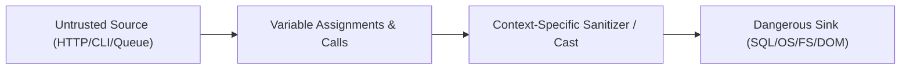

# White-Box Multi-Language Source-to-Sink Taint Analysis Playbook (`viper-taint-sast`)

## 1. Executive Scope, Standards & CWE/OWASP Mapping
- **Frameworks & Standards:** OWASP Code Review Guide, NIST SAMATE, CWE Top 25 (CWE-89, CWE-78, CWE-79, CWE-22, CWE-502, CWE-918)
- **Primary CWE Mapping:** CWE-20 (Improper Input Validation), CWE-89 (SQLi), CWE-78 (OS Command Injection), CWE-22 (Path Traversal), CWE-502 (Insecure Deserialization)
- **ViperClaw MCP Tools:** `viper_taint_scan`, `viper_graph_upsert`, `viper_verify_and_report`
- **ViperClaw CLI Command:** `viperclaw taint ./src --db .viperclaw/graph.db --output taint_report.json`

---

## 2. Threat Model & Root-Cause Architecture



### Root-Cause Analysis
Static pattern matching (`grep`) generates high false positives because it ignores whether a sink argument is a constant string, sanitized via `int()`/`PDO::prepare`, or tainted by user input across multiple variable assignments.

---

## 3. Deterministic Discovery & Grep/AST Audit Commands

Run the following discovery commands across the target repository before manual code review:

```bash
# 1. Automated ViperClaw analysis
viperclaw taint ./src --db .viperclaw/graph.db --output taint_report.json

# 2. Rapid static pattern discovery (ripgrep)
rg -n "(request\.(args|form|json|values|GET|POST)|req\.(body|query|params|headers)|\$_(GET|POST|REQUEST|COOKIE))"
rg -n "(os\.system|subprocess\.|eval\(|exec\(|pickle\.loads|yaml\.load|mysqli_query|shell_exec)"
rg -n "(send_file|sendFile|os\.Open|file_get_contents|include|require_once)"
```

---

## 4. Senior Security Engineer 8-Point Audit Checklist

| Control ID | Audit Verification Target | Pass Criteria | Fail / Vulnerability Indicator |
| :---: | :--- | :--- | :--- |
| `TAINT-01` | **Source Enumeration Completeness** | All HTTP query, body, path, header, cookie, WebSocket, and webhook inputs treated as tainted sources. | Headers (`User-Agent`, `Referer`, `X-Forwarded-For`) or DB-stored user fields assumed trusted. |
| `TAINT-02` | **Transitive Multi-Hop Tracking** | Taint propagated through f-strings, `+` concatenation, `.format()`, augmented `+=`, and helper functions. | Auditor only checks direct 1-line `sink(request.args['x'])` calls. |
| `TAINT-03` | **Context-Aware Sanitizer Verification** | Sanitizer matches the *exact* sink context (`int()` for numeric SQL, `shlex.quote` only when shell is unavoidable, `realpath` for files). | `htmlspecialchars()` used to 'sanitize' a SQL query or file path (wrong context!). |
| `TAINT-04` | **Re-Assignment & De-Tainting Accuracy** | Variables overwritten with safe constants or type-cast values (`id = int(id)`) are de-tainted. | False positives reported on variables already cast to `int` or bound via `PDO::prepare`. |
| `TAINT-05` | **Path Traversal Canonicalization** | File sinks (`open`, `send_file`, `os.Open`) resolve symlinks/dot-segments (`Path.resolve()`) and verify `.is_relative_to(BASE_DIR)`. | `os.path.join(BASE_DIR, user_path)` used without realizing `/etc/passwd` resets `os.path.join` to root! |
| `TAINT-06` | **Deserialization Sink Elimination** | Untrusted bytes never reach `pickle.loads`, `yaml.load`, `unserialize`, `Marshal.load`, or `ObjectInputStream`. | Base64-encoded cookies or Redis entries passed to native object deserializers. |
| `TAINT-07` | **XML External Entity (XXE) Sinks** | XML parsers (`lxml`, `xml.etree`, `DocumentBuilderFactory`, `DOMDocument`) disable DTDs and external entities. | `resolve_entities=True` or `LIBXML_NOENT` enabled on user-supplied XML/SVG/DOCX files. |
| `TAINT-08` | **Server-Side Template & Code Eval Sinks** | No tainted variables reach `eval()`, `exec()`, `Function()`, `render_template_string()`, or `preg_replace('/.../e')`. | Dynamic filter or formula evaluators using `eval()` on user expressions. |

---

## 5. False-Positive Elimination & CVSS v3.1 Triage Rubric

### False-Positive Gate
1. Verify whether an upstream API Gateway, global middleware, or ORM hook already enforces the control before flagging a controller.
2. Confirm the code path is reachable from an external entrypoint (not dead code, CLI-only admin script, or unit-test fixture).

| Severity Tier | Baseline CVSS v3.1 Vector | Qualifying Security Impact |
| :--- | :--- | :--- |
| **CRITICAL (9.8)** | `CVSS:3.1/AV:N/AC:L/PR:N/UI:N/S:U/C:H/I:H/A:H` | Unauthenticated source-to-sink flow into RCE (`os.system`, `pickle.loads`, SSTI) or full SQLi. |
| **HIGH (8.1)** | `CVSS:3.1/AV:N/AC:L/PR:L/UI:N/S:U/C:H/I:H/A:N` | Authenticated source-to-sink flow into arbitrary file read/write (`CWE-22`) or SQLi. |
| **MEDIUM (6.1)** | `CVSS:3.1/AV:N/AC:L/PR:N/UI:R/S:C/C:L/I:L/A:N` | Unescaped source-to-sink flow into HTML/DOM output (`CWE-79`). |

---

## 6. Production Remediation Patterns (Vulnerable vs. Hardened Code)

```python
# ❌ VULNERABLE: os.path.join discards BASE_DIR if filename starts with '/' or contains '../'
def read_invoice_pdf(filename: str) -> bytes:
    full_path = os.path.join("/var/data/invoices", filename)
    return Path(full_path).read_bytes()

# ✅ HARDENED: Canonicalizes path via resolve() and enforces strict directory confinement
INVOICE_ROOT = Path("/var/data/invoices").resolve()

def read_invoice_pdf(filename: str) -> bytes:
    candidate = (INVOICE_ROOT / filename).resolve()
    if not candidate.is_relative_to(INVOICE_ROOT) or candidate.suffix != ".pdf":
        raise PermissionError("Invalid or unauthorized invoice path")
    return candidate.read_bytes()
```

---

## 7. Regression Testing & Continuous Verification
1. Write a **Positive Unit Test** confirming authorized, schema-valid requests succeed.
2. Write a **Negative Security Regression Test** confirming unauthorized, cross-tenant, or malformed inputs are deterministically rejected.
3. Re-run `viperclaw taint` and `viperclaw verify` to confirm zero remaining unmitigated flows in `.viperclaw/graph.db`.
