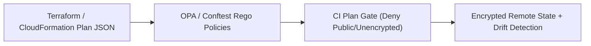

# Cloud Policy-as-Code (OPA/Rego) & IaC Guardrails Auditor (`viper-terraform-drift-policy`)

## 1. Executive Scope, Standards & CWE/OWASP Mapping
- **Frameworks & Standards:** CIS Cloud Foundations Benchmarks, Open Policy Agent (OPA / Conftest), NIST SP 800-53 CM-2
- **Primary CWE Mapping:** CWE-284 (Improper Access Control), CWE-311 (Missing Encryption of Sensitive Data), CWE-732 (Incorrect Permission Assignment)
- **ViperClaw MCP Tools:** `viper_iac_audit`, `viper_secrets_scan`, `viper_verify_and_report`
- **ViperClaw CLI Command:** `viperclaw iac . && viperclaw secrets .`

---

## 2. Threat Model & Root-Cause Architecture



### Root-Cause Analysis
Manual cloud console edits and unvalidated `terraform apply` runs introduce silent security drift—opening `0.0.0.0/0` ingress ports, disabling storage encryption, or leaving Terraform state files containing plaintext secrets accessible in shared buckets.

---

## 3. Deterministic Discovery & Grep/AST Audit Commands

```bash
# 1. Automated ViperClaw IaC & secrets audit
viperclaw iac .
viperclaw secrets .

# 2. Rapid static pattern discovery
rg -n "(0\.0\.0\.0/0|public-read|encrypted\s*=\s*false|backend\s+\"s3\")" -g "*.tf"
```

---

## 4. Senior Security Engineer 8-Point Audit Checklist

| Control ID | Audit Verification Target | Pass Criteria | Fail / Vulnerability Indicator |
| :---: | :--- | :--- | :--- |
| `POL-01` | **Encrypted Remote State with Locking** | Terraform state uses encrypted S3/GCS backend (`encrypt = true`) with DynamoDB/native lock and blocked public access. | Local `terraform.tfstate` committed to Git or stored in an unencrypted bucket. |
| `POL-02` | **Plan-Time Policy-as-Code Gate** | CI evaluates `terraform show -json tfplan` against OPA/Rego or Checkov rules before apply. | Changes applied directly from developer laptops without plan review. |
| `POL-03` | **Zero Unrestricted Management Ports** | Policy denies `0.0.0.0/0` or `::/0` ingress on SSH (`22`), RDP (`3389`), and DB ports (`5432`, `3306`, `6379`). | Security group exposes administrative or database ports publicly. |
| `POL-04` | **Mandatory Storage Encryption** | EBS, RDS, S3, and GCS resources enforce KMS/CMEK encryption at rest by default. | `storage_encrypted = false` or default unencrypted volumes permitted. |
| `POL-05` | **No Wildcard IAM Statements** | Policy blocks `"Action": "*"` and `"Resource": "*"` on production roles. | Broad administrative IAM policies attached to workload roles. |
| `POL-06` | **Sensitive Output & Variable Marking** | Secrets in Terraform variables/outputs set `sensitive = true` and come from a secrets manager. | Plaintext passwords echoed in CI plan logs. |
| `POL-07` | **Scheduled Drift Detection** | Automated read-only `terraform plan` runs detect out-of-band console modifications. | Console hotfixes diverge permanently from version-controlled IaC. |
| `POL-08` | **Pinned Module & Provider Versions** | Registry modules and providers pin exact versions and `.terraform.lock.hcl` is committed. | Unpinned Git branches (`ref=main`) used for Terraform modules. |

---

## 5. False-Positive Elimination & CVSS v3.1 Triage Rubric

### False-Positive Gate
1. Confirm whether `0.0.0.0/0` ingress is intentionally restricted to public HTTPS load balancers (`443`) behind WAF.
2. Verify whether AWS SCPs or GCP Org Policies already block public buckets at the organization root.

| Severity Tier | Baseline CVSS v3.1 Vector | Qualifying Security Impact |
| :--- | :--- | :--- |
| **CRITICAL (9.1)** | `CVSS:3.1/AV:N/AC:L/PR:N/UI:N/S:U/C:H/I:H/A:N` | Publicly readable Terraform state file or public S3 bucket containing production credentials. |
| **HIGH (7.5)** | `CVSS:3.1/AV:N/AC:L/PR:N/UI:N/S:U/C:H/I:N/A:N` | Unrestricted `0.0.0.0/0` database/SSH security group or wildcard IAM admin policy. |
| **MEDIUM (5.3)** | `CVSS:3.1/AV:N/AC:L/PR:L/UI:N/S:U/C:L/I:L/A:N` | Missing encryption at rest or unpinned third-party Terraform modules. |

---

## 6. Production Remediation Patterns (Vulnerable vs. Hardened Code)

```rego
# ✅ HARDENED: OPA/Conftest Rego policy blocking 0.0.0.0/0 on SSH/DB ports
package terraform.security

deny[msg] {
  resource := input.resource_changes[_]
  resource.type == "aws_security_group_rule"
  ingress := resource.change.after
  ingress.type == "ingress"
  ingress.cidr_blocks[_] == "0.0.0.0/0"
  ingress.from_port <= 22
  ingress.to_port >= 22
  msg := sprintf("Security group rule %s exposes SSH (22) to 0.0.0.0/0", [resource.address])
}
```

---

## 7. Regression Testing & Continuous Verification
1. Run `viperclaw iac .` in CI on every IaC pull request.
2. Test every Rego policy with positive (compliant plan) and negative (non-compliant plan) unit tests.
3. Verify `.terraform.lock.hcl` is committed and state buckets remain private.
