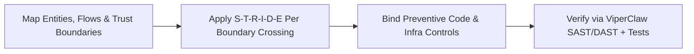
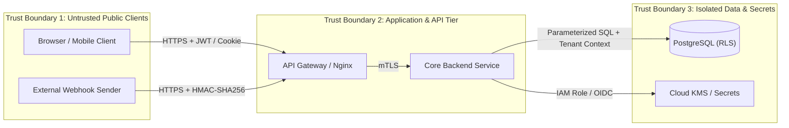

# ViperClaw Skill 64: STRIDE Threat Modeling & Trust Boundary Architect (`viper-threat-model-stride`)

## 1. Standards & Open-Source Reference
- **Standards:** OWASP Threat Modeling Cheat Sheet, Microsoft STRIDE Methodology, Trail of Bits Architectural Risk Assessment.
- **Focus:** Producing structured architectural threat models, Trust Boundary Data Flow Diagrams (Mermaid), and prioritized security control roadmaps before or during a codebase audit.

---

## 2. Threat Model & Trust-Boundary Architecture



### Automated ViperClaw Command
```bash
viperclaw graph --db .viperclaw/graph.db --mermaid
```

---

## 3. 4-Question Threat Modeling Framework
1. **What are we building?** (Map External Entities, Processes, Data Stores, Data Flows, and Trust Boundaries).
2. **What can go wrong?** (Apply **STRIDE** systematically across every flow crossing a Trust Boundary).
3. **What are we going to do about it?** (Map each threat to a concrete preventive/detective code control and ViperClaw audit skill).
4. **Did we do a good job?** (Verify controls via automated regression tests and `viperclaw taint` / `viperclaw verify`).

---

## 4. STRIDE Per-Boundary Audit Matrix
| Category | Security Property | Primary Architectural Failure | Mitigating Control & ViperClaw Skill |
| :--- | :--- | :--- | :--- |
| **S**poofing | Authentication | Tampered JWTs, missing webhook HMAC, weak OAuth/WebAuthn validation | `viper-auth-oauth-jwt`, `viper-webauthn-passkey-mfa`, `viper-webhook-edr-hmac` |
| **T**ampering | Integrity | SQL/Command injection, mass assignment, TOCTOU races, unsigned CI artifacts | `viper-injection-oracle`, `viper-race-logic`, `viper-sbom-slsa-provenance` |
| **R**epudiation | Non-Repudiation | Missing audit logs on privilege/financial actions, log injection | `viper-logging-pii-compliance`, `viper-payment-stripe-pci` |
| **I**nformation Disclosure | Confidentiality | Cross-tenant BOLA/IDOR, RAG vector bleed, hardcoded secrets, SSRF to IMDS | `viper-bola-idor`, `viper-multitenant-isolation`, `viper-rag-vector-audit`, `viper-secrets-audit` |
| **D**enial of Service | Availability | Unbounded GraphQL batching, ReDoS regex, missing Go/gRPC timeouts, malformed queues | `viper-rate-limit-dos-resilience`, `viper-graphql-ws`, `viper-go-service-audit` |
| **E**levation of Privilege | Authorization | Missing BFLA role guards, `iam:PassRole` escalation, privileged K8s pods | `viper-bola-idor`, `viper-aws-iam-cloud-audit`, `viper-container-k8s-audit` |

---

## 5. Mermaid Trust-Boundary DFD Template


---

## 6. False-Positive Elimination & CVSS v3.1 Triage Rubric

### False-Positive Elimination Gate
1. **Reachability & Boundary Check:** Confirm the flagged pattern or configuration is reachable across a trust boundary in production (not an isolated unit-test mock, build-time sample, or dead code path).
2. **Upstream Control Verification:** Check whether an upstream gateway, middleware, database policy, or compiler flag already neutralizes the weakness before marking a finding as verified.
3. **Standards Reference:** `OWASP Threat Modeling, Microsoft STRIDE, NIST SP 800-154`

| Severity Tier | Baseline CVSS v3.1 Vector | Qualifying Security Impact |
| :--- | :--- | :--- |
| **CRITICAL (9.0–10.0)** | `CVSS:3.1/AV:N/AC:L/PR:N/UI:N/S:C/C:H/I:H/A:H` | Unauthenticated remote code execution, cross-tenant authentication or isolation gap, or direct theft of funds/keys. |
| **HIGH (7.0–8.9)** | `CVSS:3.1/AV:N/AC:L/PR:L/UI:N/S:U/C:H/I:H/A:N` | Authenticated privilege escalation, unauthorized sensitive data exposure, or single-request service outage. |
| **MEDIUM (4.0–6.9)** | `CVSS:3.1/AV:N/AC:L/PR:L/UI:R/S:C/C:L/I:L/A:N` | Scoped information disclosure, non-admin state mutation, or configuration weakness requiring user interaction. |
| **LOW (0.1–3.9)** | `CVSS:3.1/AV:N/AC:H/PR:H/UI:N/S:U/C:L/I:N/A:N` | Defense-in-depth hardening gap requiring high precondition complexity and minimal direct impact. |

---

## 7. Regression Testing & Continuous Verification
1. **Positive Functional Test:** Verify that legitimate callers and valid inputs continue to succeed after applying the hardened pattern.
2. **Negative Security Regression Test:** Write an automated unit/integration test confirming that the vulnerable input, unauthenticated call, or misconfiguration is deterministically rejected.
3. **Graph & SARIF Verification:** Run `viperclaw graph --db .viperclaw/graph.db --mermaid` and `viperclaw verify` to record the verified state in `.viperclaw/graph.db`.
