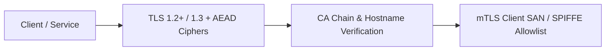

# TLS 1.3, PKI Certificate Lifecycle & Pinning Auditor (`viper-tls-pki-mtls-cert`)

## 1. Executive Scope, Standards & CWE/OWASP Mapping
- **Frameworks & Standards:** NIST SP 800-52 Rev. 2, Mozilla SSL Configuration Generator (Intermediate/Modern), RFC 8446 (TLS 1.3)
- **Primary CWE Mapping:** CWE-295 (Improper Certificate Validation), CWE-327 (Use of Weak Cryptographic Protocol), CWE-319 (Cleartext Transmission of Sensitive Information)
- **ViperClaw MCP Tools:** `viper_fingerprint_traffic`, `viper_taint_scan`, `viper_verify_and_report`
- **ViperClaw CLI Command:** `viperclaw fingerprint https://api.example.com`

---

## 2. Threat Model & Root-Cause Architecture



### Root-Cause Analysis
Transport confidentiality fails when HTTP clients disable certificate verification (`verify=False`, `InsecureSkipVerify: true`, `rejectUnauthorized: false`), servers negotiate deprecated TLS 1.0/1.1 or CBC/RC4 ciphers, or mTLS endpoints check only that a client certificate is signed by a CA without verifying its Subject Alternative Name (SAN).

---

## 3. Deterministic Discovery & Grep/AST Audit Commands

```bash
# 1. Inspect live TLS/HSTS posture passively
viperclaw fingerprint https://api.example.com

# 2. Rapid static pattern discovery for disabled TLS checks
rg -n "(verify\s*=\s*False|CERT_NONE|InsecureSkipVerify\s*:\s*true|rejectUnauthorized\s*:\s*false|SSL_VERIFY_NONE)"
```

---

## 4. Senior Security Engineer 8-Point Audit Checklist

| Control ID | Audit Verification Target | Pass Criteria | Fail / Vulnerability Indicator |
| :---: | :--- | :--- | :--- |
| `TLS-01` | **Strict TLS 1.2+ / TLS 1.3 Minimum** | Servers disable SSLv3, TLS 1.0, and TLS 1.1; prefer TLS 1.3 with AEAD ciphers (`AES-GCM`, `ChaCha20-Poly1305`). | Legacy TLS 1.0/1.1 or weak CBC/RC4/3DES ciphers negotiated. |
| `TLS-02` | **Certificate & Hostname Verification Enabled** | All outbound HTTP/gRPC/DB clients validate both CA chain and hostname (`check_hostname=True`, `CERT_REQUIRED`). | `verify=False`, `InsecureSkipVerify: true`, or `rejectUnauthorized: false` in production code. |
| `TLS-03` | **HSTS with Long Max-Age** | Public HTTPS endpoints send `Strict-Transport-Security: max-age=31536000; includeSubDomains`. | Missing HSTS header allows initial HTTP downgrade. |
| `TLS-04` | **mTLS Identity (SAN/CN) Authorization** | Services requiring mTLS verify the client certificate's SAN/SPIFFE URI against an explicit allowlist. | Any certificate signed by the corporate CA is granted full admin access. |
| `TLS-05` | **Automated Short-Lived Cert Rotation** | Certificates rotate automatically via ACME, cert-manager, or SPIRE with <= 90-day leaf lifetimes. | Manual multi-year certificates causing outages or stale keys. |
| `TLS-06` | **Private Key File Permissions** | TLS private keys on disk are `0600` owned by the service user and never bundled in container layers or Git. | `.key` or `.pem` files committed to source control or world-readable. |
| `TLS-07` | **Internal East-West Encryption** | Database, Redis, Kafka, and internal microservice links enforce TLS (`sslmode=verify-full`). | Plaintext credentials transmitted over shared VPC/cluster networks. |
| `TLS-08` | **Revocation & Expiration Monitoring** | Alerting triggers at 30/14/7 days prior to expiration and supports OCSP stapling or short-lived certs. | Expired certificates silently break production or prompt engineers to disable verification. |

---

## 5. False-Positive Elimination & CVSS v3.1 Triage Rubric

### False-Positive Gate
1. Confirm `verify=False` / `CERT_NONE` is in production code rather than a local unit test hitting `127.0.0.1`.
2. Check whether TLS termination is handled by an upstream ingress controller enforcing TLS 1.3 and HSTS.

| Severity Tier | Baseline CVSS v3.1 Vector | Qualifying Security Impact |
| :--- | :--- | :--- |
| **HIGH (7.4)** | `CVSS:3.1/AV:N/AC:H/PR:N/UI:N/S:U/C:H/I:H/A:N` | Disabled certificate verification on outbound auth/payment client or missing mTLS SAN authorization. |
| **MEDIUM (5.3)** | `CVSS:3.1/AV:N/AC:L/PR:N/UI:N/S:U/C:L/I:N/A:N` | Deprecated TLS 1.0/1.1 protocol enabled or cleartext internal database traffic. |
| **LOW (3.1)** | `CVSS:3.1/AV:N/AC:H/PR:N/UI:N/S:U/C:L/I:N/A:N` | Missing `includeSubDomains` or short `max-age` on HSTS header. |

---

## 6. Production Remediation Patterns (Vulnerable vs. Hardened Code)

```python
# ❌ VULNERABLE: Disables TLS certificate and hostname validation
ctx = ssl.create_default_context()
ctx.check_hostname = False
ctx.verify_mode = ssl.CERT_NONE

# ✅ HARDENED: Enforces TLS 1.2+ with full CA chain and hostname validation
ctx = ssl.create_default_context()
ctx.minimum_version = ssl.TLSVersion.TLSv1_2
ctx.check_hostname = True
ctx.verify_mode = ssl.CERT_REQUIRED
```

---

## 7. Regression Testing & Continuous Verification
1. Verify outbound clients reject self-signed and mismatched-hostname certificates in negative integration tests.
2. Run `viperclaw fingerprint` against staging endpoints to verify HSTS and security headers.
3. Run `viperclaw secrets .` to confirm no private key PEM files are committed.
