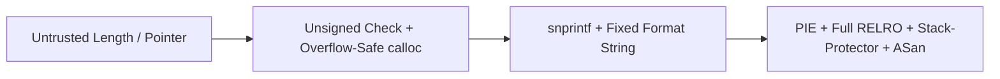

# ViperClaw Skill 62: C, C++, JNI & WebAssembly Memory Safety Auditor (`viper-wasm-c-cpp-memory`)

## 1. Standards & Open-Source Reference
- **Standards:** CERT C / C++ Coding Standard, CWE-119/125/787/416/190/134, OpenSSF Compiler Options Hardening Guide for C and C++.
- **Focus:** Auditing native C/C++ modules, Python/Node/Java native extensions (Cython, N-API, JNI), and WebAssembly (WASI) sandboxes.

---

## 2. Threat Model & Trust-Boundary Architecture



### Automated ViperClaw Command
```bash
viperclaw taint . --db .viperclaw/graph.db
```

---

## 3. Rapid Discovery Patterns
- Search for banned C functions: `strcpy`, `strcat`, `sprintf`, `vsprintf`, `gets`, `scanf("%s"`, `alloca(`, `memcpy(`, `realloc(`.
- Search `CMakeLists.txt` / `Makefile` for `-fstack-protector-strong`, `-D_FORTIFY_SOURCE=3`, `-fPIE`, `-Wl,-z,relro,-z,now`.

---

## 4. Senior Security Engineer Technical Audit Checklist
1. **Eliminate Unbounded String & Buffer Copy Functions:** Replace `strcpy`, `strcat`, `sprintf`, and `gets` with bounded alternatives (`snprintf`, `strlcpy`, `std::string`, `std::span`), and verify that `memcpy(dst, src, n)` checks `n <= dst_capacity` before copying.
2. **Allocation Size Integer Overflow (`count * sizeof(T)`):** Computing `malloc(count * sizeof(Item))` when `count` is untrusted can overflow 32/64-bit integers, allocating a tiny buffer followed by a heap buffer overflow! Use `calloc(count, sizeof(Item))` or `__builtin_mul_overflow(count, sizeof(Item), &total)`.
3. **Format String & Signed/Unsigned Length Confusion:** Never pass a variable as the first format argument (`printf(user_msg)` / `syslog(LOG_INFO, user_msg)` -> use `"%s", user_msg`); never use signed `int` for buffer lengths where a negative value passes `if (len < MAX_SIZE)` and wraps to a huge `size_t`.
4. **Use-After-Free (UAF), Double-Free & `realloc` Pitfalls:** Never write `ptr = realloc(ptr, new_size)` directly (leaks or corrupts `ptr` on failure); use a temporary pointer, null out pointers after `free()`, and prefer C++ smart pointers (`std::unique_ptr`).
5. **Compiler & Linker Hardening Mitigations (OpenSSF Guide):** Enforce `-O2 -D_FORTIFY_SOURCE=3 -fstack-protector-strong -fstack-clash-protection -fPIE -pie -Wl,-z,relro -Wl,-z,now -Wl,-z,noexecstack` in production builds and run AddressSanitizer + UndefinedBehaviorSanitizer (`-fsanitize=address,undefined`) in CI.

---

## 5. Production Remediation Patterns (Vulnerable vs. Hardened Code)
```c
// ❌ VULNERABLE: Signed length check error & integer overflow in malloc size
Item *alloc_items(int count) {
    if (count > 1024) return NULL; // Negative count passes upper-bound check!
    return (Item *)malloc(count * sizeof(Item));
}

// ✅ HARDENED: Unsigned bounds check & overflow-safe calloc
Item *alloc_items(size_t count) {
    if (count == 0 || count > 1024) return NULL;
    return (Item *)calloc(count, sizeof(Item));
}
```

---

## 6. False-Positive Elimination & CVSS v3.1 Triage Rubric

### False-Positive Elimination Gate
1. **Reachability & Boundary Check:** Confirm the flagged pattern or configuration is reachable across a trust boundary in production (not an isolated unit-test mock, build-time sample, or dead code path).
2. **Upstream Control Verification:** Check whether an upstream gateway, middleware, database policy, or compiler flag already neutralizes the weakness before marking a finding as verified.
3. **Standards Reference:** `CERT C/C++, OpenSSF Compiler Flags, CWE-122, CWE-190, CWE-416`

| Severity Tier | Baseline CVSS v3.1 Vector | Qualifying Security Impact |
| :--- | :--- | :--- |
| **CRITICAL (9.0–10.0)** | `CVSS:3.1/AV:N/AC:L/PR:N/UI:N/S:C/C:H/I:H/A:H` | Unauthenticated remote code execution, cross-tenant authentication or isolation gap, or direct theft of funds/keys. |
| **HIGH (7.0–8.9)** | `CVSS:3.1/AV:N/AC:L/PR:L/UI:N/S:U/C:H/I:H/A:N` | Authenticated privilege escalation, unauthorized sensitive data exposure, or single-request service outage. |
| **MEDIUM (4.0–6.9)** | `CVSS:3.1/AV:N/AC:L/PR:L/UI:R/S:C/C:L/I:L/A:N` | Scoped information disclosure, non-admin state mutation, or configuration weakness requiring user interaction. |
| **LOW (0.1–3.9)** | `CVSS:3.1/AV:N/AC:H/PR:H/UI:N/S:U/C:L/I:N/A:N` | Defense-in-depth hardening gap requiring high precondition complexity and minimal direct impact. |

---

## 7. Regression Testing & Continuous Verification
1. **Positive Functional Test:** Verify that legitimate callers and valid inputs continue to succeed after applying the hardened pattern.
2. **Negative Security Regression Test:** Write an automated unit/integration test confirming that the vulnerable input, unauthenticated call, or misconfiguration is deterministically rejected.
3. **Graph & SARIF Verification:** Run `viperclaw taint . --db .viperclaw/graph.db` and `viperclaw verify` to record the verified state in `.viperclaw/graph.db`.
