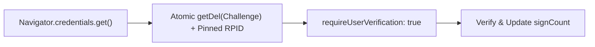

# ViperClaw Skill 46: WebAuthn, FIDO2 Passkey & MFA Security Auditor (`viper-webauthn-passkey-mfa`)

## 1. Standards & Open-Source Reference
- **Standards:** W3C WebAuthn Level 2/3 Specification, OWASP Multifactor Authentication Cheat Sheet, NIST SP 800-63B.
- **Focus:** Auditing FIDO2/WebAuthn passkey registration & authentication flows, TOTP/recovery codes, and MFA session step-up logic.

---

## 2. Threat Model & Trust-Boundary Architecture



### Automated ViperClaw Command
```bash
viperclaw taint . --db .viperclaw/graph.db
```

---

## 3. Rapid Discovery Patterns
- Search for `verifyRegistrationResponse`, `verifyAuthenticationResponse`, `clientDataJSON`, `expectedOrigin`, `expectedRPID`, `userVerification`, `totp.verify`.

---

## 4. Senior Security Engineer Technical Audit Checklist
1. **Single-Use Server-Stored Challenge Binding:** The WebAuthn `challenge` must be >= 16 bytes of CSPRNG output, stored in the server-side session/cache bound to the specific `user_id` with a short TTL (e.g., 5 minutes), and **deleted atomically** upon the first verification attempt.
2. **Strict `expectedOrigin` & `expectedRPID` Pinning:** Never derive `expectedOrigin` or `expectedRPID` dynamically from the incoming `Origin` or `Host` HTTP request header; compare against a hardcoded configuration constant.
3. **Mandatory `userVerification: "required"` for Passwordless Flows:** When passkeys act as a single-factor password replacement, enforce `userVerification: "required"` (UV flag checked in `authenticatorData`) so a stolen physical security key cannot authenticate without biometrics/PIN.
4. **Clone Detection (`signCount`) & TOTP Replay Prevention:** Update the stored credential `signCount` on each login and alert/revoke if `newSignCount <= storedSignCount` (when `signCount > 0`); for TOTP, record the last used 30-second time step per user so a 6-digit code cannot be replayed within the same window.
5. **Server-Side MFA State Binding:** Never issue a full session token after step 1 (password check) expecting the frontend to redirect to `/mfa`; issue a restricted, short-lived `pre_mfa_token` that is only valid on `/api/mfa/verify`.

---

## 5. Production Remediation Patterns (Vulnerable vs. Hardened Code)
```typescript
// ❌ VULNERABLE: Trusts client-supplied challenge & Origin header without deleting challenge
const verification = await verifyAuthenticationResponse({
  response: req.body,
  expectedChallenge: req.body.challenge,
  expectedOrigin: req.headers.origin,
  expectedRPID: req.hostname,
  authenticator,
});

// ✅ HARDENED: Consumes server-stored challenge atomically & pins RPID/Origin + requireUserVerification
const expectedChallenge = await redis.getDel(`webauthn:chal:${session.userId}`);
if (!expectedChallenge) throw new UnauthorizedError("Expired or missing challenge");
const verification = await verifyAuthenticationResponse({
  response: req.body,
  expectedChallenge,
  expectedOrigin: "https://login.example.com",
  expectedRPID: "example.com",
  requireUserVerification: true,
  authenticator,
});
```

---

## 6. False-Positive Elimination & CVSS v3.1 Triage Rubric

### False-Positive Elimination Gate
1. **Reachability & Boundary Check:** Confirm the flagged pattern or configuration is reachable across a trust boundary in production (not an isolated unit-test mock, build-time sample, or dead code path).
2. **Upstream Control Verification:** Check whether an upstream gateway, middleware, database policy, or compiler flag already neutralizes the weakness before marking a finding as verified.
3. **Standards Reference:** `W3C WebAuthn L3, NIST SP 800-63B, CWE-294, CWE-287`

| Severity Tier | Baseline CVSS v3.1 Vector | Qualifying Security Impact |
| :--- | :--- | :--- |
| **CRITICAL (9.0–10.0)** | `CVSS:3.1/AV:N/AC:L/PR:N/UI:N/S:C/C:H/I:H/A:H` | Unauthenticated remote code execution, cross-tenant authentication or isolation gap, or direct theft of funds/keys. |
| **HIGH (7.0–8.9)** | `CVSS:3.1/AV:N/AC:L/PR:L/UI:N/S:U/C:H/I:H/A:N` | Authenticated privilege escalation, unauthorized sensitive data exposure, or single-request service outage. |
| **MEDIUM (4.0–6.9)** | `CVSS:3.1/AV:N/AC:L/PR:L/UI:R/S:C/C:L/I:L/A:N` | Scoped information disclosure, non-admin state mutation, or configuration weakness requiring user interaction. |
| **LOW (0.1–3.9)** | `CVSS:3.1/AV:N/AC:H/PR:H/UI:N/S:U/C:L/I:N/A:N` | Defense-in-depth hardening gap requiring high precondition complexity and minimal direct impact. |

---

## 7. Regression Testing & Continuous Verification
1. **Positive Functional Test:** Verify that legitimate callers and valid inputs continue to succeed after applying the hardened pattern.
2. **Negative Security Regression Test:** Write an automated unit/integration test confirming that the vulnerable input, unauthenticated call, or misconfiguration is deterministically rejected.
3. **Graph & SARIF Verification:** Run `viperclaw taint . --db .viperclaw/graph.db` and `viperclaw verify` to record the verified state in `.viperclaw/graph.db`.
