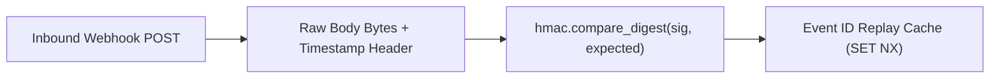

# Inbound & Outbound Webhook Security & HMAC Verification Auditor (`viper-webhook-edr-hmac`)

## 1. Executive Scope, Standards & CWE/OWASP Mapping
- **Frameworks & Standards:** Standard Webhooks Specification, Stripe/GitHub/Slack Webhook Security Guidelines, CWE-345, CWE-294, CWE-918
- **Primary CWE Mapping:** CWE-345 (Insufficient Verification of Data Authenticity), CWE-294 (Authentication via Capture-Replay), CWE-208 (Observable Timing Discrepancy)
- **ViperClaw MCP Tools:** `viper_taint_scan`, `viper_oob_probe`, `viper_verify_and_report`
- **ViperClaw CLI Command:** `viperclaw taint ./src --db .viperclaw/graph.db`

---

## 2. Threat Model & Root-Cause Architecture



### Root-Cause Analysis
Webhook receivers frequently skip cryptographic signature checks, compute the HMAC over a re-serialized `json.dumps(req.json)` object instead of the exact raw request body bytes, use non-constant-time `==` comparisons, or omit timestamp and `event_id` replay checks.

---

## 3. Deterministic Discovery & Grep/AST Audit Commands

Run the following discovery commands across the target repository before manual code review:

```bash
# 1. Automated ViperClaw analysis
viperclaw taint ./src --db .viperclaw/graph.db

# 2. Rapid static pattern discovery (ripgrep)
rg -n "(stripe-signature|x-hub-signature-256|x-slack-signature|svix-signature|webhook)"
rg -n "(construct_event|compare_digest|timingSafeEqual)"
```

---

## 4. Senior Security Engineer 8-Point Audit Checklist

| Control ID | Audit Verification Target | Pass Criteria | Fail / Vulnerability Indicator |
| :---: | :--- | :--- | :--- |
| `WHK-01` | **Mandatory HMAC Signature Verification over Raw Bytes** | HMAC-SHA256 computed over `f"{timestamp}.{raw_body_bytes.decode()}"` using `request.get_data()` / `await request.body()`. | Webhook handler parses JSON without checking `X-Hub-Signature-256` / `Stripe-Signature`. |
| `WHK-02` | **Constant-Time Digest Comparison** | Signature comparison uses `hmac.compare_digest(expected, received)` or `crypto.timingSafeEqual()`. | Standard `if sig == expected_sig:` used (vulnerable to byte-by-byte timing side-channels). |
| `WHK-03` | **Timestamp Tolerance Window (<= 300s)** | Signed timestamp header verified to be within `±300 seconds` of current server UTC time. | Timestamp header not included in the HMAC signing string or not checked for expiration. |
| `WHK-04` | **Atomic Event ID Deduplication (`event_id`)** | Processed webhook `event_id` stored atomically (`INSERT ... ON CONFLICT DO NOTHING` / Redis `SET NX EX 86400`) before fulfilling orders. | Same valid webhook replayed 10 times within the 5-minute window credits the user's account 10 times. |
| `WHK-05` | **Fail-Closed Secret Configuration** | Webhook verifier raises a startup error if `WEBHOOK_SECRET` is empty or unset. | `os.getenv('WEBHOOK_SECRET', '')` signs with empty key `b''` when unconfigured! |
| `WHK-06` | **Outbound Webhook SSRF & DNS Rebinding Guard** | User-configured outbound webhook URLs resolve DNS and block RFC 1918 / `169.254.169.254` on every delivery attempt. | User registers `https://169.254.169.254/latest/meta-data/` as their webhook URL and views the delivery log response. |
| `WHK-07` | **Outbound Delivery Log Redaction** | Webhook delivery logs shown to users truncate response bodies and never expose internal network connection errors. | Full internal HTTP response body returned in the 'Test Webhook' UI. |
| `WHK-08` | **Asynchronous Queue Decoupling & Timeouts** | Inbound webhooks acknowledge `200 OK` after signature check + queue enqueue, and outbound webhooks enforce strict 5s timeouts. | Synchronous slow downstream processing causes webhook sender retries and thread starvation. |

---

## 5. False-Positive Elimination & CVSS v3.1 Triage Rubric

### False-Positive Gate
1. Verify whether an upstream API Gateway, global middleware, or ORM hook already enforces the control before flagging a controller.
2. Confirm the code path is reachable from an external entrypoint (not dead code, CLI-only admin script, or unit-test fixture).

| Severity Tier | Baseline CVSS v3.1 Vector | Qualifying Security Impact |
| :--- | :--- | :--- |
| **CRITICAL (9.1)** | `CVSS:3.1/AV:N/AC:L/PR:N/UI:N/S:U/C:N/I:H/A:H` | Missing or avoidable payment/provisioning webhook signature check allowing unverified `payment_intent.succeeded` events. |
| **HIGH (7.5)** | `CVSS:3.1/AV:N/AC:L/PR:L/UI:N/S:C/C:H/I:N/A:N` | Outbound webhook tester vulnerable to Full-Read SSRF against cloud metadata or internal services. |
| **MEDIUM (5.9)** | `CVSS:3.1/AV:N/AC:H/PR:N/UI:N/S:U/C:N/I:H/A:N` | Missing `event_id` deduplication or timestamp window allowing webhook replay. |

---

## 6. Production Remediation Patterns (Vulnerable vs. Hardened Code)

```python
# ❌ VULNERABLE: Trusts webhook body without HMAC signature or replay deduplication
@app.post("/webhooks/payment")
async def payment_webhook(request: Request, db: Session = Depends(get_db)):
    event = await request.json()
    if event["type"] == "checkout.completed":
        credit_user_wallet(db, event["user_id"], event["amount_cents"])
    return {"ok": True}

# ✅ HARDENED: Verifies raw-body HMAC + 300s timestamp window + atomic event_id deduplication
@app.post("/webhooks/payment")
async def payment_webhook(request: Request, db: Session = Depends(get_db)):
    raw_body = await request.body()
    ts_str = request.headers.get("X-Webhook-Timestamp", "0")
    sig_hdr = request.headers.get("X-Webhook-Signature", "")
    if abs(int(time.time()) - int(ts_str)) > 300:
        raise HTTPException(status_code=400, detail="Expired webhook timestamp")
    expected = hmac.new(WEBHOOK_SECRET.encode(), f"{ts_str}.".encode() + raw_body, hashlib.sha256).hexdigest()
    if not hmac.compare_digest(f"v1={expected}", sig_hdr):
        raise HTTPException(status_code=401, detail="Invalid webhook signature")
    event = json.loads(raw_body)
    if not record_unique_webhook_event(db, event["id"]):
        return {"status": "duplicate_ignored"}
    if event["type"] == "checkout.completed":
        credit_user_wallet(db, event["user_id"], event["amount_cents"])
    return {"ok": True}
```

---

## 7. Regression Testing & Continuous Verification
1. Write a **Positive Unit Test** confirming authorized, schema-valid requests succeed.
2. Write a **Negative Security Regression Test** confirming unauthorized, cross-tenant, or malformed inputs are deterministically rejected.
3. Re-run `viperclaw taint` and `viperclaw verify` to confirm zero remaining unmitigated flows in `.viperclaw/graph.db`.
