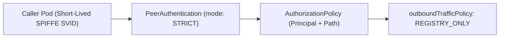

# ViperClaw Skill 61: Zero-Trust Service Mesh, mTLS & SPIFFE/SPIRE Auditor (`viper-zero-trust-mtls-mesh`)

## 1. Standards & Open-Source Reference
- **Standards:** NIST SP 800-207 (Zero Trust Architecture), Istio Security Best Practices, CNCF SPIFFE/SPIRE Specification.
- **Focus:** Auditing Kubernetes service mesh manifests (`PeerAuthentication`, `AuthorizationPolicy`, `DestinationRule`) and internal mTLS configurations.

---

## 2. Threat Model & Trust-Boundary Architecture



### Automated ViperClaw Command
```bash
viperclaw taint . --db .viperclaw/graph.db
```

---

## 3. Rapid Discovery Patterns
- Search Kubernetes/Istio YAML files for `kind: PeerAuthentication`, `mode: PERMISSIVE`, `mode: DISABLE`, `kind: AuthorizationPolicy`, `spiffe://`.

---

## 4. Senior Security Engineer Technical Audit Checklist
1. **Mesh-Wide `STRICT` Mutual TLS (`PeerAuthentication`):** Audit Istio `PeerAuthentication` resources in `istio-system` and workload namespaces; flag `mode: PERMISSIVE` or `mode: DISABLE` in production and enforce `mtls: { mode: STRICT }` so plaintext lateral movement is rejected.
2. **Default-Deny & SPIFFE Identity `AuthorizationPolicy`:** Deploy a namespace-wide default-deny `AuthorizationPolicy` (`spec: {}`) and grant access using explicit `from: [{ source: { principals: ["cluster.local/ns/prod/sa/checkout-sa"] } }]` combined with allowed HTTP methods and paths.
3. **Ingress Gateway Host & SNI Isolation:** Ensure Istio `Gateway` and `VirtualService` definitions bind to explicit hostnames (never `hosts: ["*"]` on production TLS gateways) and enforce `minProtocolVersion: TLSV1_2`.
4. **Egress Traffic Control (`REGISTRY_ONLY`):** Set `meshConfig.outboundTrafficPolicy.mode: REGISTRY_ONLY` and require explicit `ServiceEntry` definitions for approved external APIs so compromised pods cannot connect to arbitrary external hosts.
5. **Short-Lived Workload SVID Rotation:** Confirm SPIFFE/Istio workload X.509 certificates use short TTLs (<= 24 hours) with automated SDS rotation and never mount static root CA private keys into application pods.

---

## 5. Production Remediation Patterns (Vulnerable vs. Hardened Code)
```yaml
# ❌ VULNERABLE: Permissive mTLS & allows any pod in cluster to call payments service
apiVersion: security.istio.io/v1beta1
kind: PeerAuthentication
metadata:
  name: default
  namespace: prod
spec:
  mtls:
    mode: PERMISSIVE

# ✅ HARDENED: Strict mTLS + SPIFFE principal allowlist scoped to specific POST route
apiVersion: security.istio.io/v1beta1
kind: PeerAuthentication
metadata:
  name: default
  namespace: prod
spec:
  mtls:
    mode: STRICT
---
apiVersion: security.istio.io/v1beta1
kind: AuthorizationPolicy
metadata:
  name: payments-allow-checkout
  namespace: prod
spec:
  selector:
    matchLabels:
      app: payments-service
  action: ALLOW
  rules:
    - from:
        - source:
            principals: ["cluster.local/ns/prod/sa/checkout-service"]
      to:
        - operation:
            methods: ["POST"]
            paths: ["/v1/charge"]
```

---

## 6. False-Positive Elimination & CVSS v3.1 Triage Rubric

### False-Positive Elimination Gate
1. **Reachability & Boundary Check:** Confirm the flagged pattern or configuration is reachable across a trust boundary in production (not an isolated unit-test mock, build-time sample, or dead code path).
2. **Upstream Control Verification:** Check whether an upstream gateway, middleware, database policy, or compiler flag already neutralizes the weakness before marking a finding as verified.
3. **Standards Reference:** `NIST SP 800-207, Istio/Linkerd Security, SPIFFE/SPIRE, CWE-319`

| Severity Tier | Baseline CVSS v3.1 Vector | Qualifying Security Impact |
| :--- | :--- | :--- |
| **CRITICAL (9.0–10.0)** | `CVSS:3.1/AV:N/AC:L/PR:N/UI:N/S:C/C:H/I:H/A:H` | Unauthenticated remote code execution, cross-tenant authentication or isolation gap, or direct theft of funds/keys. |
| **HIGH (7.0–8.9)** | `CVSS:3.1/AV:N/AC:L/PR:L/UI:N/S:U/C:H/I:H/A:N` | Authenticated privilege escalation, unauthorized sensitive data exposure, or single-request service outage. |
| **MEDIUM (4.0–6.9)** | `CVSS:3.1/AV:N/AC:L/PR:L/UI:R/S:C/C:L/I:L/A:N` | Scoped information disclosure, non-admin state mutation, or configuration weakness requiring user interaction. |
| **LOW (0.1–3.9)** | `CVSS:3.1/AV:N/AC:H/PR:H/UI:N/S:U/C:L/I:N/A:N` | Defense-in-depth hardening gap requiring high precondition complexity and minimal direct impact. |

---

## 7. Regression Testing & Continuous Verification
1. **Positive Functional Test:** Verify that legitimate callers and valid inputs continue to succeed after applying the hardened pattern.
2. **Negative Security Regression Test:** Write an automated unit/integration test confirming that the vulnerable input, unauthenticated call, or misconfiguration is deterministically rejected.
3. **Graph & SARIF Verification:** Run `viperclaw taint . --db .viperclaw/graph.db` and `viperclaw verify` to record the verified state in `.viperclaw/graph.db`.
