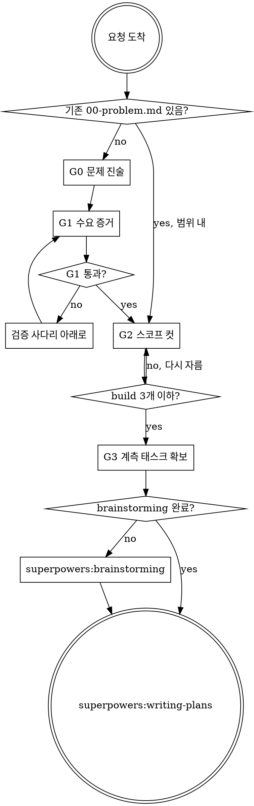

# Startup Lens

만들기 전에 **만들 이유**를 통과시키는 게이트. YC/Paul Graham 계열 원칙을 웹앱 착수 결정으로 번역한 것.

<HARD-GATE>
G0(문제 진술) · G1(수요 증거) · G2(MVP 스코프 컷) 세 산출물이 없으면
코드 작성, 스캐폴딩(create-*, repo init, DB 스키마 설계), 구현 스킬 호출을 하지 않는다.
프로젝트가 아무리 단순해 보여도 적용한다.
</HARD-GATE>

## Anti-Pattern: "이건 토이라서 게이트 필요 없음"

모든 프로젝트가 이 과정을 거친다. 랜딩 1장, 개인용 도구, 주말 프로젝트 전부 포함. 산출물은 짧아도 된다(각 5~10줄). 하지만 **쓰지 않고 넘어가지는 않는다.**

"토이여도 괜찮다"는 원문 주장은 게이트를 통과한 토이에 대한 말이다. 통과하지 않은 토이는 그냥 버려지는 코드다.

예외 하나: 이미 이 프로젝트에 `docs/startup/00-problem.md` 가 존재하고 이번 요청이 그 문제 범위 안이면 G0/G1은 재확인만 하고 G2로 간다.

## 체크리스트

각 항목을 TodoWrite 태스크로 만들고 순서대로 처리한다.

1. **G0 문제** 확인 및 `docs/startup/00-problem.md` 작성
2. **G1 수요** 검증 단계 판정 및 `docs/startup/01-validation.md` 작성
3. **G2 스코프** build/fake/manual 분류 및 `docs/startup/02-mvp-scope.md` 작성
4. **G3 계측** 항목을 구현 계획 태스크로 확보
5. **인계** `superpowers:writing-plans` 호출

### G0 문제

- 실제 겪은 문제인가? 아니면 겪은 사람과 대화한 기록이 있는가?
- 사용자들이 **지금 어떻게 때우고 있는가**? (우회 수단이 없으면 문제가 아닐 가능성 높음)
- 연락 가능한 실명/핸들을 몇 개 댈 수 있는가? (익명 페르소나는 답이 아님)
- 경쟁 서비스가 **놓친 지점**을 한 문장으로 쓸 수 있는가?

### G1 수요

검증 사다리에서 현재 위치를 판정한다. 아래 단을 통과 못 했으면 위로 못 간다.

| 단계 | 만드는 것 | 통과 기준 |
|---|---|---|
| L0 | 시트/노션/수동 | 나 말고 다른 사람이 2주 이상 계속 씀 |
| L1 | 랜딩 + 대기자 | 등록자가 후속 연락에 회신함 |
| L2 | 사람이 직접 처리 | 같은 사람이 재요청함 |
| L3 | 코어 기능 MVP | Revenue 또는 주 단위 반복 사용 |

증거 강도: `돈을 냄 > 반복 사용 > 1회 사용 > 가입만 > "좋다"는 말`. 오른쪽 둘은 증거가 아니다.

### G2 스코프

모든 후보 기능을 네 통에 배정한다: **build / fake / manual / 제외**.

- build 통은 **3개 이하**. 넘으면 다시 자른다
- 잘라낸 항목마다 **되살릴 조건**을 숫자로 적는다
- 소프트 론칭까지 **6주 상한**. 넘칠 것 같으면 일정이 아니라 스코프를 자른다
- 스택: 관리형 백엔드 · 남의 인증 · 남의 결제 · 팀이 이미 아는 프레임워크 하나. 이번에 배우려는 신기술은 제외
- **포기 불가 6항목**은 반드시 build: 데이터 유실 방지, 인증/권한 기본, 결제 정확성, 개인정보 최소화, 에러 로깅, 접근성 기본

### G3 계측

구현 계획에 다음이 태스크로 존재해야 한다. 론칭 후가 아니라 론칭 전이다.

- 이벤트 기록(`user_id, event, ts, props`)
- 활성화 이벤트 **1개** 정의
- 가입일 + 유입 경로 저장 (나중에 복원 불가)
- 주간 집계 스크립트
- 피드백 채널 1개, 도착지가 매일 보는 곳
- 에러 알림에 사용자 식별 부착

## superpowers 연동

| superpowers 스킬 | startup-lens 개입 | 결과 |
|---|---|---|
| `brainstorming` | 첫 clarifying question **앞에** G0/G1 질문을 넣는다 | 설계 문서에 "수요 증거" 섹션이 생김 |
| `writing-plans` | 계획 작성 전 G2 스코프 컷 적용 | fake/manual 항목은 계획에서 빠짐 |
| `executing-plans` | G3 태스크가 계획에 포함된 상태로 실행 | 계측이 기능과 함께 나감 |
| `verification-before-completion` | G3 확인 항목 추가 | 계측·피드백 채널 미구현이면 완료 아님 |
| `test-driven-development` | 개입 없음 | 그대로 |

**종료 조건: `superpowers:writing-plans` 호출.** 다른 구현 스킬로 직접 넘어가지 않는다.
brainstorming이 아직 안 돌았으면 G0~G2 후 `superpowers:brainstorming` 으로 넘긴다.



## Red Flags

이 생각이 떠오르면 합리화 중이다.

| 생각 | 현실 |
|---|---|
| "내가 겪은 문제니까 검증 생략" | 본인 문제인 건 G0 통과일 뿐. G1은 남이 쓰는지 |
| "일단 만들고 반응 보자" | 그게 SISP. L0~L2가 훨씬 싸다 |
| "계측은 나중에" | 론칭 후 붙이면 초기 코호트가 영구 소실 |
| "토이 프로젝트라서" | 토이가 좋아지는 건 게이트를 통과했을 때 |
| "이건 이미 남이 하고 있어서 늦었다" | 포화 시장은 수요 증명. 놓친 지점만 지목하면 됨 |
| "이왕 하는 거 제대로 만들자" | 1년 걸린 첫 론칭이 원문의 대표 실패 사례 |
| "설정으로 빼두면 나중에 편해" | 두 번째 사례 전 추상화는 조기 일반화 |
| "대형 론칭/제휴로 유저를 모으자" | 원문이 통하지 않는다고 명시한 두 전술 |
| "사용자한테 직접 연락하는 건 확장성이 없어" | 확장 안 되는 일을 하라는 게 원칙 그 자체 |

## 참조 문서

전문을 인라인하지 않는다. 필요한 것만 Read.

| 상황 | 문서 |
|---|---|
| G0 판단, SISP 여부, 좁고 깊은 우물, schlep filter | `references/01-problem-and-ideas.md` |
| G1 사다리 상세, 통과 기준 정의, 컨시어지 방법 | `references/02-demand-validation-ladder.md` |
| G2 결정표, 스택 규칙, 포기 가능/불가 경계 | `references/03-mvp-scope-and-stack.md` |
| 첫 사용자 확보, over-engagement, 온보딩 | `references/04-first-users-and-feedback.md` |
| G3 계측 세트, 주간 리뷰, 안티패턴 15종 | `references/05-metrics-and-antipatterns.md` |
| 전체 흐름, 원문 매핑 | `references/00-overview.md` |

경로는 이 SKILL.md 기준 상대 경로다. 파일이 없는 환경이면 이 SKILL.md의 체크리스트만으로 게이트를 진행한다.

## 산출물 경로

대상 프로젝트 기준(이 스킬 폴더가 아니라 작업 중인 프로젝트):

```
docs/startup/00-problem.md     G0
docs/startup/01-validation.md  G1
docs/startup/02-mvp-scope.md   G2
docs/startup/friction-log.md   (선택) 결함 로그, 다음 아이디어 원료
```
