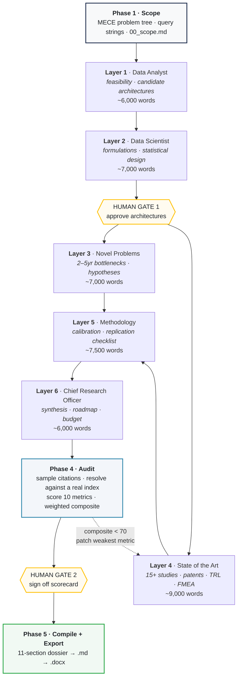

<div align="center">

# Enterprise Deep Research

**A multi-layer research dossier framework for agentic coding tools.**
Six specialist layers write it, ten metrics audit it, one command turns it into Word.

[](LICENSE)
[](scripts/docx_generator.py)
[](SKILL.md)
[](gemini/SKILL.md)
[](scripts/docx_generator.py)

</div>

---

## What this is

A skill you drop into Claude Code or Antigravity. You give it a use case; it
produces a **~42,500-word research dossier** — problem decomposition, mathematical
modelling, frontier gaps, a systematic literature review, a replication
methodology, and a CRO-level synthesis — then audits its own output against ten
scored quality metrics before handing you a Markdown file and a styled `.docx`.

Three things make it different from asking a model to "write a long report":

- **Layers have dependencies, and the pipeline respects them.** Layer 2 formalizes
  the architectures Layer 1 proposed. Layer 5 operationalizes Layers 2 and 4. Nothing
  is parallelized across a dependency edge, so no layer writes against a draft
  that does not exist yet.
- **The audit is arithmetic, not vibes.** Ten metrics, fixed weights summing to
  1.00, every metric bounded 0–100, an explicit formula per metric, and a gate the
  report can actually pass.
- **Two human gates.** Architecture approval lands *before* the expensive layers
  run, not after. Audit sign-off lands before compilation.

---

## The pipeline



---

## The six layers

| # | Persona | Produces | Target |
|:-:|:--------|:---------|-------:|
| **1** | Principal systems architect | MECE decomposition, feasibility matrix, 2–3 candidate architectures, risk table | 6,000 w |
| **2** | Principal ML architect | Full mathematical formulations, power analysis, pipeline architecture, KPIs | 7,000 w |
| **3** | Frontier research scientist | 2–5 year bottlenecks from first principles, theoretical gaps, testable hypotheses | 7,000 w |
| **4** | Literature archivist / patent examiner | 15+ verified studies, patent whitespace, TRL assessment, FMEA with RPNs | 9,000 w |
| **5** | Replication expert | Method audit, contrarian methods, error and drift calibration, replication checklist | 7,500 w |
| **6** | CTO / managing partner | Cross-layer synthesis, Go/No-Go criteria, phased roadmap, headcount and budget | 6,000 w |

Word counts are targets, not gates. A layer landing 40% short gets one targeted
expansion pass on the thin sections; a persistent shortfall is recorded in the
report's Limitations section rather than hidden.

---

## The audit

Ten metrics. Weights sum to exactly `1.00`. Every metric is bounded `0–100`, so a
perfect dossier scores 100 and the gate is reachable.

| Metric | Weight | Pass | How it is computed |
|:-------|-------:|-----:|:-------------------|
| Fact verification | `0.15` | ≥ 80 | Sampled citations resolved against a real index |
| Source authority | `0.12` | ≥ 70 | Mean of per-source credibility bands |
| Logical coherence | `0.12` | ≥ 80 | 100 − 15 per unsupported causal claim or unreconciled conflict |
| Temporal relevance | `0.10` | ≥ 75 | Mean age score; seminal works get a floor, never a downgrade |
| Blind spot coverage | `0.10` | ≥ 70 | 20 pts each: proponent, critic, regulatory, technical, financial |
| Structural completeness | `0.10` | 100 | `100 × sections_present / 11` |
| Information density | `0.08` | ≥ 70 | `min(100, 25 × data_points_per_100_words)` |
| Citation network depth | `0.08` | ≥ 60 | `20 × min(levels_to_primary_data, 5)` |
| Semantic precision | `0.08` | ≥ 80 | `max(0, 100 − 5·hedges − 5·vague_quantifiers)` |
| Analytical reproducibility | `0.07` | ≥ 80 | 25 pts each: queries, date range, criteria, runnable code |

**Gate:** composite ≥ 70 **and** no single metric < 50. On failure the pipeline
patches the weakest metric with targeted searches and re-scores, capped at two
loops — after which it reports the failure honestly instead of looping forever.

A domain rubric is layered on top, picked from **biomedical**, **computer science**,
**financial**, **engineering**, or a **qualitative/legal/policy** fallback. All four
of its items need evidence, not assertions.

---

## Word export

`scripts/docx_generator.py` renders the compiled Markdown dossier top-to-bottom
into a styled Word document. It walks the source in document order rather than
extracting named sections, so nothing in the dossier can be silently dropped or
attributed to the wrong layer.

<table>
<tr><td width="50%" valign="top">

**Renders**
- Real Word heading styles → resolvable TOC field
- Zebra-striped tables with computed column widths
- `> [!NOTE]` … `> [!CAUTION]` alert callouts as shaded cells with accent bars
- Fenced code and ASCII diagrams in monospace panels
- Clickable hyperlinks, nested ordered/bullet lists, horizontal rules
- A branded cover page parsed from the dossier header

</td><td width="50%" valign="top">

**Handles correctly**
- `snake_case`, file paths and `t_1/2` subscripts — underscores survive
- `&`, `<` and `>` inside citation titles and link text
- Empty table cells
- Ragged tables with uneven column counts
- Markdown nested inside alert callouts
- Missing output directories

</td></tr>
</table>

```bash
uv run scripts/docx_generator.py --input Enterprise_Research_Report.md --output output/Enterprise_Research_Report.docx
```

Branding lives in [`resources/report_styles.json`](resources/report_styles.json) —
fonts, brand colours, page size and margins. Values are merged over built-in
defaults, so a partial file is safe. Per-run overrides:

```bash
uv run scripts/docx_generator.py --input REPORT.md --output out.docx \
  --primary-color "#0B3D2E" --secondary-color "#B08D57" --heading-font "Georgia"
```

The exporter ships its own regression check:

```bash
uv run scripts/docx_generator.py --self-check
```

---

## Install

The only runtime requirement is [`uv`](https://docs.astral.sh/uv/). The exporter
declares its dependency inline (PEP 723), so there is no virtualenv to manage.

<details open>
<summary><b>Claude Code</b></summary>

```bash
git clone https://github.com/Santhosh0303/enterprise-deep-research.git
cp -r enterprise-deep-research ~/.claude/skills/enterprise-deep-research
```

Windows PowerShell:

```powershell
git clone https://github.com/Santhosh0303/enterprise-deep-research.git
Copy-Item enterprise-deep-research "$HOME\.claude\skills\enterprise-deep-research" -Recurse
```

The root `SKILL.md` is the Claude Code entry point. Verify it loaded by asking
Claude to list available skills.

</details>

<details>
<summary><b>Antigravity / Gemini</b></summary>

The Antigravity variant lives in [`gemini/SKILL.md`](gemini/SKILL.md) and shares
the same `references/`, `resources/` and `scripts/`. Assemble it into your
personal skills directory — **not** into a plugin install directory, which gets
overwritten on update:

```powershell
$dst = "$HOME\.gemini\config\skills\enterprise_deep_research"
New-Item -ItemType Directory -Force $dst | Out-Null
Copy-Item gemini\SKILL.md $dst\SKILL.md
Copy-Item references, resources, scripts $dst -Recurse
```

</details>

---

## Usage

Invoke it explicitly — the description is deliberately narrow so it does not
hijack ordinary literature lookups:

```
/enterprise-deep-research

Use case: on-device retrieval-augmented generation for clinical decision
support in NHS trusts. Domain: biomedical. Classification: INTERNAL.
```

The skill will confirm scope, warn you about the cost up front, and stop at both
human gates. Expect a multi-turn run and a large token budget — this is not a
one-shot prompt.

---

## Layout

```
enterprise-deep-research/
├── SKILL.md                          Claude Code entry point
├── gemini/
│   └── SKILL.md                      Antigravity entry point
├── references/
│   ├── executive_layers.md           Personas, section structure, dependency order
│   ├── subordinate_metrics.md        Metric formulas, weights, gate, JSON schema
│   └── report_template.md            11-section dossier contract
├── resources/
│   └── report_styles.json            Fonts, brand colours, page geometry
└── scripts/
    └── docx_generator.py             Markdown → Word renderer (+ --self-check)
```

`references/subordinate_metrics.md` is the single definition of the scorecard.
Nothing else in the repo redefines the metrics, the weights or the JSON schema —
a deliberate constraint, because two divergent copies of a rubric is how an agent
ends up reporting a score it never computed.

---

## Design notes

**No template binary.** The exporter builds the document in `python-docx`
directly instead of filling placeholders in a checked-in `.docx`. A template with
fixed placeholder slots silently caps which sections can reach Word; walking the
Markdown in order cannot.

**One dependency.** `python-docx`. Markdown parsing, styling and OOXML emission
are ~740 lines in one file with a runnable self-check, rather than a dependency
tree to keep current.

**Gates before spend, not after.** An approval step placed after the work has
already run approves nothing. Both human gates sit ahead of the tokens they
govern.

**Say what was measured.** The scorecard records which index citations were
actually resolved against. A citation is never marked verified against a database
that was never queried.

---

## Contributing

Issues and PRs welcome. If you change anything the exporter parses, extend
`_self_check()` in `scripts/docx_generator.py` with a case that fails before your
fix and passes after it.

## License

[Apache License 2.0](LICENSE) — see [NOTICE](NOTICE) for attribution.
