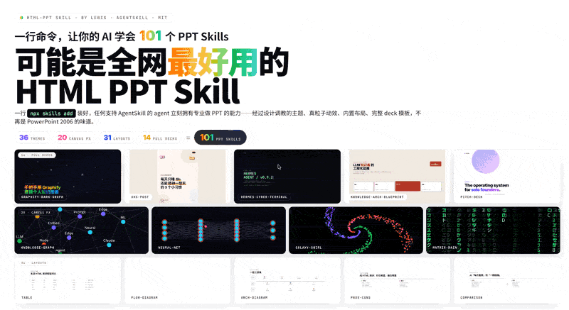

# Repo Referensi: lewislulu/html-ppt-skill

Repo: https://github.com/lewislulu/html-ppt-skill
Ref lokal: /Users/chaali0324/.agents/repo-refs/lewislulu_html-ppt-skill
API: curl "localhost:27126/repos/readme?name=lewislulu_html-ppt-skill"
Dibuat: 2026-09-16

## Cuplikan README
# lewislulu/html-ppt-skill

Source: https://github.com/lewislulu/html-ppt-skill
Fetched: 2026-09-16

## README
# html-ppt — HTML PPT Studio

> A world-class AgentSkill for producing professional HTML presentations in
> **36 themes**, **15 full-deck templates**, **36 page layouts**,
> **47 animations** (27 CSS + 20 canvas FX), and a **true presenter mode**
> with pixel-perfect previews + speaker script + timer — all pure static
> HTML/CSS/JS, no build step.

**Author:** lewis &lt;sudolewis@gmail.com&gt;
**License:** MIT
**中文文档:** [README.zh-CN.md](README.zh-CN.md)



> One command installs **36 themes × 20 canvas FX × 36 layouts × 15 full decks + presenter mode**. Every preview above is a live iframe of a real template file rendering inside the deck — no screenshots, no mock-ups.

## 🎤 Presenter Mode (new!)

Press `S` on any deck to pop open a dedicated presenter window with four
draggable, resizable **magnetic cards**: current slide, next slide preview,
speaker script (逐字稿), and timer. Two windows stay in sync via
`BroadcastChannel`.


**Why previews are pixel-perfect:** each card is an `<iframe>` that loads the
same deck HTML with a `?preview=N` query param. The runtime detects this and
renders only slide N with no chrome — so the preview uses the **same CSS,
theme, fonts and viewport** as the audience view. Colors and layout are
guaranteed identical.

**Smooth (no-reload) navigation:** on slide change, the presenter window
sends `postMessage({type:'preview-goto', idx:N})` to each iframe. The iframe
just toggles `.is-active` between slides — **no reload, no flicker**.

**Speaker script rules (3 golden):**
1. **Prompt signals, not lines to read** — bold the keywords, separate
   transition sentences into their own paragraphs
2. **150–300 words per slide** — that's the ~2–3 min/page pace
3. **Write it like you speak** — conversational, not written prose

See [`references/presenter-mode.md`](references/presenter-mode.md) for the
full authoring guide, or copy the ready-made template at
`templates/full-decks/presenter-mode-reveal/` which ships with full 150-300
word speaker scripts on every slide.

## Install (one command)

```bash
npx skills add https://github.com/lewislulu/html-ppt-skill
```

That registers the skill with your agent runtime. After install, any agent
that supports AgentSkills can author presentations by asking th
